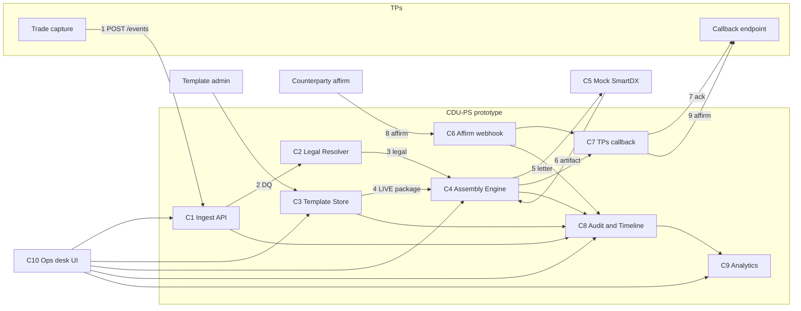

# Prototype architecture — CDU-PS Phase 2

| Item | Value |
| --- | --- |
| Status | Phase 2 design pack — draft for review |
| Scope | Ideal path only: template admin/view + one new FXO trade end to end (+ one manual draft, small book for ops desk / MIS) |
| Sources of truth | Data: Excel [`docs/mappings/`](../mappings/) · Contract: [`specs/api/openapi.md`](../../specs/api/openapi.md) v1.6 |
| Simulation files | [`prototype/data/`](../../prototype/data/) + route manifest `prototype/routes.json` (both generated by `scripts/build.py`) · run notes [`prototype/README.md`](../../prototype/README.md) |
| Stack | Static HTML + Carbon Design System, no server; in-browser mock API (§5). Later swap-in: FastAPI replay of the same contract |
| Data model | FpML-style trade: [`modelling-decisions.md`](modelling-decisions.md) · UI view of it: [`information-architecture.md`](information-architecture.md) |
| Not in this PR | Prototype app code (HTML/JS) |

## 1. Goal

Give the prototype agents one picture of **which component does what, which file it reads and writes, and which API the UI calls**, so the static HTML ops desk replays the simulation through the contract and never invents data.

## 2. Components

| # | Component | Bounded context (PRD §8) | Responsibility in the prototype | API surface |
| --- | --- | --- | --- | --- |
| C1 | Ingest API | Trade Lifecycle | Accept TPs events, idempotency, DQ, start AssemblyRun | `POST /events`, `GET /trades`, `GET /trades/{id}` |
| C2 | Legal Resolver | Confirmation Assembly | Defs year, MCA path, matrix pins | internal → `GET /assemblies/{id}` (`legal`) |
| C3 | Template Store | Template Admin | Packages, versions, layer bodies, selection rules, four-eyes approval (mocked as given), activate | `GET /templates`, `GET /templates/{id}`, `PUT /templates/{id}/versions`, `POST /templates/{id}/activate` |
| C4 | Assembly Engine | Confirmation Assembly | Locate package, compose Exhibit I + II-B, manual draft | `GET /assemblies/{id}`, `GET /assemblies/{id}/shell`, `PUT /assemblies/{id}/manual-draft`, `POST /assemblies/{id}/submit` |
| C5 | Mock SmartDX | (external stand-in) | Accept package, return letter artifact, take status updates | `POST /mock/smartdx/documents`, `POST /mock/smartdx/documents/{id}/status` |
| C6 | Affirm webhook | Affirmation / Matching | Receive counterparty affirm (matched) | `POST /webhooks/affirmation` |
| C7 | TPs callback | Affirmation / Matching | Push generation ack and affirm status back to TPs | `POST /callbacks/tps` (outbound) |
| C8 | Audit / Timeline | Analytics / Timeline | Write AuditEvent for every step; project TimelineEvent per trade | `GET /audit`, `GET /templates/{id}/audit`, `GET /trades/{id}/timeline` |
| C9 | Analytics | Analytics / Timeline | Aggregates derived from the trade book | `GET /analytics/summary`, `GET /analytics/aging`, `GET /analytics/queues/errors`, `GET /analytics/contagion` |
| C10 | Ops desk UI | — | Shell + 5 screens in [`screens/`](screens/) | calls the APIs above only, through the mock API layer |
| C11 | Mock API layer | (prototype only) | In-browser `fetch` stand-in for C1–C9: answers `/v1/...` from `prototype/routes.json` + `prototype/data/` | every path in `routes.json` |

In the static prototype C1–C9 are not running code: their behaviour is the recorded files, and C11 replays them.

## 3. Flow



## 4. Step → file map (flow B, `TR-FXO-001`, With_MCA)

Every row is a row in Excel `Prototype_Sim` (step id in column 1). Paths are relative to `prototype/data/`.

| Step | Component | Reads | Writes (request / response) | Timeline event |
| --- | --- | --- | --- | --- |
| B01–B02 | C1 | — | `inbound/trades/TR-FXO-001.new-trade.json` → `outbound/api-responses/TR-FXO-001/01-post-events.202.json` | `TL-01-01` trade.received · `TL-01-02` trade.dq_passed |
| B03 | C2 | trade file | `outbound/api-responses/TR-FXO-001/02-get-assembly.legal-resolved.200.json` | `TL-01-03` legal.resolved |
| B04 | C4 + C3 | `templates/fxo-deliverable-2026/selection-rules.json`, `package.json` | `outbound/api-responses/TR-FXO-001/03-get-assembly.package-located.200.json` | `TL-01-04` package.located |
| B05 | C4 | `templates/fxo-deliverable-2026/exhibit-i-master.json`, `exhibit-ii-b-product.json` | `outbound/api-responses/TR-FXO-001/04-get-assembly.completed.200.json` | `TL-01-05` assembly.completed |
| B06–B07 | C4 → C5 | assembly | `outbound/smartdx/DOC-001.send.json` → `outbound/smartdx/DOC-001.generated.json` | `TL-01-06` document.sent · `TL-01-07` document.created |
| B08 | C7 | document | `outbound/tps-callbacks/TR-FXO-001.01-generated.json` | `TL-01-08` callback.sent |
| B09–B10 | C6 | — | `inbound/webhooks/DOC-001.affirmed.json` → `outbound/api-responses/TR-FXO-001/05-post-webhooks-affirmation.200.json` | `TL-01-09` affirm.affirmed |
| B11 | C6 → C5 | — | `outbound/smartdx/DOC-001.status-affirmed.json` | (same as TL-01-09) |
| B12 | C7 | — | `outbound/tps-callbacks/TR-FXO-001.02-affirmed.json` | `TL-01-10` callback.sent |
| B13–B15 | C1, C8 | all above | `outbound/api-responses/TR-FXO-001/06-get-trade.200.json`, `07-get-document.200.json`, `timeline/TR-FXO-001.json` | — |

Flow A (template admin), flow C (manual draft `TR-FXO-005`) and flow D (book + MIS) follow the same pattern; see [`flows/fxo-ideal-path.md`](flows/fxo-ideal-path.md) and [`prototype/README.md`](../../prototype/README.md).

## 5. How the prototype replays the files

The prototype is a static site (HTML + Carbon, plain JS), with no server-side code. Any static host works; locally, run `python3 -m http.server` from `prototype/` (a file server only).

1. **Mock API layer (C11).** One small JS module, `api.js`, exposes `api(method, url, body?)`. It is the only way screens get data.
   - It loads `routes.json` once. Each entry has `step`, `at`, `method`, `path` (the OpenAPI template), `url` (concrete), `contract` and `file`.
   - It resolves a call by `method` + `url` under base path `/v1`.
   - Screen URLs are client-side hash routes (`#/trades/TR-FXO-001`), so deep links work on a file server. The sitemap is in [`information-architecture.md`](information-architecture.md).
2. **Simulated clock.** The shell holds a sim clock, which defaults to the book `asOf` 2027-12-01T16:30:00Z.
   - **Reads (GET)** return the latest entry whose `at` is at or before the clock. For example, `GET /assemblies/AR-FXO-001-01` has three recorded states.
   - **Writes (POST/PUT)** return the `response-*` entry for the same `method` + `url` and move the clock to its `at`. The UI then re-reads, which is how activation and manual submit show their "after" state.
   - **Unrecorded calls** return 404 `NOT_FOUND` in the OpenAPI error shape, and the screen shows its stub.
3. **Request files** (`contract` = `request…`) are sample bodies for the forms. The layer does not validate them.
4. **Later swap-in.** A FastAPI app that replays the same `routes.json` on the same paths. Screens change only the base URL. No contract or data change is needed.
5. **Never hand-edit** `prototype/data/`, `routes.json` or the workbooks. Change the generators in `scripts/`, run `scripts/build.py`, then `scripts/check_prototype_sync.py`.

### Single rebuild path

```text
docs/reference/isda/*.pdf ──(scripts/extract_isda_text.py, only when a PDF changes)──► docs/reference/isda/text/*.txt  (committed)
text extract + curated tables in scripts/ ──(scripts/build.py)──► docs/mappings/*.xlsx (every sheet)
                                                              ──► prototype/data/**  +  prototype/routes.json
scripts/check_prototype_sync.py: workbooks == fresh build · data == Prototype_Sim · keys ⊆ OpenAPI examples · docs bindings resolve
```

`scripts/build.py` is deterministic: the same inputs give byte-identical xlsx and JSON. A rebuild with no generator change leaves git clean.

### Four-eyes activation

A DRAFT version can only be activated once a second user has approved it (`approval.status = APPROVED`, approver ≠ activator; LDM `TemplateApproval`). In the simulation:
- 1.2.0 was requested by `u.admin.lee` and approved by `u.ctrl.ng` at 15:30 (`AUD-0007`).
- `u.admin.lee` activated it at 16:00 (`AUD-0008`).

The approval itself (`POST /templates/{id}/versions/{version}/approval`) is planned and shown as "Coming soon".

## 6. Simulated clock (one trade date)

| Time (UTC, 2027-12-01) | What happens | Package LIVE |
| --- | --- | --- |
| 09:00 | `TR-FXO-006` booked, affirmed 11:30 | 1.1.0 |
| 10:00:00–10:00:05 | `TR-FXO-001` received → sent → ack (flow B) | 1.1.0 |
| 13:15 | `TR-FXO-002` booked, AffirmPending | 1.1.0 |
| 14:20 | `TR-FXO-005` booked, waits in ManualDraft (flow C) | 1.1.0 |
| 15:04:05 | `TR-FXO-001` affirmed (matched) → callback | 1.1.0 |
| 15:30 | `u.ctrl.ng` approves DRAFT 1.2.0 (four-eyes, `AUD-0007`; requested 2027-11-28 09:15) | 1.1.0 |
| 15:59 | Admin views the LIVE package (flow A view) | 1.1.0 |
| 16:00 | Admin activates approved 1.2.0 (flow A, `AUD-0008`); 1.1.0 → RETIRED, rollback target | **1.2.0** |
| 16:25 / 16:29 | `TR-FXO-003` (Composing on 1.2.0), `TR-FXO-004` (Received) | 1.2.0 |
| 16:30 | **Ops desk / MIS snapshot** (`asOf`) | 1.2.0 |
| 16:40–16:55 | Ops loads, edits, submits `TR-FXO-005` (run pinned to 1.1.0) → `DOC-105` | 1.2.0 |

An AssemblyRun pins the package version it started with (`AssemblyRun.templateVersion`), so `TR-FXO-005` stays on 1.1.0 after activation. `resendPolicy = MANUAL`, so activation does not resend anything.

## 7. Status vocabulary

The ops desk uses generic trade statuses (PRD §13.2). FXO deep-dive states (§13.3) map onto them:

| FXO state (§13.3) | Trade status (§13.2) | AssemblyRun.status |
| --- | --- | --- |
| NewFxo | Received | — |
| LegalResolved · PackageLocated | Composing | ASSEMBLING |
| ManualPath | ManualDraft | PENDING_MANUAL_DRAFT |
| LetterDrafted | Composing | COMPLETED |
| SentToSmartDX | Sent → AffirmPending | COMPLETED |
| Affirmed | Affirmed | COMPLETED |

## 8. Canonical ids

| Id | Meaning | Excel source |
| --- | --- | --- |
| `TB-FXO-DEL-2026-001` | LIVE 2026 FXO Deliverable (II-B) package | `Template_Admin_Utility` |
| `TV-I-2026-1.1.0` / `TV-IIB-2026-1.1.0` | Exhibit I / II-B layer versions in package 1.1.0 | `Prototype_Sim` A03 |
| `PSR-FXO-DEL-2026-001` | Selection rule NEW_TRADE → package | `Prototype_Sim` A05 |
| `TR-FXO-001` … `TR-FXO-006` | Trades in the book | `Prototype_Trade_Book` (`TR-FXO-001` = `Sample_Trade_Card`) |
| `evt_1001` | NEW_TRADE event of `TR-FXO-001` | `With_MCA` NEW_TRADE |
| `AR-FXO-001-01` | AssemblyRun of `TR-FXO-001` | `Prototype_Trade_Book` |
| `DOC-001` / `SDX-DOC-001` | Confirmation document / SmartDX id | `With_MCA` OUTBOUND_SMARTDX / CALLBACK_TPS |
| `MCA-SCB-ACME-2026-001` | Assumed master confirmation (ACME): `trade.documentation.masterConfirmation.masterConfirmationId` | `Legend_Assumptions` |
| `AUD-0007` / `AUD-0008` | 1.2.0 four-eyes approval (`u.ctrl.ng`) / activation (`u.admin.lee`) | `Prototype_Sim` D06 |
| `AUD-0001`…, `TL-01-01`… | Audit / timeline events | `Prototype_Sim` D06, B15, C11 |
| `partyA` / `partyB` | Party ids inside a trade (`trade.parties[].id`, targets of `…PartyReference.href`) | `Sample_Trade_Card` |

## 9. Timeline coverage

Only `TR-FXO-001` and `TR-FXO-005` have simulated timelines (`timelineAvailable = true` on `GET /trades`). The other four book trades stay as they are: the ops desk marks them, and the timeline screen shows a stub panel for them.

## 10. Coming soon (shown as stubs, not built)

These use the `(◌ Coming soon)` chip in [`system/components.md`](system/components.md).

| Feature | Screen |
| --- | --- |
| Template approval workflow (request / approve / reject) | 02 |
| Timelines for trades without a simulated timeline | 01, 04 |
| AI: "Explain this number", anomaly detection, predictive aging | 05 |
| MIS alerts / subscriptions, export, custom windows | 05 |
| Agent tools (`GET /agent/tools`, Phase 3) | 00 |

## EDGE / STUB

Coming-soon features are listed in §10. Not modelled in components or files (listed in [`prototype/README.md`](../../prototype/README.md) §5): E1 wrong template → hot-swap → `POST /documents/{id}/resend`, E3 affirm fail, E4 DQ reject, E6 Swoosh inbound, E7 Compare X, E8 SmartDX down (`CHANNEL_UNAVAILABLE`), E9 idempotency clash, E10 rollback, E11 manual draft abandoned, AMEND / NOVATION / EXERCISE / TERMINATE events (payloads exist in the payload-mocks workbook only), SWIFT channel, HMAC webhook verification.
