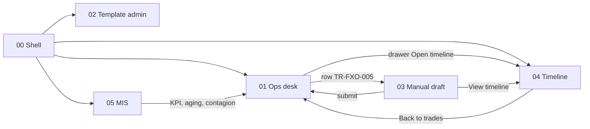
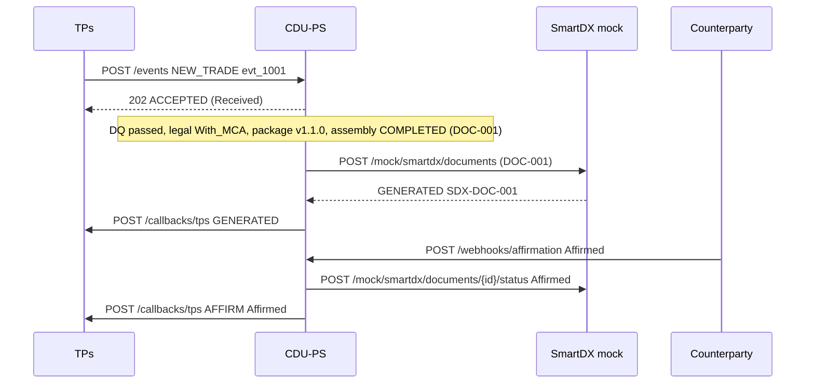

# FXO ideal path — story map → screens → simulation → data

| Item | Value |
| --- | --- |
| Status | Phase 2 — ideal path only — draft for review |
| Story map | PRD [`§9.3`](../../prd-cdu-ps-v1.md) kite → sea → fish |
| Simulation | Excel `docs/mappings/` sheet `Prototype_Sim` (steps A01–D06) → `prototype/data/` (see [`prototype/README.md`](../../../prototype/README.md)) |
| Architecture | [`../architecture.md`](../architecture.md) · navigation: [`../information-architecture.md`](../information-architecture.md) · data model: [`../modelling-decisions.md`](../modelling-decisions.md) |

## 1. Story map → screen matrix

| Kite | Sea | Fish | Screen | Sim steps |
| --- | --- | --- | --- | --- |
| K1 Define templates | S1 Activate LIVE package | F1a Draft version | [`02-template-admin`](../screens/02-template-admin.md) Versions tab | A03c, A07–A08 |
| K1 | S1 | F1b Configure mapping | [`02-template-admin`](../screens/02-template-admin.md) Bindings tab | A04a–A05 |
| K1 | S1 | F1c Audit activate | [`02-template-admin`](../screens/02-template-admin.md) Activate modal, Audit tab | A06, A09–A12 |
| K2 Book and assemble | S2 Assemble FXO letter | F2a Locate package | [`04-fxo-timeline`](../screens/04-fxo-timeline.md) node `package.located` | B04 |
| K2 | S2 | F2b Prepare MCA and DQ | [`04-fxo-timeline`](../screens/04-fxo-timeline.md) nodes `trade.dq_passed`, `legal.resolved` | B02–B03 |
| K2 | S2 | F2c Auto or manual draft | [`01-ops-desk`](../screens/01-ops-desk.md) (auto) · [`03-manual-draft`](../screens/03-manual-draft.md) (manual) | B05 · C03–C08 |
| K3 Send and match | S3 SmartDX then affirm | F3a Channel send | [`01-ops-desk`](../screens/01-ops-desk.md) drawer, status Sent | B06–B07, C09 |
| K3 | S3 | F3b Callback TPs | [`04-fxo-timeline`](../screens/04-fxo-timeline.md) TPs lane | B08, B12, C10 |
| K3 | S3 | F3c Affirm webhook | [`04-fxo-timeline`](../screens/04-fxo-timeline.md) Counterparty lane | B09–B11 |
| K4 Change and recover | S4 Amend novate exercise recover | F4a Reassemble, F4b Hot-swap resend, F4c Swoosh CompareX gates | EDGE / STUB only | — |
| K5 Observe | S5 Timeline and queues | F5a Per-trade timeline | [`04-fxo-timeline`](../screens/04-fxo-timeline.md) | B15, C11 |
| K5 | S5 | F5b Aging contagion errors | [`05-mis-dashboard`](../screens/05-mis-dashboard.md) | D01–D06 |

The shell ([`00-shell-nav`](../screens/00-shell-nav.md)) is the entry point to every screen; **Timeline** and **MIS** are first-level nav items.

## 2. Screen sequence

## 3. Flow A — template admin views LIVE package and activates the approved DRAFT 1.2.0

Scenario **A · Template release**. Actor `u.admin.lee`, simulated clock 2027-12-01 15:59Z → 16:00:01Z. The four-eyes approval by `u.ctrl.ng` (15:30Z, `AUD-0007`) is mocked as already given; the approval workflow is "Coming soon". Screen [`02-template-admin`](../screens/02-template-admin.md).

1. `GET /templates` → `prototype/data/templates/index.json` — one package `TB-FXO-DEL-2026-001`, LIVE 1.1.0.
2. `GET /templates/{id}` → `prototype/data/templates/fxo-deliverable-2026/package.json` — versions 1.0.0 RETIRED, 1.1.0 LIVE, 1.2.0 DRAFT.
3. `GET /templates/{id}/versions/{version}` → `prototype/data/templates/fxo-deliverable-2026/versions/1.2.0.json` — change on the Party A notice line, validation PASSED (`AUD-0006`), approval APPROVED by `u.ctrl.ng` (`AUD-0007`).
4. `GET /templates/selection-rules` and `GET /templates/{id}/layers/{templateVersionId}` → `prototype/data/templates/fxo-deliverable-2026/selection-rules.json`, `prototype/data/templates/fxo-deliverable-2026/exhibit-i-master.json`, `prototype/data/templates/fxo-deliverable-2026/exhibit-ii-b-product.json`.
5. `POST /templates/{id}/activate` with `prototype/data/inbound/ui/TB-FXO-DEL-2026-001.activate-1.2.0.json` → `prototype/data/outbound/api-responses/TB-FXO-DEL-2026-001/02-post-activate.200.json` (`AUD-0008`, citing approval `AUD-0007`).
6. Refresh → `prototype/data/outbound/api-responses/TB-FXO-DEL-2026-001/03-get-template.after-activate.200.json`, `prototype/data/outbound/api-responses/TB-FXO-DEL-2026-001/04-get-template-audit.after-activate.200.json`.

Runs started before 16:00Z stay pinned to 1.1.0 (`TR-FXO-001`, `-002`, `-005`, `-006`); `TR-FXO-003` (16:25Z) composes on 1.2.0.

## 4. Flow B — new trade TR-FXO-001 → assembled → SmartDX → affirmed → TPs

Scenario **B · TR-FXO-001 journey**. Simulated clock 10:00:00Z → 15:04:06Z. Screens [`01-ops-desk`](../screens/01-ops-desk.md), [`04-fxo-timeline`](../screens/04-fxo-timeline.md). Timeline `events[]` are filtered by the clock.

| Step | Call | File | Path | Value |
| --- | --- | --- | --- | --- |
| B01 | `POST /events` (request) | `prototype/data/inbound/trades/TR-FXO-001.new-trade.json` | `eventId` | `evt_1001` |
| B01 | `POST /events` (request) | `prototype/data/inbound/trades/TR-FXO-001.new-trade.json` | `trade.documentation.masterConfirmation.masterConfirmationId` | `MCA-SCB-ACME-2026-001` |
| B03 | `GET /assemblies/{id}` | `prototype/data/outbound/api-responses/TR-FXO-001/02-get-assembly.legal-resolved.200.json` | `legal.mcaPath` | `With_MCA` |
| B02 | `POST /events` (202) | `prototype/data/outbound/api-responses/TR-FXO-001/01-post-events.202.json` | `tradeStatus` | `Received` |
| B05 | `GET /assemblies/{id}` | `prototype/data/outbound/api-responses/TR-FXO-001/04-get-assembly.completed.200.json` | `documentId` | `DOC-001` |
| B07 | `POST /mock/smartdx/documents` | `prototype/data/outbound/smartdx/DOC-001.generated.json` | `smartdxDocumentId` | `SDX-DOC-001` |
| B08 | `POST /callbacks/tps` | `prototype/data/outbound/tps-callbacks/TR-FXO-001.01-generated.json` | `status` | `GENERATED` |
| B09 | `POST /webhooks/affirmation` | `prototype/data/inbound/webhooks/DOC-001.affirmed.json` | `status` | `Affirmed` |
| B10 | `POST /webhooks/affirmation` (200) | `prototype/data/outbound/api-responses/TR-FXO-001/05-post-webhooks-affirmation.200.json` | `tradeStatus` | `Affirmed` |
| B12 | `POST /callbacks/tps` | `prototype/data/outbound/tps-callbacks/TR-FXO-001.02-affirmed.json` | `affirmationStatus` | `Affirmed` |
| B15 | `GET /trades/{id}/timeline` | `prototype/data/timeline/TR-FXO-001.json` | `events[9].action` | `callback.sent` |

## 5. Flow C — TR-FXO-005 manual draft (mode a)

Scenario **C · Manual draft**. Starting clock 16:40:00Z (shell load); writes advance to 16:55:02Z. Screen [`03-manual-draft`](../screens/03-manual-draft.md). After submit, `GET /trades` returns the D07 book (`TR-FXO-005` Affirm pending).

| Step | Call | File | Path | Value |
| --- | --- | --- | --- | --- |
| C01 | `POST /events` (request) | `prototype/data/inbound/trades/TR-FXO-005.new-trade.json` | `assembly.requestedMode` | `MANUAL_DRAFTING` |
| C01 | `POST /events` (request) | `prototype/data/inbound/trades/TR-FXO-005.new-trade.json` | `trade.parties[id=partyB].partyName` | `Globex Holdings Ltd` |
| C03 | `GET /assemblies/{id}` | `prototype/data/outbound/api-responses/TR-FXO-005/02-get-assembly.pending-manual-draft.200.json` | `status` | `PENDING_MANUAL_DRAFT` |
| C04 | `GET /assemblies/{id}/shell` | `prototype/data/outbound/api-responses/TR-FXO-005/03-get-assembly-shell.200.json` | `editableBlocks[0]` | `elections` |
| C06 | `PUT /assemblies/{id}/manual-draft` | `prototype/data/outbound/api-responses/TR-FXO-005/04-put-manual-draft.200.json` | `auditId` | `AUD-0506` |
| C08 | `POST /assemblies/{id}/submit` | `prototype/data/outbound/api-responses/TR-FXO-005/05-post-submit.200.json` | `confirmationId` | `CONF-105` |
| C09 | `POST /mock/smartdx/documents` | `prototype/data/outbound/smartdx/DOC-105.send.json` | `documentId` | `DOC-105` |
| C10 | `POST /callbacks/tps` | `prototype/data/outbound/tps-callbacks/TR-FXO-005.01-generated.json` | `documentId` | `DOC-105` |

## 6. Flow D — ops desk and MIS at 16:30Z

Scenario **D · Book & MIS** (default). Screens [`01-ops-desk`](../screens/01-ops-desk.md), [`05-mis-dashboard`](../screens/05-mis-dashboard.md). The book (Excel `Prototype_Trade_Book`) is the single source at 16:30Z; every MIS number is derived from it. D07–D11 are the post-submit book/analytics snapshots used after scenario C.

| Step | Call | File | Path | Value |
| --- | --- | --- | --- | --- |
| D01 | `GET /trades` | `prototype/data/outbound/api-responses/book/get-trades.200.json` | `count` | `6` |
| D02 | `GET /analytics/summary` | `prototype/data/outbound/api-responses/analytics/get-summary.200.json` | `volumes.affirmed` | `2` |
| D03 | `GET /analytics/aging` | `prototype/data/outbound/api-responses/analytics/get-aging.200.json` | `series[0].buckets[1].count` | `1` |
| D04 | `GET /analytics/queues/errors` | `prototype/data/outbound/api-responses/analytics/get-errors.200.json` | `count` | `0` |
| D05 | `GET /analytics/contagion` | `prototype/data/outbound/api-responses/analytics/get-contagion.200.json` | `items[1].open` | `2` |

## EDGE / STUB

Four-eyes approval workflow and timelines for unsimulated trades are "Coming soon" stubs (see [`../architecture.md`](../architecture.md) §10). All K4 Change and recover work (hot-swap and resend E1, rollback E10, unmatched/disputed E3/E4, Compare X gate, channel errors E7/E8, abandon E11) is out of the ideal path. Each screen lists its own EDGE / STUB items; [`../README.md`](../README.md) collects them.
