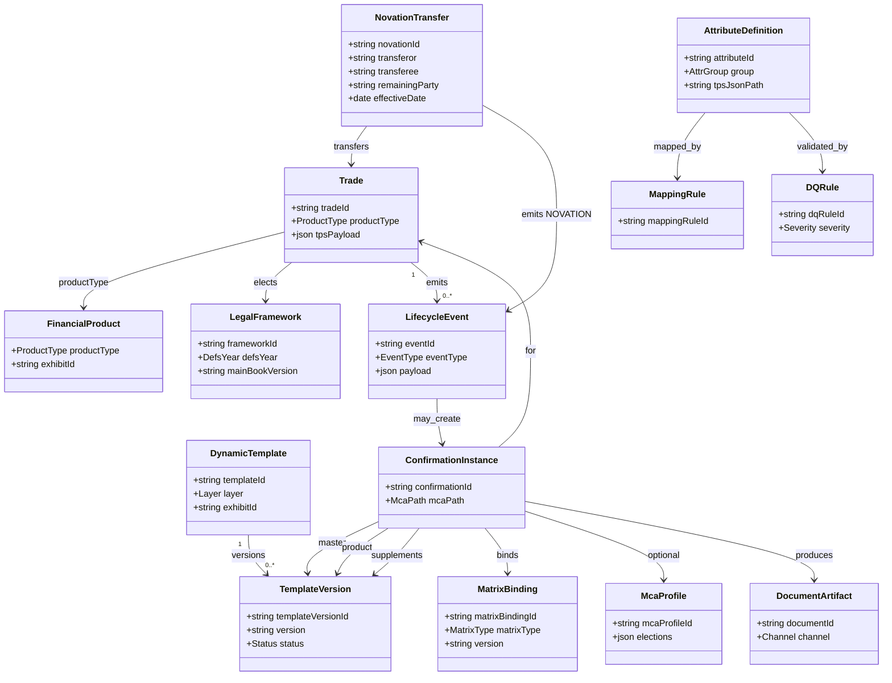
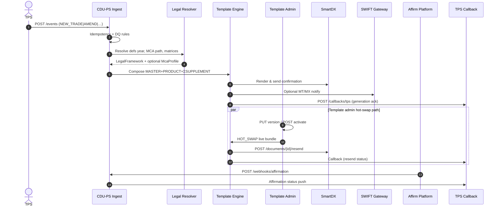
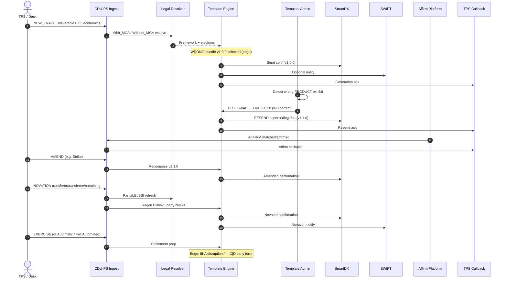

# CDU-PS Product Requirements Document (v1)

**Project:** Confirmation Document Utility — Product Spec (CDU-PS) / con4m8ions  
**Phase:** 1 — Spec artifacts only (PRD + Excel mapping + light API/feature specs)  
**Status:** Draft for Excel / mapping sign-off  
**Primary legal source:** Annotated Confirmation Templates — 2026 FX Definitions (Version 1, 8 July 2026)  
**Effective-date note:** 2026 FX Definitions take effect **22 November 2027** (Introduction PDF). SWIFT support for 1998 definitions is not expected after that date.

> **License:** ISDA / EMTA materials in `docs/reference/isda/` are licensed content. Internal use only; do not redistribute outside the license terms.

---

## 1. Executive summary

CDU-PS generates, versions, and lifecycle-manages FX confirmation documents composed from the 2026 ISDA/EMTA **Master (Exhibit I) + Product (Exhibit II-*) + Supplement (Exhibit III-*)** stack, with optional **MCA** overlay and **matrix** version pins. Upstream economics arrive from TPS; downstream artifacts go to SmartDX and optionally SWIFT; affirmation returns via webhook.

**Phase 1 (this document + Excel + `specs/`)** locks ontology, logical data model, attribute↔product mapping, DQ/mapping rules, E2E and FXO sequences, and API contracts.  
**Phase 2** implements HTML5 ops desk (Carbon principles, SCB-approx palette) and Python services against those contracts — Mac-first, then cloud/Vercel. No Phase 2 UI/API code in this delivery.

---

## 2. Phase 1 vs Phase 2

| Artifact | Phase 1 | Phase 2 |
| --- | --- | --- |
| Ontology + logical data model | Yes (this PRD + Excel `Logical_Data_Model`) | Refine if impl finds gaps |
| Master / Product / Supplement composition | Yes | Enforce in template engine |
| Attribute lineage + DQ/mapping catalog | Yes (`Attribute_Product_Map`, `Rules_DQ`) | Validators + field inspector UI |
| E2E + FXO sequence diagrams | Yes (mermaid below) | Optional interactive timeline |
| API contract | Yes (`specs/api/openapi.md`) | FastAPI implementation |
| Running UI / services / live SmartDX·SWIFT | No | Yes (mock first) |

---

## 3. Domain ontology

| Concept | Meaning |
| --- | --- |
| **FinancialProduct** | Canonical product type bound to one Exhibit II-* (e.g. `Deliverable_FX_Option` → II-B). |
| **LegalFramework** | ISDA/EMTA defs year and Main Book version (`1998` \| `2026`), plus elected matrix versions. |
| **McaProfile** | Optional bilateral Master Confirmation Agreement elections. Sample inventory is **Assumed** (invented). Paths: `With_MCA` / `Without_MCA`. |
| **DynamicTemplate** | Versioned confirmation fragment with layer `MASTER` \| `PRODUCT` \| `SUPPLEMENT`. |
| **MatrixBinding** | Version pin for SRO / EM Currency / CFC / DM / Offshore CNY matrices (not a confirmation body). |
| **DocumentArtifact** | Generated confirmation payload + channel metadata (SmartDX document id, SWIFT msg ref). |
| **LifecycleEvent** | `NEW_TRADE`, `AMEND`, `TERMINATE`, `EXERCISE`, `NOVATION`, `AFFIRM`, `HOT_SWAP`, `ROLLBACK`, `RESEND`. |
| **ConfirmationInstance** | Runtime composition of layers + bindings + optional MCA + platform metadata for one trade event. |
| **NovationTransfer** | Transferor / transferee / remaining party + effective date for `NOVATION`. |
| **AttributeDefinition** | Mapped field with group, layer, exhibit, lineage, TPS path, DQ/mapping FKs. |
| **MappingRule / DQRule** | Transform and validation catalog (`MAP-*`, `DQ-*`). |

### Attribute groups

`COMMON` · `PRODUCT` · `SUPPLEMENT` · `MATRIX` · `MCA` · `PLATFORM` · `LIFECYCLE`

### Template layers

| Layer | ISDA source | Group |
| --- | --- | --- |
| MASTER | Exhibit I | COMMON |
| PRODUCT | Exhibit II-A … II-K | PRODUCT |
| SUPPLEMENT | Exhibit III-A … III-H | SUPPLEMENT |

### Composition rule

```text
ConfirmationInstance =
  MASTER(Exhibit I)
  + PRODUCT(Exhibit II-*)
  + Σ elected SUPPLEMENT(Exhibit III-*)
  + MATRIX bindings (if applicable)
  + optional MCA profile
  + PLATFORM runtime metadata
```

### Product universe (Exhibit II)

| Exhibit | Product |
| --- | --- |
| II-A | Deliverable FX Transaction |
| II-B | Deliverable FX Option Transaction **(deepest mapping)** |
| II-C | Non-Deliverable FX Transaction |
| II-D | Non-Deliverable FX Option Transaction |
| II-E | NDF (EM Currency Matrix) |
| II-F | NDO (EM Currency Matrix) |
| II-G | ND Cross-Currency FX (EM Currency Matrix) |
| II-H | ND Cross-Currency FX Option (EM Currency Matrix) |
| II-I | Variance / Volatility Swap |
| II-J | Correlation Swap |
| II-K | Deliverable Delta Neutral Forward Volatility Agreement |

### Supplements (Exhibit III)

III-A Deliverable disruption · III-B Non-deliverable disruption · III-C Mandatory early termination · III-D Optional early termination · III-E Averaging forward rate · III-F Averaging settlement rate · III-G Averaging strike · III-H Barrier.

**II-B eligible supplements:** III-A, III-C, III-D, III-F, III-G, III-H.

---

## 4. MCA dual path

| Path | Behaviour |
| --- | --- |
| **With_MCA** | Resolve `McaProfile` (Assumed sample `MCA-SCB-ACME-2026-001`). Defaults fill Calculation Agent, notices, SSI, auto-exercise, defs year when confirmation omits them. Master Agreement date expected. |
| **Without_MCA** | No MCA profile. Exhibit I long-form fallback language (footnote 2 style) and explicit governing-law / termination-currency / CA / notice elections on the confirmation. |

1998 vs 2026: MCA (or confirm) elects defs year. After 22 Nov 2027, new activity is expected on 2026; prototype must still demonstrate both elections.

All invented MCA fields are flagged **Assumed** in Excel.

---

## 5. Logical data model

### 5.1 Entity summary

Primary entities and keys mirror Excel sheet `Logical_Data_Model`:

- `Trade` (PK `tradeId`) → `FinancialProduct`
- `ConfirmationInstance` (PK `confirmationId`) composed of `TemplateVersion` rows for MASTER/PRODUCT/SUPPLEMENT, optional `McaProfile`, `MatrixBinding[]`, `DocumentArtifact`
- `LifecycleEvent` / `NovationTransfer` drive regeneration and party changes
- `AttributeDefinition` ← `MappingRule` / `DQRule`

### 5.2 Class / ER diagram



---

## 6. E2E sequence / event flow

Systems: **TPS**, **CDU-PS Ingest**, **Legal Resolver**, **Template Engine**, **Template Admin**, **SmartDX**, **SWIFT**, **Affirm webhook**, **TPS Callback**.



---

## 7. FXO Deliverable deep-dive sequence

Sample: Deliverable FX Option (Exhibit **II-B**), with wrong-template → hot-swap → resend, then affirm, amend, novation, exercise. Systems named on each message. Detail table: Excel `FXO_Deliverable_Lifecycle`. Spec: `specs/features/fxo-deliverable-lifecycle.md`.



---

## 8. Master / Product / Supplement composition (ops view)

Template Admin binds:

- `masterTemplateId` → Exhibit I version  
- `productExhibitId` → II-* + `productType` routing  
- `supplementExhibitIds[]` → elected III-*  
- `matrixBindings` → version pins  
- `mcaRequired` + optional `mcaProfileId`  
- `status` ∈ `DRAFT` | `LIVE` | `RETIRED` with hot-reload, rollback, resend policy  

See Excel `Template_Admin_Utility` and `specs/features/template-admin.md`.

---

## 9. Mapping workbook

**File:** [`docs/mappings/cdu-ps-isda-2026-mapping.xlsx`](mappings/cdu-ps-isda-2026-mapping.xlsx)

| Sheet | Purpose |
| --- | --- |
| `Attribute_Product_Map` | Field inventory: group, layer, exhibit, matrix hooks, lineage, lifecycle, MCA path, Assumed MCA, TPS JSON path, SmartDX/SWIFT, DQ/MAP IDs |
| `Template_Admin_Utility` | Admin binding / versioning fields |
| `Logical_Data_Model` | Entity/attribute/PK-FK + relationship adjacency |
| `Rules_DQ` | DQ + mapping/transform rule catalog |
| `FXO_Deliverable_Lifecycle` | II-B sample event × system steps |
| `Legend_Assumptions` | Keys, Assumed MCA inventory, PDF sources, gaps |

**Depth policy:** Exhibit **II-B** rows are `Deep` (full inventory + rule FKs). All other exhibits are `Standard` (field extraction + exhibit-level lineage minimum).

---

## 10. Non-functional requirements

### 10.1 Prototype-realistic (Phase 2 targets)

| Area | Target |
| --- | --- |
| Ingest ack latency | p95 &lt; 2s for single-event validate+persist |
| Confirmation compose | p95 &lt; 5s mock SmartDX |
| Idempotency | Exactly-once effect per `Idempotency-Key` / TPS event id |
| Audit | Every HOT_SWAP / ROLLBACK / RESEND attributable |
| Availability (local Mac) | Best-effort; restartable services |
| Security | No secrets in repo; webhook HMAC in Phase 2 |

### 10.2 Appendix — aspirational only (not Phase 1/2 acceptance)

Draft notions such as five-nines (99.999%) availability, multi-region active-active, and sub-100ms p99 ingest are **aspirational** for a future production CDU — **not** acceptance criteria for the prototype.

---

## 11. Acceptance criteria (Phase 1)

- [x] PRD includes ontology, LDM (mermaid), E2E sequence, FXO deep-dive (systems named)
- [x] Specs: mapping, template admin, FXO lifecycle, scenarios, API contract
- [x] Excel six sheets; Master/Product/Supplement explicit; II-B deepest
- [x] Lineage + DQ/MAP IDs on Deep rows; Standard rows exhibit-level lineage minimum
- [x] MCA Assumed flagged; Without_MCA path present
- [x] Workbook openable; indexed from README / Context

**Out of scope Phase 1:** running UI, FastAPI server, live SmartDX/SWIFT, OpenSpec CLI/CI, interactive diagram playback.

---

## 12. References

- `docs/reference/isda/2026-FX-Defs-Consolidated-Confirmation-Templates_Colour-Coded-Annotation-070726_05a5.pdf`
- `docs/reference/isda/Introduction_to_the_2026_FX_Definitions_ab61.pdf`
- `docs/reference/isda/1998-FX-and-Currency-Option-Definitions_0d3f.pdf`
- `docs/reference/isda/annex-a-to-the-1998-fx-and-currency-option-definitions-june-30-2023_0919.pdf`
- `docs/phase-1-plan.md` (locked plan)
- `specs/` feature, scenario, and API contracts
