# CDU-PS Product Requirements (v1.4)

**What this is:** Spec pack for a confirmation helper (CDU-PS). Phase 1 = docs + Excel only.  
**Who for:** Ops analysts and interns who ship FX confirms — and builders who help them.  
**Legal source:** ISDA/EMTA 2026 FX Definitions confirmation templates (8 Jul 2026). Defs effective **22 Nov 2027**.

> **License:** PDFs in `docs/reference/isda/` are licensed. Internal use only. SmartDX screenshots in `docs/reference/smartdx/` are internal reference only.

**Naming:** **TPs** = Transaction Processing systems. **SmartDX** = external vendor that generates the ISDA confirmation letter.  
**Basics / phases:** [`docs/explainer-basics.md`](explainer-basics.md) (affirm vs confirm, MCA, CSA, matrices, phase split, Phase 2 wireframe kickoff).

---

## 1. Story in plain words

You work ops. A trader books a **Deliverable FX Option** in the **TPs**. Your job: get a correct **confirmation letter** out, get the other side to **affirm** it, and handle changes (amend, novation, exercise).

**MCA utility (one line):** If we already share a Master Confirmation Agreement with the client, many letter defaults come from that MCA — each confirm stays shorter. If not, the letter spells elections out. CDU-PS supports **both** paths. (More: [explainer](explainer-basics.md).)

CDU-PS helps you:

1. Keep **templates** ready (letter wrapper + product form + optional add-ons) — with a full **audit trail** of who changed what.  
2. Take trade data from **TPs**.  
3. **Assemble** the Exhibit I letter (“tops and tails”) + Exhibit II-B (and any III) — **or manually draft** when STP cannot finish (load template then edit, or drag fields and type values).  
4. Hand the package to **SmartDX** to produce the ISDA letter.  
5. Take status back into CDU-PS, then **callback TPs**.  
6. On exceptions: **Swoosh** OCR/classify; **Compare X** reconcile — **gates**, not happy path.  
7. Show a **timeline** per trade (and simple ops aggregates) fed by the same audit events.

**Template setup first. Trade journey second.** Separate jobs.

---

## 2. Domain ontology

### 2.1 Ontology diagram

Caption: *Solid lines = happy path. Dotted lines = optional (MCA, supplements, exception systems, manual draft).*

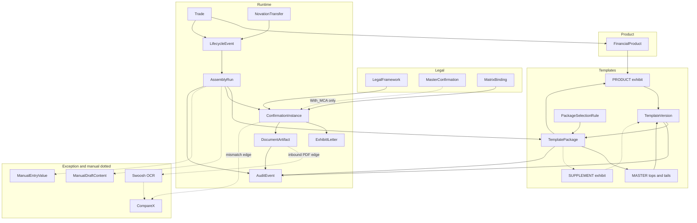

**Happy-path story:** Trade event → pick **TemplatePackage** → **AssemblyRun** → compose **ExhibitILetter** + economics → SmartDX → **DocumentArtifact** → callback TPs. Optional: MCA, III, manual draft/entry, Swoosh/Compare X.

### 2.2 Concept table

| Thing | Simple meaning |
| --- | --- |
| Trade | One deal |
| FinancialProduct | Product type (Deliverable FX Option → II-B) |
| LegalFramework | 1998 or 2026 defs + version |
| MasterConfirmation | Optional MCA defaults (Assumed) |
| TemplatePackage | Bundle: tops-and-tails + product (+ optional supplement) |
| TemplateVersion | DRAFT / LIVE / RETIRED fragment |
| PackageSelectionRule | How we pick a package |
| AssemblyRun | One assemble attempt (auto or manual-assisted) |
| ManualDraftContent | Free-text / structured letter draft when assembly_mode needs human prose |
| ManualEntryValue | Field values typed when mapping cannot supply them |
| ExhibitILetter | Letter wrapper (“tops and tails”) |
| FxOptionEconomics | II-B fields |
| Party | Names, LEI, office, roles |
| DocumentArtifact | Sent/received doc id |
| AuditEvent | Who / what / when / version for template, assembly, document |
| LifecycleEvent | NEW, AMEND, AFFIRM, NOVATION, … |
| NovationTransfer | Who leaves / who joins |

We **borrow** AssemblyRun / TemplatePackage / selection rules / manual entry from the internal ER image. We **keep** MASTER / PRODUCT / SUPPLEMENT. “Tops and tails” = Exhibit I wrapper where helpful.

---

## 3. Template layers — how they come together

Caption: *Letter wraps product. Supplements bolt on. Package ties LIVE versions.*

```text
TemplatePackage (LIVE)
├── tops and tails  → Exhibit I letter   (MASTER)
├── product         → Exhibit II-B       (PRODUCT)
└── optional        → Exhibit III-*      (SUPPLEMENT)

AssemblyRun uses that package + trade data
  → auto compose  OR  manual draft / manual entry
→ ConfirmationInstance → DocumentArtifact (via SmartDX)
```

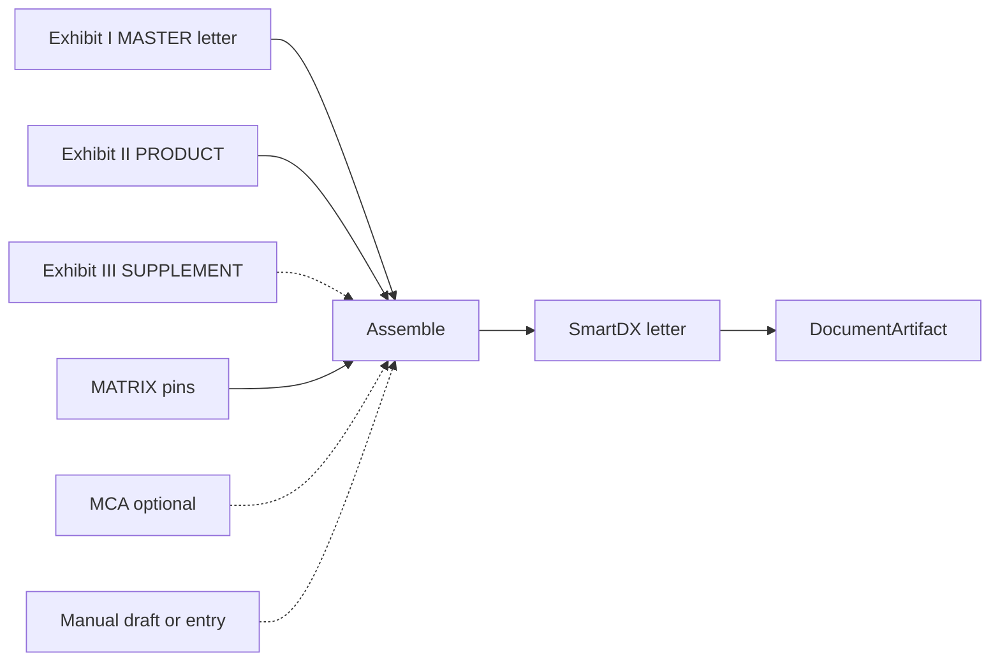

**II-B add-ons allowed:** III-A, III-C, III-D, III-F, III-G, III-H.

---

## 4. Exhibit I letter (MASTER / tops and tails)

Exhibit I is the **confirmation letter**, not only a header.

| Block | You put |
| --- | --- |
| Heading | Letterhead, date, their name/address |
| Intro | “This letter confirms the Transaction…” |
| Defs | FX Definitions version |
| Agreement | Master date **or** long-form text |
| **Insert** | Exhibit II-B (+ III) body |
| Elections | LEI, calc agent, accounts, offices, notices |
| Closing | Supersession + signatures |

With MCA → short Master clause. Without MCA → long-form.  
Mocks: payload Excel + `specs/features/exhibit-i-letter.md`.

---

## 5. MCA paths

| Path | What you do |
| --- | --- |
| With_MCA | Attach Assumed `MCA-SCB-ACME-2026-001`; fill gaps from MCA. |
| Without_MCA | No profile; long-form Exhibit I; explicit elections. |

---

## 6. Manual drafting of ISDA letters (first-class)

STP cannot cover every FXO. Ops must be able to **finish the letter by hand** without leaving CDU-PS.

### 6.1 Two ways

| Mode | What you do | AssemblyRun status |
| --- | --- | --- |
| **(a) Load template then edit** | Open LIVE TemplatePackage / Exhibit I+II-B shell; edit prose and fields; save ManualDraftContent | `PENDING_MANUAL_DRAFT` → `ASSEMBLING` → `COMPLETED` |
| **(b) From scratch via drag-drop fields** | Blank canvas; drag AttributeDefinition fields onto letter; type ManualEntryValue; optional paste clauses | `PENDING_DATA_ENTRY` → `ASSEMBLING` → `COMPLETED` |

Both still hand off to **SmartDX** when ready (or mark channel-suppressed for paper). FXO examples: exotic barrier wording, missing SSI, non-matrix SRO narrative.

### 6.2 Context ownership

| Context | Owns |
| --- | --- |
| Template Admin | Which templates allow `assembly_mode = MANUAL_DRAFTING` |
| Confirmation Assembly | ManualDraftContent / ManualEntryValue on AssemblyRun |
| Analytics / Timeline | Audit + timeline markers for manual saves / submit |

### 6.3 Sequence (edge — not mashed into happy path)

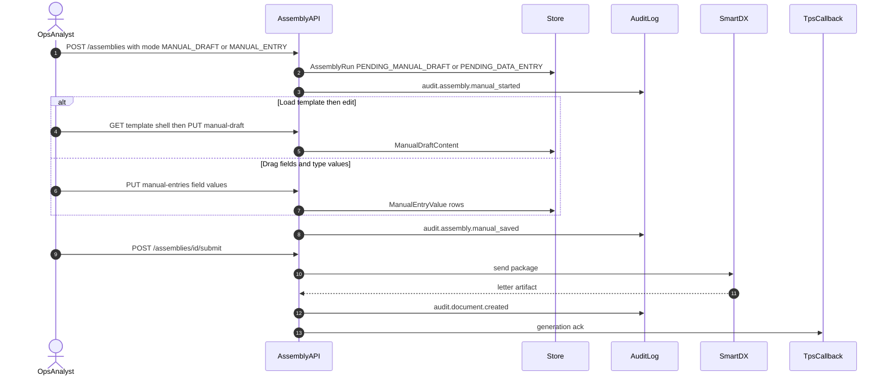

---

## 7. Audit trail (across the board)

Every material change writes an **AuditEvent** (and usually a **TimelineEvent** when trade-scoped).

| Area | What we log | Example actions |
| --- | --- | --- |
| Template Admin | Who / what / when / version | create package, add version, activate, hot-swap, rollback, change selection rule |
| AssemblyRun | Run id, mode, status transitions | auto compose, manual start/save/submit, fail |
| DocumentArtifact | Doc id, channel, prior id | send, resend, supersede |
| Affirm / Compare X / Swoosh | Gate outcomes | affirm status, OCR complete, reconcile opened |
| Manual draft / entry | Author, field or content hash | save draft, submit |

**Minimum fields:** `auditId`, `at`, `actorId`, `action`, `entityType`, `entityId`, `beforeVersion?`, `afterVersion?`, `tradeId?`, `correlationId`.

Timeline (§10) **reads** these events for the per-trade view. Template-only audits stay on the package history API even when no trade is open.

---

## 8. DDD bounded contexts

| Bounded context | Owns | Aggregate roots (sketch) |
| --- | --- | --- |
| **Template Admin** | Packages, versions, selection rules, template audit | TemplatePackage |
| **Confirmation Assembly** | AssemblyRun, auto/manual compose, SmartDX handoff | AssemblyRun |
| **Trade Lifecycle** | Events from TPs | Trade |
| **Affirmation / Matching** | Affirm webhooks, Compare X gate | AffirmationCase |
| **Inbound Capture** | Swoosh OCR (exception) | InboundDocument |
| **Analytics / Timeline** | Per-trade timeline, aging, contagion, error queue | TimelineView |

API groups: `specs/api/openapi.md`.

---

## 9. Archetypes, jobs, impact, story map

### 9.1 Who + job (functional + emotional)

| Who | Functional JTBD | Emotional JTBD | Done when |
| --- | --- | --- | --- |
| Ops confirm analyst | Get a correct confirm out and affirmed | Calm under volume; not blamed for wrong template | Affirmed doc, few reworks |
| Template admin | Keep LIVE packages right; auditable changes | Trust the cutover | Safe activate / rollback |
| Legal / product control | See defs, MCA, matrix choices | Traceable elections | Clear lineage |
| Desk support | Push amend/exercise without legalese | Not blocked | Event in → status out |
| MIS lead | See SLA, affirm rate, errors | Early warning | Simple aggregates |
| Future agent (Phase 3) | Look up timeline with tools | — | Stubs only |

**OKR / metrics (unverified):**

| Level | Metric | Baseline (unverified) | Target (unverified) |
| --- | --- | --- | --- |
| Outcome | NEW→Affirmed median time (FXO) | TBD | TBD |
| Outcome | Wrong-template send rate | TBD % | TBD % |
| Outcome | Affirm rate (FXO) | TBD % | TBD % |
| Hygiene | Open failed/error queue age p95 | TBD | TBD |
| Hygiene | Manual-draft cycle time (FXO) | TBD | TBD |

### 9.2 Impact map

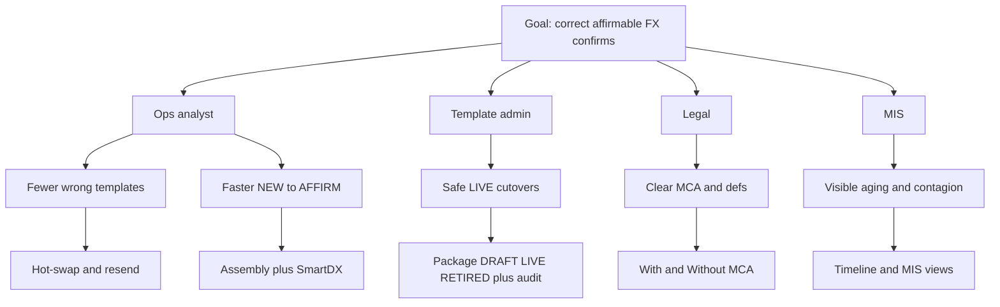

### 9.3 User story map

Core journey: **define → locate → prepare → confirm → send → match → change → recover → observe**.

Caption: *Kite use cases across the top. Under each: sea (user goal) then fish (subfunction).*

```mermaid
flowchart TB
  subgraph kiteRow [Kite - summary goals]
    K1[Define templates]
    K2[Book and assemble]
    K3[Send and match]
    K4[Change and recover]
    K5[Observe]
  end

  subgraph seaDefine [Sea under Define]
    S1[Activate LIVE package]
  end
  subgraph fishDefine [Fish under Define]
    F1a[Draft version]
    F1b[Configure mapping]
    F1c[Audit activate]
  end

  subgraph seaBook [Sea under Book]
    S2[Assemble FXO letter]
  end
  subgraph fishBook [Fish under Book]
    F2a[Locate package]
    F2b[Prepare MCA and DQ]
    F2c[Auto or manual draft]
  end

  subgraph seaSend [Sea under Send]
    S3[SmartDX then affirm]
  end
  subgraph fishSend [Fish under Send]
    F3a[Channel send]
    F3b[Callback TPs]
    F3c[Affirm webhook]
  end

  subgraph seaChange [Sea under Change]
    S4[Amend novate exercise recover]
  end
  subgraph fishChange [Fish under Change]
    F4a[Reassemble]
    F4b[Hot-swap resend]
    F4c[Swoosh CompareX gates]
  end

  subgraph seaObs [Sea under Observe]
    S5[Timeline and queues]
  end
  subgraph fishObs [Fish under Observe]
    F5a[Per-trade timeline]
    F5b[Aging contagion errors]
  end

  K1 --> S1 --> F1a
  S1 --> F1b
  S1 --> F1c
  K2 --> S2 --> F2a
  S2 --> F2b
  S2 --> F2c
  K3 --> S3 --> F3a
  S3 --> F3b
  S3 --> F3c
  K4 --> S4 --> F4a
  S4 --> F4b
  S4 --> F4c
  K5 --> S5 --> F5a
  S5 --> F5b
```

| # | Kite | Sea | Fish (examples) | Trigger | Systems | Archetypes | JTBD metrics | Emotional job |
| --- | --- | --- | --- | --- | --- | --- | --- | --- |
| 1 | Define templates | Activate LIVE package | Draft version; mapping; audit activate | New product / defs change | Template Admin | Admin, Legal | Time to LIVE; audit complete | Cutover confidence |
| 2 | Book and assemble | Assemble FXO letter | Locate package; MCA/DQ; auto or manual draft | NEW_TRADE | Selection, Assembly | Ops, Engine | First-time correct %; DQ pass; compose p95 | No folder hunting; pride in letter |
| 3 | Send and match | SmartDX then affirm | Send; callback; affirm webhook | Channel / counterparty reply | SmartDX, Affirm, Compare X | Ops | Send %; affirm rate; unmatched age | Relief; calm when matched |
| 4 | Change and recover | Amend / novate / exercise / recover | Reassemble; hot-swap resend; Swoosh/Compare X | Lifecycle or exception | Trade Lifecycle, Admin, gates | Desk, Ops, Admin | Cycle time; time to resend | Control under fire |
| 5 | Observe | Timeline and queues | Per-trade timeline; aging/contagion/errors | Always / start of day | Analytics / Timeline | MIS, Ops lead | Aging p95; contagion alerts | Early warning |

Altitude key: **kite** = summary · **sea** = user goal · **fish** = subfunction · **clam** = too low (avoid).

---

## 10. Use Case 2.0 — Deliverable FX Option

**Goal:** Book → assemble letter → SmartDX → affirm → later changes.  
**Precondition:** LIVE TemplatePackage exists (§12 Template Admin).

### 10.1 Success bar

| Level | Meaning |
| --- | --- |
| Minimum | Event accepted or clear error. No silent drop. Audited. |
| Success | Right package; letter via SmartDX; TPs ack; affirmable. |
| Nice | Auto-resend after hot-swap; rich timeline; smooth manual draft. |

### 10.2 Main success — usecase diagram

Caption: *Happy path only. Numbers match the step table.*

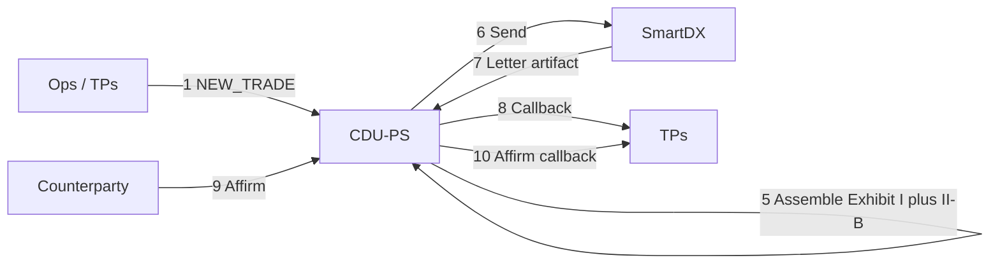

| # | Who | Does | System |
| --- | --- | --- | --- |
| 1 | TPs | Sends NEW_TRADE FXO | Trade Lifecycle API |
| 2 | CDU-PS | Checks id + DQ | Ingest |
| 3 | CDU-PS | Picks defs / MCA / matrix | Legal |
| 4 | CDU-PS | Locates LIVE TemplatePackage | Selection rules |
| 5 | CDU-PS | AssemblyRun: draft Exhibit I + II-B | Assembly |
| 6 | CDU-PS | Hands payload to SmartDX | SmartDX |
| 7 | SmartDX | Returns / hosts ISDA letter | SmartDX |
| 8 | CDU-PS | Acks TPs | Callback |
| 9 | Affirm channel | Affirms | Webhook |
| 10 | CDU-PS | Pushes affirm to TPs | Callback |
| 11–13 | TPs | Later AMEND / NOVATION / EXERCISE | Events → re-assemble |

### 10.3 Alternate flows

| # | If this | Then |
| --- | --- | --- |
| 3a | With MCA | Apply Assumed defaults |
| 3b | Without MCA | Long-form letter |
| 4a | Supplement elected | Append III |
| 5a | Deferred premium | Far premium date; warn |
| 5b | Manual entry required | `PENDING_DATA_ENTRY` — drag fields / type values (§6) |
| 5c | Manual draft required | `PENDING_MANUAL_DRAFT` — load template then edit (§6) |
| 9a | Unmatched / disputed | Store status; open Compare X gate |

### 10.4 Edge cases

| # | Edge | What we do |
| --- | --- | --- |
| E1 | Wrong template | Admin hot-swap; RESEND; supersede; audit |
| E2 | Novation | New parties on Exhibit I; new confirm |
| E3 | Affirm fail | Retry; idempotent; non-affirm to TPs |
| E4 | DQ error | Reject with rule ids; no send |
| E5 | Disruption III-A | Extra clauses; may terminate |
| E6 | Inbound PDF | Swoosh → CDU-PS → Compare X |
| E7 | Data mismatch | Compare X gate |
| E8 | SmartDX down | ChannelError; retry; timeline |
| E9 | Idempotency clash | Conflict |
| E10 | Rollback package | New trades use prior LIVE; audit |
| E11 | Manual draft abandoned | Fail or suppress AssemblyRun; audit |

---

## 11. Target architecture

### 11.1 Outbound happy path (locked)

```text
TPs → CDU-PS → SmartDX (ISDA letter) → CDU-PS → TPs
```

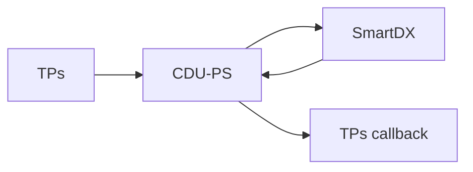

### 11.2 Exception gates

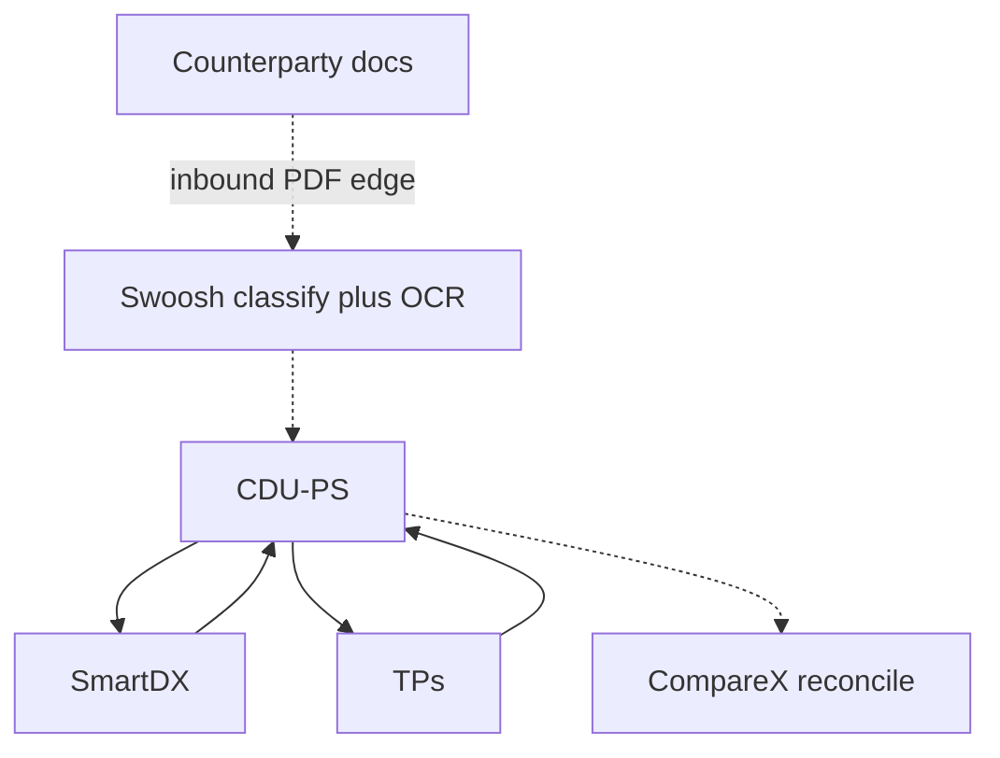

| System | Role |
| --- | --- |
| **Swoosh** | Downstream: classify + OCR (inbound / exception) |
| **Compare X** | Reconcile when outbound vs inbound disagree |

### 11.3 Open question — counterparty matching

> **Open:** Is external counterparty matching another system, SmartDX Docbox, Compare X, or a mix? Phase 1 keeps Affirm webhook + Compare X as placeholders.

---

## 12. Timeline feature (SmartDX-inspired)

### 12.1 Per-trade timeline (FXO seed only)

Swimlane events from **AuditEvent** / **TimelineEvent**: received → DQ → assembled (or manual) → SmartDX sent → affirmed → amend/novation/exercise. Include actor, timestamp, document version, status.

### 12.2 Aggregates (simple)

| View | Ops value |
| --- | --- |
| Failed / error queue | DQ, channel, OCR, Compare X, abandoned manual |
| Aging / SLA | AffirmPending / Unmatched age |
| Counterparty contagion | Counterparties with many unmatched/errors |

---

## 13. State diagrams

### 13.1 Template Admin (separate)

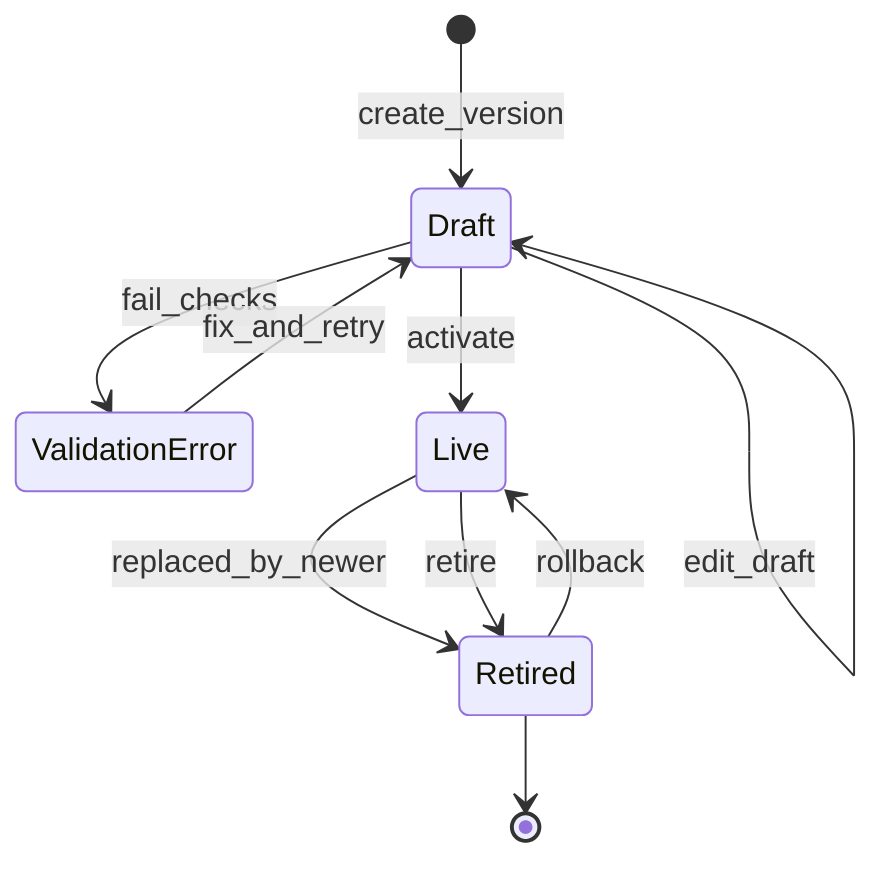

### 13.2 Generic trade

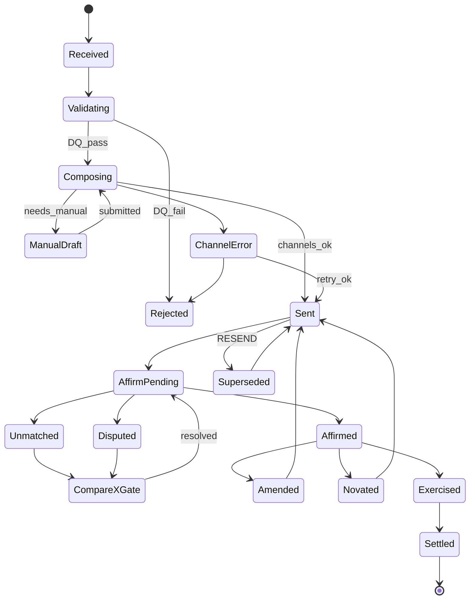

### 13.3 FXO deep dive

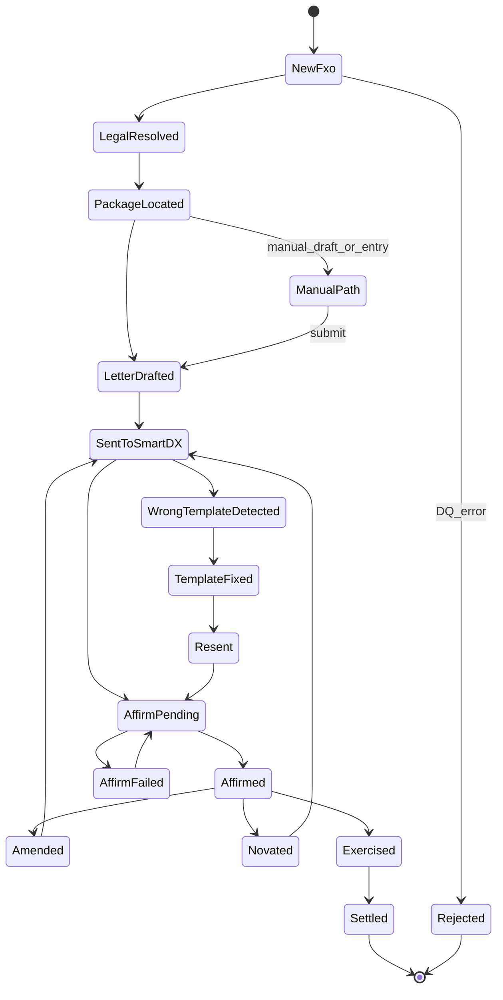

---

## 14. Sequences

### 14.1 Template Admin (+ audit)

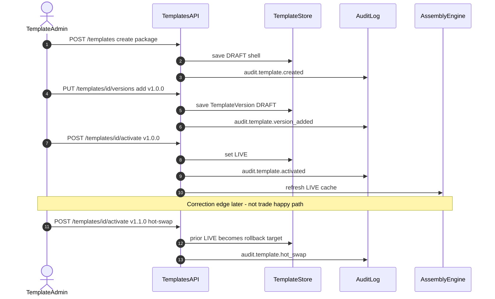

### 14.2 Trade lifecycle (FXO happy path)

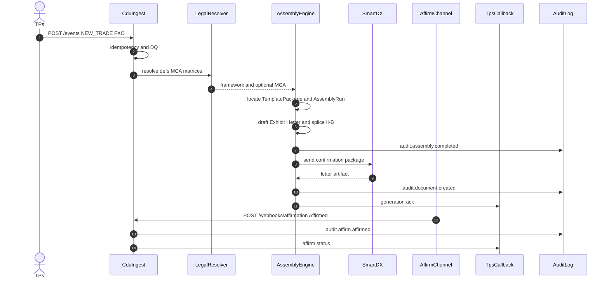

### 14.3 Exception — Swoosh + Compare X

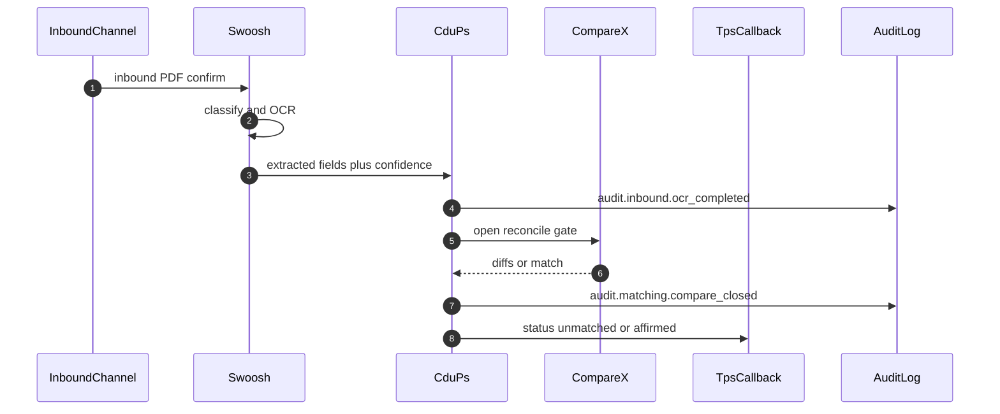

Manual draft sequence: §6.3.

---

## 15. FXO worked example

Sample `TR-FXO-001`: EUR Call / USD Put, European, auto-exercise, 2027-12-01 → 2027-12-31, premium USD 15,000. Path: With_MCA.

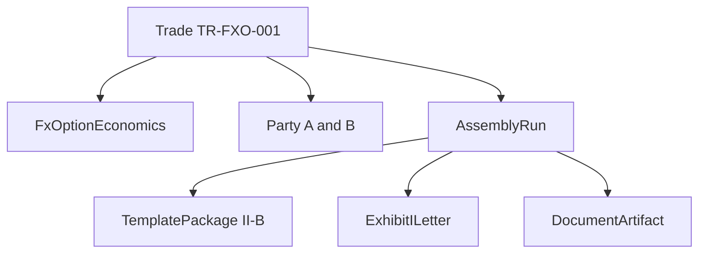

Party A/B one-pager: [`docs/party-ab-fxo-one-pager.md`](party-ab-fxo-one-pager.md).

---

## 16. Logical data model

### 16.1 Alignment

| Path / card | LDM entity |
| --- | --- |
| tradeId / productType | Trade / FinancialProduct |
| parties.* | Party |
| economics.* (II-B) | FxOptionEconomics |
| confirmation.* / letter | ExhibitILetter |
| template package | TemplatePackage |
| assembly | AssemblyRun |
| manual draft / entry | ManualDraftContent / ManualEntryValue |
| audit / timeline | AuditEvent / TimelineEvent |
| selection | PackageSelectionRule |
| mca / matrix | MasterConfirmation / MatrixBinding |
| novation | NovationTransfer |

### 16.2 ER diagram (PK/FK)

Caption: *Valid Mermaid ER syntax. Tops-and-tails = master TemplateVersion via FK on TemplatePackage.*

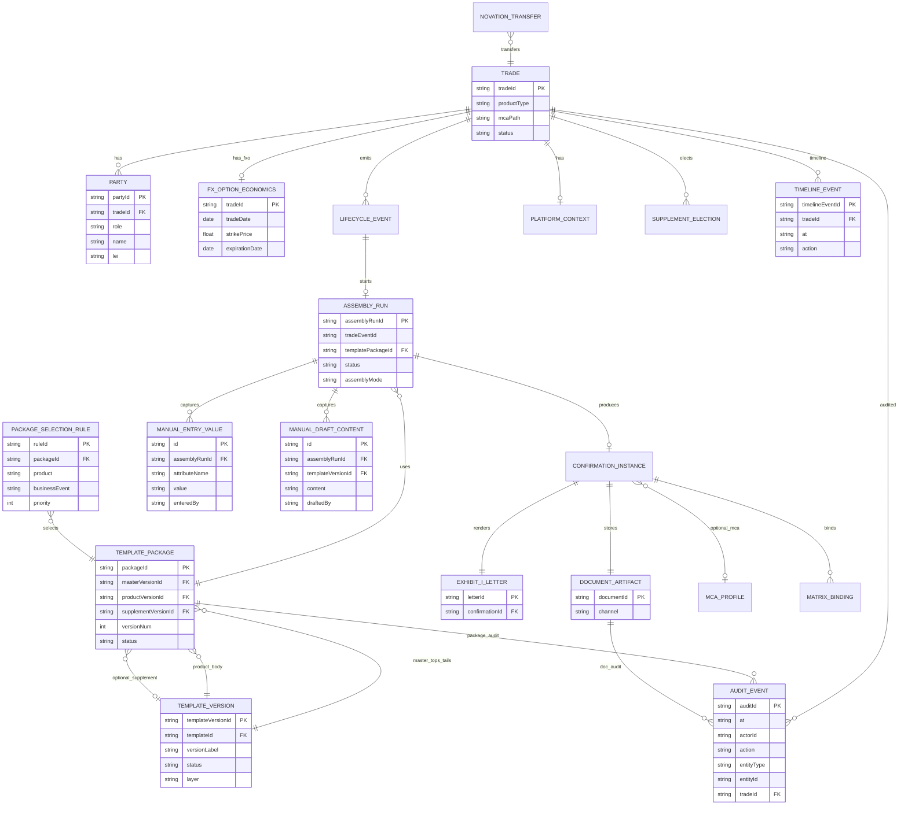

### 16.3 Class diagram (companion)

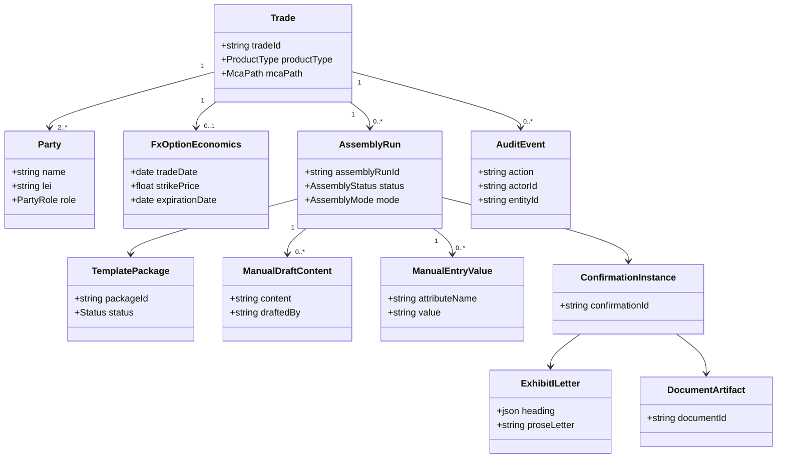

Excel: `Logical_Data_Model` (+ Manual*/AuditEvent rows).

---

## 17. Mapping workbooks

| File | Use |
| --- | --- |
| [`docs/mappings/cdu-ps-isda-2026-mapping.xlsx`](mappings/cdu-ps-isda-2026-mapping.xlsx) | Attributes, admin, LDM, DQ, FXO steps, legend, PartyAB |
| [`docs/mappings/cdu-ps-fxo-deliverable-payload-mocks.xlsx`](mappings/cdu-ps-fxo-deliverable-payload-mocks.xlsx) | FXO payloads |
| [`docs/party-ab-fxo-one-pager.md`](party-ab-fxo-one-pager.md) | Party A vs B |
| [`docs/explainer-basics.md`](explainer-basics.md) | Plain-language + phases |

---

## 18. Non-functional (Phase 2 targets)

| Area | Target |
| --- | --- |
| Ingest ack | p95 under 2s |
| Compose | p95 under 5s mock SmartDX |
| Idempotency | One effect per key |
| Audit | Template activate/rollback/hot-swap, assembly, document, affirm always written |

Five-nines ideas remain aspirational only.

---

## 19. Phase 2 kickoff note

Phase 2 **starts** with PRD re-read + **ASCII wireframes** for main ops screens **before** HTML/Python. **Do not** expect full ASCII wireframes in Phase 1 — plan only (see [explainer](explainer-basics.md#phase-2-kickoff-locked-plan)).

---

## 20. Acceptance (Phase 1 v1.4)

- [x] Explainers moved to `docs/explainer-basics.md`; PRD renumbered  
- [x] Story map mermaid (kite → sea → fish) + matching table  
- [x] §16.2 ER Mermaid fixed / validated  
- [x] Manual drafting first-class (load+edit / drag-drop fields)  
- [x] Audit trail across template, assembly, document; tied to timeline  
- [x] Phase 2 wireframe-first kickoff stated (no wireframes drawn now)  
- [x] Store mirrors; checkpoint then v1.4 commit on PR #1  

**Out of scope:** Phase 2 UI code; Phase 3 AI; drawing ASCII wireframes now.

---

## 21. Open questions

1. Counterparty matching system identity  
2. OKR baselines (unverified)  
3. Swoosh / Compare X contracts  
4. Inbound channel inventory  
5. Manual drafting volume / which FXO cases default to MANUAL_DRAFT  

---

## 22. References

- `docs/reference/isda/` · `docs/reference/smartdx/`  
- `docs/phase-1-plan.md` · `docs/explainer-basics.md`  
- `docs/party-ab-fxo-one-pager.md`  
- `specs/features/` · `specs/scenarios/` · `specs/api/openapi.md`
