# CDU-PS Product Requirements (v1.2)

**What this is:** Spec pack for building a confirmation helper (CDU-PS). Docs + Excel only in Phase 1.  
**Who it is for:** Ops analysts and interns who book FX confirms — and the builders who help them.  
**Legal source:** ISDA/EMTA 2026 FX Definitions confirmation templates (8 Jul 2026). Go live date for the defs: **22 Nov 2027**.

> **License:** PDFs in `docs/reference/isda/` are licensed. Internal use only.

**Phases in one line:** Phase 1 = write the map. Phase 2 = build the app on your Mac. Phase 3 = AI helpers (ideas only here — no build yet).

---

## 1. Story in plain words

You work ops. A trader books a **Deliverable FX Option**. Your job is to get a correct **confirmation letter** out the door, get the other side to **affirm** it, and handle changes (amend, novation, exercise).

CDU-PS helps you:

1. Keep **templates** ready (letter wrapper + product form + optional add-ons).  
2. Take trade data from the **trading system (TPS)**.  
3. Draft the **Exhibit I letter** and fill in **Exhibit II-B** (and any Exhibit III add-ons).  
4. Send to **SmartDX** (and maybe **SWIFT**).  
5. Take the **affirm** result back to TPS.  
6. Redo the letter when the trade changes.

You do **template setup first**. Then you run the **trade journey**. Those are two separate jobs.

---

## 2. Phase split

| Thing | Phase 1 | Phase 2 | Phase 3 |
| --- | --- | --- | --- |
| Maps, diagrams, Excel, API shapes | Yes | Tweak | — |
| Running screen + Python services | No | Yes | — |
| AI / chatbot | No | No | Yes (later) |

---

## 3. Plain-language explainers

Read this once. We reuse these words everywhere.

### 3.1 Affirmation vs confirmation

| Word | Meaning |
| --- | --- |
| **Confirmation** | The letter/document **we send** that states the deal terms (Exhibit I letter + product body). |
| **Affirmation** | The **other side’s reply**: “yes, this matches” (or unmatched / disputed). |

Relevance: sending a confirm is not the finish line. Ops cares that it is **affirmed**. CDU-PS tracks both.

### 3.2 Termsheet vs confirmation vs settlement

| Artifact | Job |
| --- | --- |
| **Termsheet** | Short commercial summary used while negotiating. Not the legal confirm. |
| **Confirmation** | Formal ISDA-style record of the trade terms between the parties. |
| **Settlement** | Later cash/currency movement when the deal pays or delivers. |

A confirm can describe settlement dates and accounts. Settlement systems still do the actual pay.

### 3.3 MCA (Master Confirmation Agreement)

| Idea | Meaning |
| --- | --- |
| **MCA** | A side agreement that sets default elections for many FX confirms (calc agent, notices, product set, etc.). |
| **With MCA** | Confirm stays short; defaults come from the MCA profile (**Assumed** sample in our Excel). |
| **Without MCA** | Confirm must spell elections out (long-form Exhibit I language). |

2026 defs pull many old EM MCA ideas into the main book — but firms may still use an MCA. We model **both** paths.

### 3.4 Why FX often has no CSA

A **CSA** (Credit Support Annex) is about posting collateral under an ISDA. Many short-dated FX flows settle fast (or via CLS) and desks often treat them as settlement risk, not long derivative credit risk — so **no CSA** is common market practice for those FX trades. Credit still exists; the docs pack is just different. CDU-PS does not require a CSA field for FXO happy path.

### 3.5 Matrices vs Exhibit III supplements

| Thing | What it is | What it is not |
| --- | --- | --- |
| **Matrix** (e.g. SRO Matrix, EM Currency Matrix) | Versioned **reference table** (fixing sources, EM pair defaults). You pin a version. | Not a letter body. |
| **Exhibit III supplement** | Optional **extra confirmation text** (barrier, averaging, disruption…). | Not a matrix. |

Matrix = lookup data. Supplement = extra clauses on the confirm.

---

## 4. Domain ontology (what things exist)

### 4.1 Short table

| Thing | Simple meaning |
| --- | --- |
| Trade | One deal in the system |
| FinancialProduct | Product type (e.g. Deliverable FX Option → Exhibit II-B) |
| LegalFramework | 1998 or 2026 defs + version |
| McaProfile | Optional MCA defaults (Assumed sample) |
| DynamicTemplate | MASTER / PRODUCT / SUPPLEMENT template |
| TemplateVersion | DRAFT / LIVE / RETIRED copy of a template |
| MatrixBinding | Matrix type + version pin |
| ConfirmationInstance | One composed confirm for an event |
| ExhibitILetter | The letter wrapper we draft |
| FxOptionEconomics | II-B economic fields (strike, expiry, premium…) |
| Party | Names, LEI, office, roles |
| DocumentArtifact | Sent file/message id (SmartDX / SWIFT) |
| LifecycleEvent | NEW, AMEND, AFFIRM, NOVATION, … |
| NovationTransfer | Who leaves / who joins |

### 4.2 Ontology diagram

Caption: *Boxes are business things. Lines show “uses” / “makes”.*

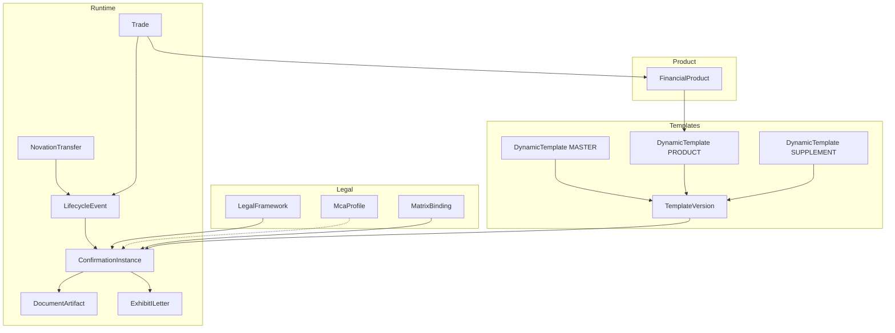

---

## 5. Template layers (how a confirm is built)

Caption: *Exhibit I is the letter. II is the product. III is optional add-on text. Matrix and MCA sit beside the letter.*

```text
ConfirmationInstance
├── MASTER  Exhibit I letter   (heading → insert → elections → closing)
│              └── wraps →
├── PRODUCT Exhibit II-*       (e.g. II-B FX option terms)
├── SUPPLEMENT Exhibit III-*   (only if elected)
├── MATRIX pins                (SRO / EM …)
├── MCA profile                (optional)
└── PLATFORM ids               (trade id, template version, channels)
```

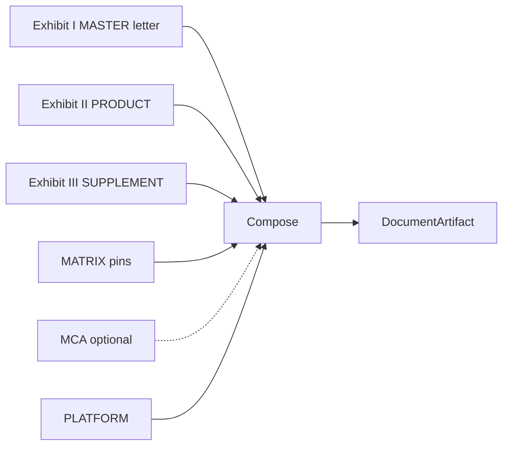

**II-B add-ons allowed:** III-A, III-C, III-D, III-F, III-G, III-H.

---

## 6. Exhibit I letter (MASTER)

Exhibit I is the **confirmation letter**. It is not only a header.

| Block | You put |
| --- | --- |
| Heading | Our letterhead, date, their name/address |
| Intro | “This letter confirms the Transaction…” |
| Defs | Which FX Definitions version |
| Agreement | Master date **or** long-form text |
| **Insert** | Exhibit II-B (+ III) body |
| Elections | LEI, calc agent, accounts, offices, notices |
| Closing | “This replaces prior confirms…” + signatures |

**With MCA:** short Master clause; many defaults from MCA.  
**Without MCA:** long-form clause; you fill law / calc agent / notices yourself.

Mocks: `docs/mappings/cdu-ps-fxo-deliverable-payload-mocks.xlsx` and `specs/features/exhibit-i-letter.md`.

---

## 7. MCA paths

| Path | What you do |
| --- | --- |
| With_MCA | Attach Assumed profile `MCA-SCB-ACME-2026-001`. Fill gaps from MCA. |
| Without_MCA | No profile. Long-form Exhibit I. Explicit elections. |

Assumed fields are marked **Assumed** in Excel. They are inventedsamples for the prototype.

---

## 8. Archetypes, jobs, impact, story map

### 8.1 Who + job

| Who | Job to be done | Done when |
| --- | --- | --- |
| Ops confirm analyst | Get a correct confirm out and affirmed | Affirmed doc, few reworks |
| Template admin | Keep LIVE templates right | Safe activate / rollback |
| Legal / product control | See defs, MCA, matrix choices | Clear lineage |
| Desk support | Push amend/exercise without legalese | Event in → status out |
| MIS lead | See SLA, affirm rate, errors | Analytics numbers |
| Future agent (Phase 3) | Look up timeline with tools | Stubs only now |

### 8.2 Impact map

Caption: *Goal → people → better outcomes → what we deliver in Phase 1 docs.*

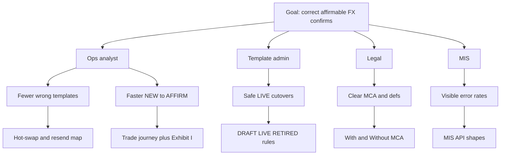

### 8.3 User story map (backbone)

| Step | Cards |
| --- | --- |
| 1 Setup templates | Create I, II-B, optional III; pin matrix; set MCA flag |
| 2 Activate LIVE | DRAFT → LIVE; audit |
| 3 Ingest NEW | TPS payload; MCA path; DQ check |
| 4 Draft letter | Exhibit I + II-B splice |
| 5 Send | SmartDX; optional SWIFT; TPS ack |
| 6 Affirm | Webhook in; status to TPS |
| 7 Change | Amend / novate / exercise → rewrite letter |
| 8 Recover | Wrong template → hot-swap → resend; affirm fail |
| 9 Observe | MIS counts |

---

## 9. Use Case 2.0 — Deliverable FX Option (happy path)

**Goal:** Book → confirm letter → send → affirm → later changes.  
**Precondition:** LIVE templates already exist (see §10 — separate job).

### 9.1 Success bar

| Level | Meaning |
| --- | --- |
| Minimum | Event accepted or clear error. No silent drop. |
| Success | Right templates; letter sent; TPS ack; affirmable. |
| Nice | Auto-resend after hot-swap; rich MIS. |

### 9.2 Main success steps

| # | Who | Does | System |
| --- | --- | --- | --- |
| 1 | TPS | Sends NEW_TRADE FXO | Events API |
| 2 | CDU-PS | Checks id + data rules | Ingest |
| 3 | CDU-PS | Picks defs / MCA / matrix | Legal |
| 4 | CDU-PS | Loads LIVE I + II-B (+ III) | Engine |
| 5 | CDU-PS | Drafts Exhibit I letter; inserts II-B | Engine |
| 6 | SmartDX | Gets package | SmartDX |
| 7 | SWIFT | Optional notify | SWIFT |
| 8 | CDU-PS | Acks TPS | Callback |
| 9 | Affirm platform | Affirms | Webhook |
| 10 | CDU-PS | Pushes affirm to TPS | Callback |
| 11–13 | TPS | Amend / novation / exercise later | Events |

### 9.3 Alternate flows

| # | If this | Then |
| --- | --- | --- |
| 3a | With MCA | Apply Assumed defaults |
| 3b | Without MCA | Long-form letter |
| 4a | Supplement elected | Append III text |
| 5a | Deferred premium | Far premium date; warn only |
| 9a | Unmatched / disputed | Store status; do not fake Affirmed |

### 9.4 Edge cases

| Edge | What we do |
| --- | --- |
| Wrong template | Admin hot-swap; resend; supersede old doc |
| Novation | New parties on Exhibit I; new confirm |
| Affirm fail | Retry; idempotent; TPS gets non-affirm status |
| DQ error | Reject with rule ids; no send |
| Disruption III-A | Extra clauses; may later terminate |
| Deferred premium | Allowed; calendar warn |
| Rollback template | New trades use prior LIVE |
| Idempotency clash | Same key, different body → conflict |
| Missing letter fields | Fail compose |
| FAE / Binary barrier | Extra II-B / III-H rules |

---

## 10. State diagram — Template Admin (separate)

Caption: *Template versions move DRAFT → LIVE → RETIRED. Hot-swap and rollback are admin moves. Not part of the trade happy path.*

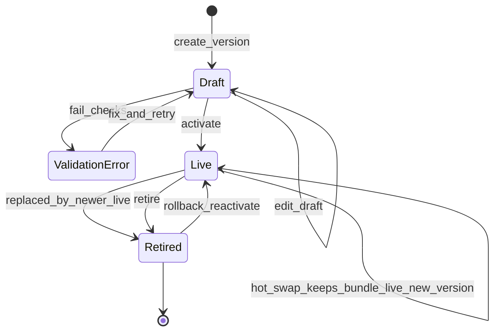

---

## 11. Sequence — Template Admin

Caption: *Admin builds and activates templates before any trade.*

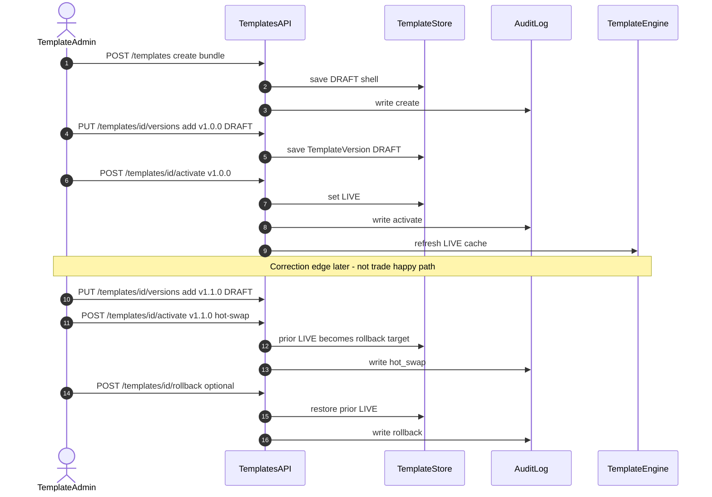

---

## 12. State diagram — Generic trade lifecycle

Caption: *Happy path down the middle. Errors and edges on the sides.*

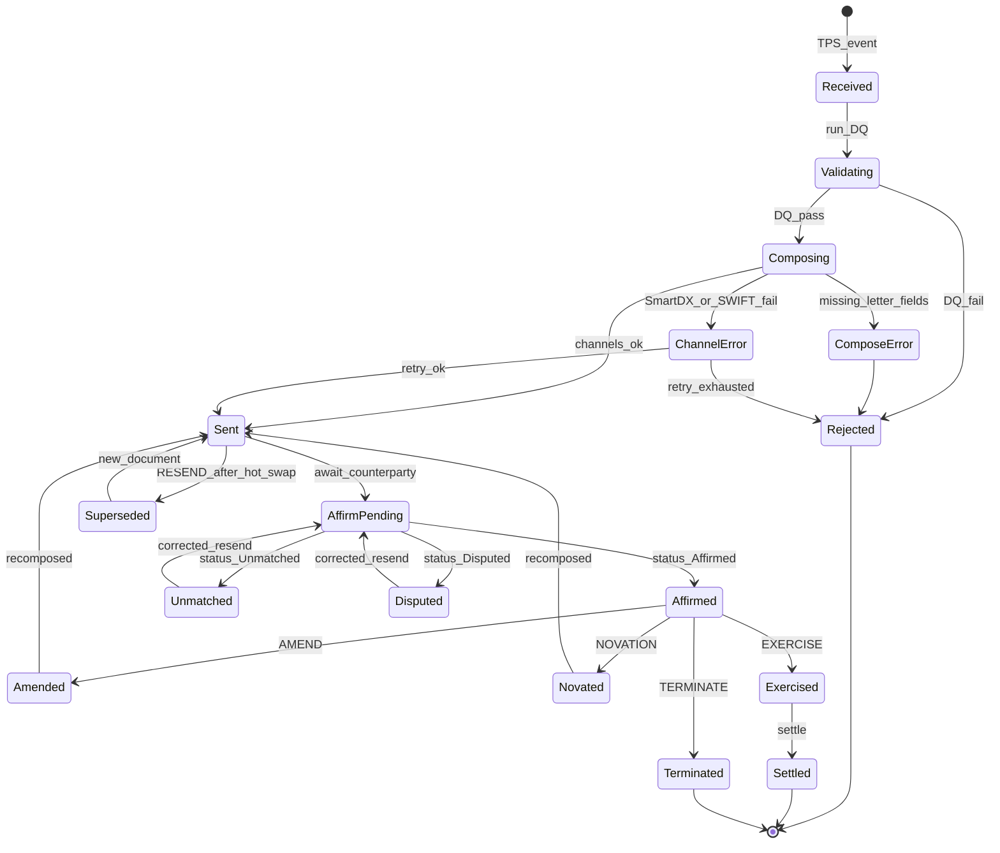

---

## 13. State diagram — FXO deep dive

Caption: *Same idea for Deliverable FX Option. Includes wrong-template, deferred premium, disruption.*

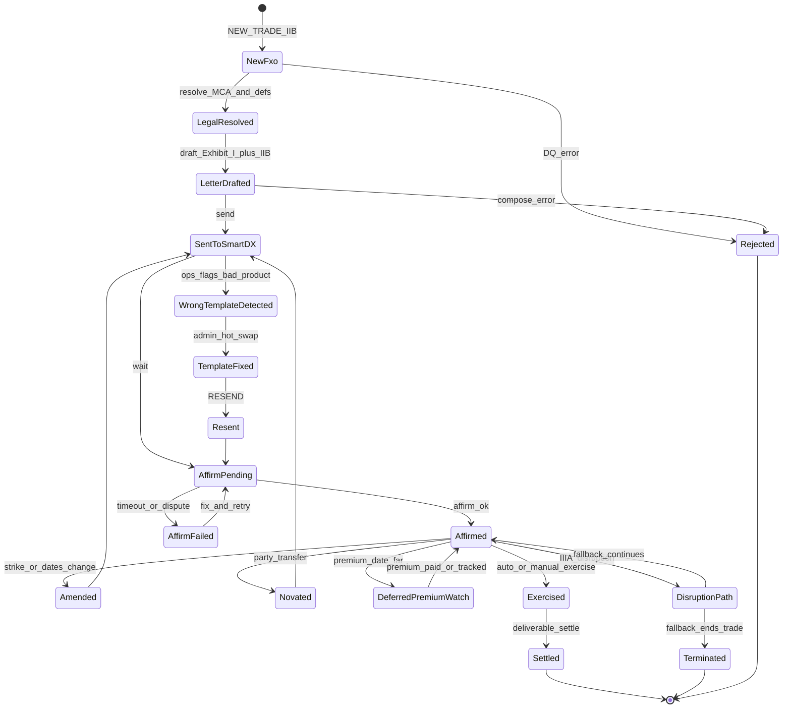

---

## 14. Sequence — Trade lifecycle (FXO happy path)

Caption: *Assumes LIVE templates. Letter draft is its own step.*

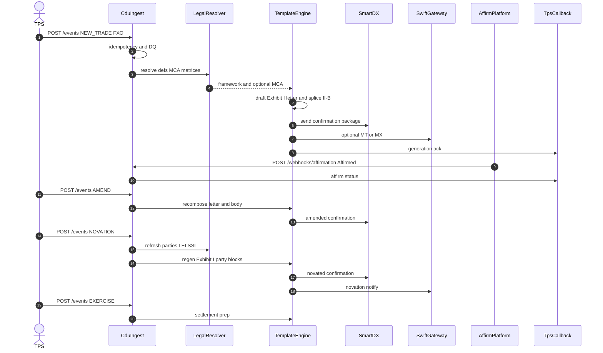

### 14.1 Edge sequence — wrong template recovery

Caption: *Admin path. Kept out of the happy-path diagram.*

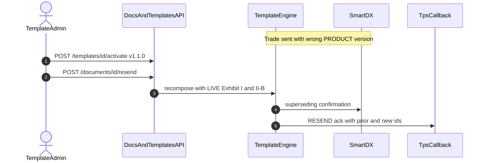

---

## 15. FXO worked example

### 15.1 Sample trade parts → ontology → templates

Sample `TR-FXO-001`: EUR Call / USD Put, European, auto-exercise, trade 2027-12-01, expiry 2027-12-31, premium USD 15,000. Path shown: With_MCA.

Caption: *One sample deal mapped to entities and exhibits.*

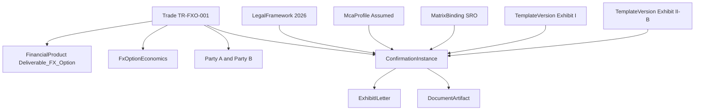

| Part | Entity | Template |
| --- | --- | --- |
| Strike, expiry, premium | FxOptionEconomics | II-B |
| Letter heading / closing | ExhibitILetter | I |
| Names / LEI | Party | I (+ novation) |
| MCA defaults | McaProfile | — |
| SRO pin | MatrixBinding | — |

### 15.2 Process flow

Caption: *Setup first. Then book → send → affirm → later changes.*

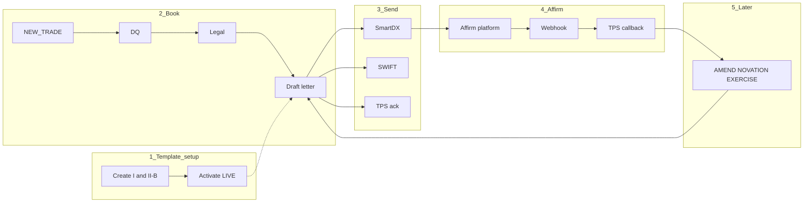

---

## 16. Logical data model

### 16.1 LDM alignment note

We keep **one vocabulary** across PRD, Excel `Logical_Data_Model`, `Attribute_Product_Map`, and payload mocks:

| Sample_Trade_Card / TPS path | LDM entity |
| --- | --- |
| `tradeId`, `productType` | Trade |
| `parties.*` | Party |
| `economics.*` (II-B) | FxOptionEconomics |
| Exhibit I letter blocks / `confirmation.*` | ExhibitILetter |
| `legal.*` defs / master | LegalFramework |
| `mcaProfileId` / MCA fields | McaProfile |
| `matrixBindings` | MatrixBinding |
| `supplementExhibitIds` + III fields | SupplementElection |
| platform ids | PlatformContext |
| novation block | NovationTransfer |

`Attribute_Product_Map` now has columns **Attribute type**, **Domain**, **LDM entity**. TPS JSON paths should resolve to `LDM entity` + attribute.

### 16.2 Class diagram

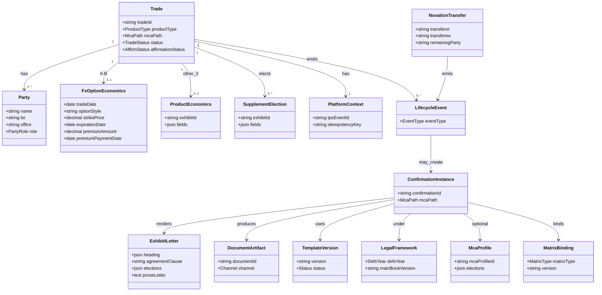

Working table: Excel sheet `Logical_Data_Model`.

---

## 17. Mapping workbooks

| File | Use |
| --- | --- |
| [`docs/mappings/cdu-ps-isda-2026-mapping.xlsx`](mappings/cdu-ps-isda-2026-mapping.xlsx) | Attributes (+ type/domain/LDM entity), admin, LDM, DQ, FXO steps, legend |
| [`docs/mappings/cdu-ps-fxo-deliverable-payload-mocks.xlsx`](mappings/cdu-ps-fxo-deliverable-payload-mocks.xlsx) | Sample FXO payloads With/Without MCA + errors + letter text |

---

## 18. Non-functional (Phase 2 targets)

| Area | Target |
| --- | --- |
| Ingest ack | p95 under 2s |
| Compose | p95 under 5s with mock SmartDX |
| Idempotency | One effect per key |
| Audit | Every hot-swap / rollback / resend has who/when |

Five-nines / multi-region ideas stay **aspirational only** — not acceptance for Phase 1/2.

---

## 19. Acceptance (Phase 1 v1.2)

- [x] Mermaid sequences render (no `{id}` / heavy punctuation in labels)
- [x] State diagrams: generic trade, FXO, template admin
- [x] Template Admin kept separate from trade journey
- [x] LDM includes Party, FxOptionEconomics, ExhibitILetter; Attribute sheet has type/domain/LDM entity
- [x] Plain-language explainers (affirm vs confirm, termsheet, MCA, CSA, matrices vs III)
- [x] Simpler ops/intern wording; UC2.0 stays action-first
- [x] Store mirrors updated; checkpoint commit then v1.2 commit on PR

**Out of scope:** Phase 2/3 code.

---

## 20. References

- `docs/reference/isda/` (+ LICENSE-NOTICE)
- `docs/phase-1-plan.md`
- `specs/features/` (incl. `exhibit-i-letter.md`)
- `specs/scenarios/`
- `specs/api/openapi.md`
