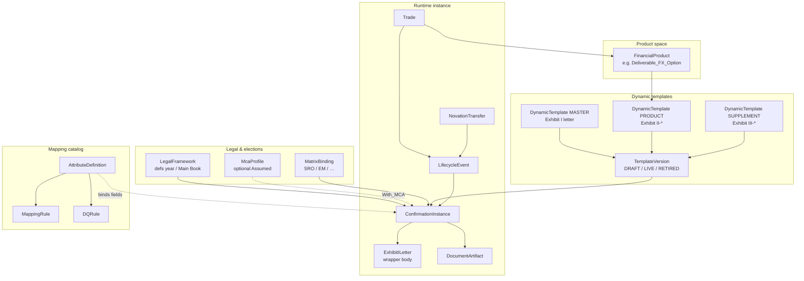
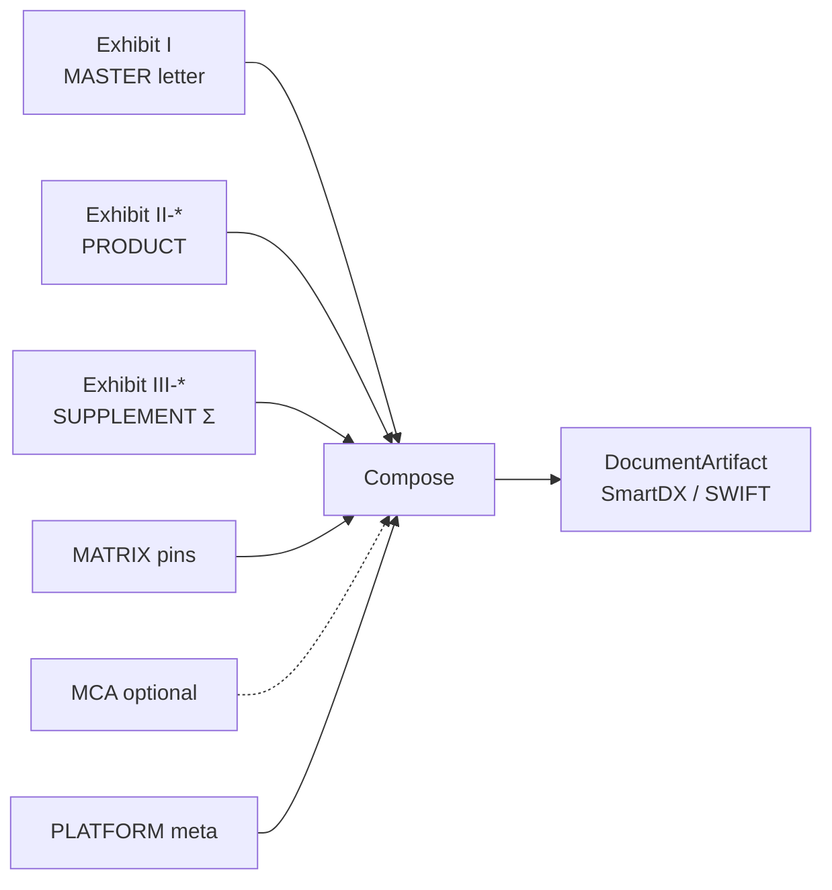
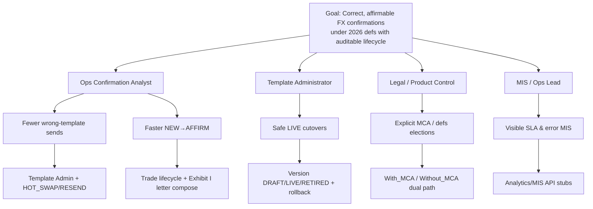
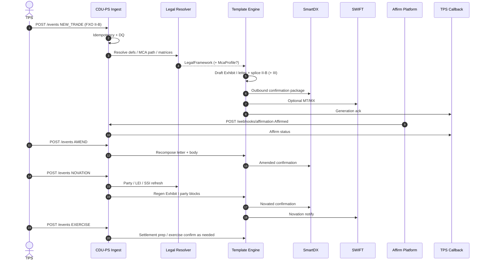
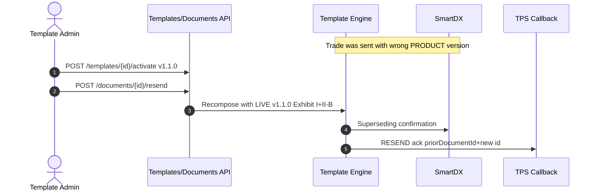
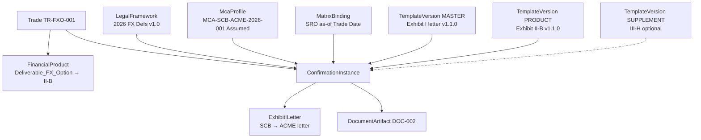
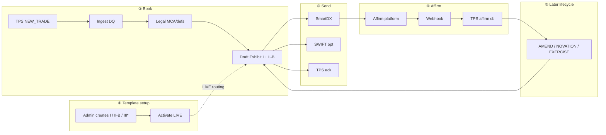
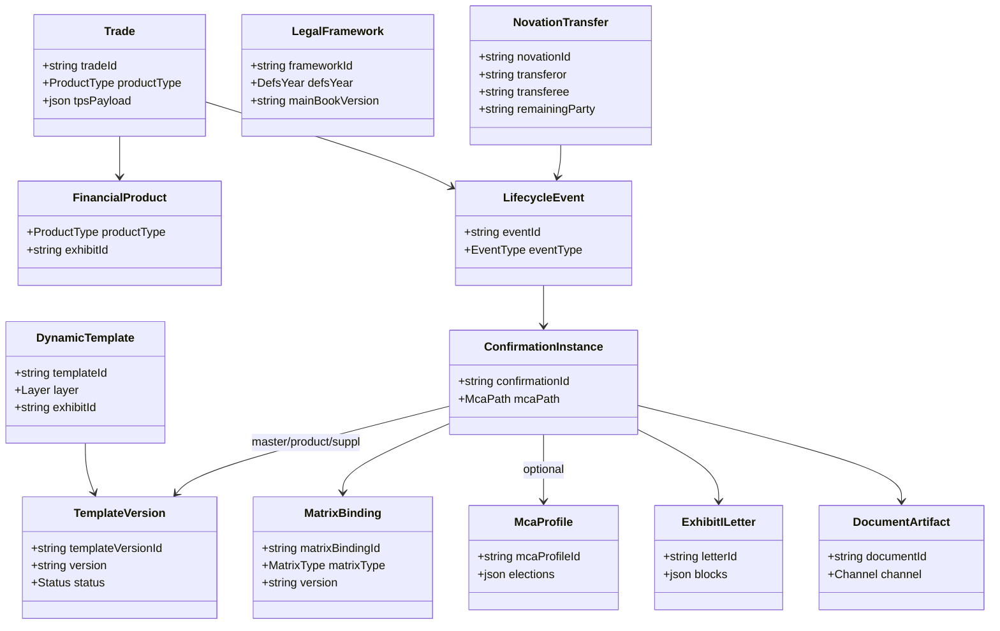

# CDU-PS Product Requirements Document (v1.1)

**Project:** Confirmation Document Utility — Product Spec (CDU-PS) / con4m8ions  
**Phase:** 1 — Spec artifacts only (PRD + Excel mapping + light API/feature specs + payload mocks)  
**Status:** Enhanced draft for Excel / mapping / UC sign-off  
**Primary legal source:** Annotated Confirmation Templates — 2026 FX Definitions (Version 1, 8 July 2026)  
**Effective-date note:** 2026 FX Definitions take effect **22 November 2027** (Introduction PDF). SWIFT support for 1998 definitions is not expected after that date.

> **License:** ISDA / EMTA materials in `docs/reference/isda/` are licensed content. Internal use only; do not redistribute outside the license terms.

---

## 1. Executive summary

CDU-PS generates, versions, and lifecycle-manages FX confirmation documents composed from the 2026 ISDA/EMTA **Master (Exhibit I letter wrapper) + Product (Exhibit II-*) + Supplement (Exhibit III-*)** stack, with optional **MCA** overlay and **matrix** version pins. Upstream economics arrive from TPS; downstream artifacts go to SmartDX and optionally SWIFT; affirmation returns via webhook.

**Phase 1** locks ontology, logical data model, attribute↔product mapping, DQ/mapping rules, Use Case 2.0 journeys, split sequences, API contracts (incl. MIS + agent-readiness stubs), and FXO payload mocks.  
**Phase 2** implements HTML5 ops desk + Python services — Mac-first.  
**Phase 3** (future): AI / chatbot / agent runtime — **thinking only in this PRD; no implementation**.

---

## 2. Phase split

| Artifact | Phase 1 | Phase 2 | Phase 3 |
| --- | --- | --- | --- |
| Ontology + LDM + composition visuals | Yes | Refine | — |
| Use Case 2.0 + edge cases + story maps | Yes | Wire to demo | — |
| Split Template Admin vs Trade sequences | Yes | Interactive timeline optional | — |
| Exhibit I letter mock + payload Excel | Yes | Render engine | — |
| API contract (grouped) + MIS + agent stubs | Yes | FastAPI | MCP/skills live |
| Running UI / services / live SmartDX·SWIFT | No | Yes (mock first) | — |
| AI chatbot / agent UX | No | No | Yes |

---

## 3. Domain ontology

### 3.1 Concept table

| Concept | Meaning |
| --- | --- |
| **FinancialProduct** | Canonical product type bound to one Exhibit II-* (e.g. `Deliverable_FX_Option` → II-B). |
| **LegalFramework** | ISDA/EMTA defs year and Main Book version (`1998` \| `2026`), plus elected matrix versions. |
| **McaProfile** | Optional bilateral Master Confirmation Agreement elections (**Assumed** sample). Paths: `With_MCA` / `Without_MCA`. |
| **DynamicTemplate** | Versioned confirmation fragment with layer `MASTER` \| `PRODUCT` \| `SUPPLEMENT`. |
| **MatrixBinding** | Version pin for SRO / EM / CFC / DM / Offshore CNY matrices (not a confirmation body). |
| **DocumentArtifact** | Generated confirmation (Exhibit I letter + inserted II/III body) + channel metadata. |
| **LifecycleEvent** | `NEW_TRADE`, `AMEND`, `TERMINATE`, `EXERCISE`, `NOVATION`, `AFFIRM`, `HOT_SWAP`, `ROLLBACK`, `RESEND`. |
| **ConfirmationInstance** | Runtime composition of layers + bindings + optional MCA + platform metadata. |
| **NovationTransfer** | Transferor / transferee / remaining party + effective date. |
| **AttributeDefinition** | Mapped field with group, layer, exhibit, lineage, TPS path, DQ/mapping FKs. |
| **MappingRule / DQRule** | Transform and validation catalog (`MAP-*`, `DQ-*`). |
| **ExhibitILetter** | Rendered MASTER confirmation letter (heading, intro, elections, closing, signatures) that **wraps** the Product + Supplement body. |

### 3.2 Ontology diagram



### 3.3 Attribute groups

`COMMON` · `PRODUCT` · `SUPPLEMENT` · `MATRIX` · `MCA` · `PLATFORM` · `LIFECYCLE`

---

## 4. Template layers visual (composition)

```text
┌──────────────────────────────────────────────────────────────────────────┐
│                     ConfirmationInstance (runtime)                       │
│  ┌────────────────────────────────────────────────────────────────────┐  │
│  │ MASTER — Exhibit I  (confirmation LETTER wrapper)                  │  │
│  │  Heading · Intro (“purpose of this letter…”) · Defs incorporate    │  │
│  │  Master Agreement / long-form · LEI · CA · Accounts · Offices      │  │
│  │  Notices · Governing law · Closing · Signature blocks              │  │
│  │  ★ Insert point → Product + Supplement body                        │  │
│  └───────────────────────────────┬────────────────────────────────────┘  │
│                                  │ wraps                                 │
│  ┌───────────────────────────────▼────────────────────────────────────┐  │
│  │ PRODUCT — Exhibit II-*  (e.g. II-B Deliverable FX Option)          │  │
│  │  Economics: Buyer/Seller, Style/Type, Strike, Expiry, Premium…     │  │
│  └───────────────────────────────┬────────────────────────────────────┘  │
│                                  │ + elected                             │
│  ┌───────────────────────────────▼────────────────────────────────────┐  │
│  │ SUPPLEMENT — Σ Exhibit III-*  (III-A disruption, III-H barrier…)   │  │
│  └────────────────────────────────────────────────────────────────────┘  │
│  ┌─────────────────┐  ┌──────────────────┐  ┌─────────────────────────┐  │
│  │ MATRIX bindings │  │ MCA profile opt. │  │ PLATFORM / LIFECYCLE    │  │
│  │ SRO / EM pins   │  │ With_MCA only    │  │ ids, affirm, novation   │  │
│  └─────────────────┘  └──────────────────┘  └─────────────────────────┘  │
└──────────────────────────────────────────────────────────────────────────┘
```



**Composition rule**

```text
ConfirmationInstance =
  MASTER(Exhibit I letter)
  + PRODUCT(Exhibit II-*)
  + Σ elected SUPPLEMENT(Exhibit III-*)
  + MATRIX bindings (if applicable)
  + optional MCA profile
  + PLATFORM runtime metadata
```

### Product universe (Exhibit II)

| Exhibit | Product |
| --- | --- |
| II-A | Deliverable FX Transaction |
| II-B | Deliverable FX Option Transaction **(deepest)** |
| II-C … II-K | NDF/NDO/EM/cross/variance/correlation/delta-neutral FVA (see plan) |

**II-B eligible supplements:** III-A, III-C, III-D, III-F, III-G, III-H.

---

## 5. Exhibit I — ISDA confirmation letter (MASTER)

Exhibit I is not “just headers”: it is the **confirmation letter** that introduces the transaction, incorporates the 2026 FX Definitions, subjects the trade to the ISDA Master (or long-form fallback), carries shared elections, and closes with supersession + signature blocks. The Product/Supplement forms are **inserted** into the letter body.

### 5.1 Letter structure (mock outline)

| Block | Fields (illustrative) | Notes |
| --- | --- | --- |
| Heading | Party A letterhead, Confirmation Date, Party B name/address | |
| Salutation | Dear Sir/Madam | |
| Intro | Purpose of Confirmation; Trade Date reference | |
| Definitions incorporate | FX Definitions version election | Footnote versioning |
| Agreement subject | ISDA Master date **or** long-form fallback | With_MCA vs Without_MCA |
| **Insert** | `[Exhibit II-* + Exhibit III-* body]` | Template Engine splice |
| Additional elections | LEI A/B, Fallback Benchmark, Acks/Reps, Calculation Agent, Joint CA dispute | MCA may default |
| Account details | Accounts Party A/B | Assumed SSI when With_MCA |
| Offices / Broker | Offices, Broker/Arranger | |
| Governing law / Notices | Law election; contact details (new 2026 optional) | Law often omitted if Master exists |
| Closing | Supersession clause; please confirm… | |
| Signatures | Party A block; Party B confirm-as-of block | |

### 5.2 How Exhibit I wraps II-B

```text
[Exhibit I Heading + Intro + Agreement paragraphs]
    └── [II-B General Terms + Business Days]
    └── [optional III-* Additional Provisions]
[Exhibit I Additional Elections / Accounts / Notices]
[Exhibit I Closing + Signatures]
```

Full field inventory: Excel `Attribute_Product_Map` (Exhibit `I`).  
Worked letter text + JSON: payload mocks workbook (§14) and `specs/features/exhibit-i-letter.md`.

---

## 6. MCA dual path

| Path | Behaviour |
| --- | --- |
| **With_MCA** | Resolve Assumed `McaProfile` `MCA-SCB-ACME-2026-001`. Defaults fill CA, notices, SSI, auto-exercise, defs year when confirm omits them. Master Agreement date expected. Exhibit I uses short-form “subject to Agreement dated…”. |
| **Without_MCA** | No MCA profile. Exhibit I **long-form** fallback language; explicit governing-law / termination-currency / CA / notice elections. |

All invented MCA fields flagged **Assumed** in Excel.

---

## 7. Archetypes, JTBD, Impact Map, User Story Map

### 7.1 Archetypes × Jobs to be Done

| Archetype | Primary JTBD | Success looks like |
| --- | --- | --- |
| **Ops Confirmation Analyst** | When a trade is booked/amended/novated, help me produce a correct ISDA confirmation quickly so counterparties can affirm. | Right templates, clean Exhibit I letter, affirmable doc |
| **Template Administrator** | When defs/templates change, help me version MASTER/PRODUCT/SUPPLEMENT safely so live trades use the right LIVE bundle. | Activate/rollback with audit; hot-swap + resend |
| **Legal / Product Control** | When electing 1998 vs 2026 / MCA / matrices, help me see elections and lineage so legal risk is controlled. | MCA path clear; matrix pins; Assumed flagged |
| **FO / Desk support** | When economics change, help me trigger amend/exercise flows without understanding exhibit legalese. | Event in → status out via TPS callback |
| **MIS / Ops Lead** | When running the book, help me see confirmation SLAs, affirm rates, error rates by product. | Analytics endpoints / events |
| **Future Agent Operator (Phase 3)** | When investigating a failed confirm, help an agent retrieve trade timeline + templates with tools/skills. | Agent-readiness stubs only now |

### 7.2 Impact Map



### 7.3 User story map (journey backbone)

Backbone aligned with Use Case 2.0 journeys (template setup **before** trade happy path):

| Backbone step | Story cards (JTBD-level) |
| --- | --- |
| **1. Setup templates** | Create Exhibit I MASTER letter template; create II-B PRODUCT; attach optional III-*; pin matrices; bind MCA required flag |
| **2. Activate LIVE** | Version DRAFT→LIVE; audit who/when; set resend policy |
| **3. Ingest NEW_TRADE** | Accept TPS FXO payload; choose With/Without MCA; run DQ |
| **4. Draft Exhibit I letter + body** | Compose letter wrapper; insert II-B (+ III); freeze template version |
| **5. Send channels** | Push SmartDX; optional SWIFT; callback TPS |
| **6. Affirm** | Receive webhook; update status; callback TPS |
| **7. Amend / Novate / Exercise** | Recompose letter+body; party swap on novation; exercise/settle |
| **8. Edge recovery** | Wrong template→hot-swap→resend; affirm fail; disruption; deferred premium |
| **9. Observe** | MIS: volumes, affirm rates, error codes, template versions used |

---

## 8. Use Case 2.0 — Ideal-state Deliverable FX Option (II-B)

Style: Cockburn goals + Jacobson “job/service/process” journey. Template Admin is a **prerequisite use case**, not mashed into the trade happy path.

### 8.1 Goals

| Level | Goal |
| --- | --- |
| **User goal** | Produce and lifecycle an affirmable Deliverable FX Option confirmation under 2026 FX Definitions. |
| **Summary goal** | From LIVE templates + TPS economics → Exhibit I letter wrapping II-B → SmartDX/SWIFT → affirm → later amend/novate/exercise. |
| **Subfunctions** | Legal resolve, compose, send, callback, affirm ingest, regenerate. |

### 8.2 Stakeholders

| Stakeholder | Interest |
| --- | --- |
| Ops Confirmation Analyst | Correct docs, low rework |
| Template Administrator | Correct LIVE bindings |
| Counterparty / Affirm platform | Matchable confirmation |
| FO / TPS | Event ack + status callbacks |
| Legal | Defs/MCA/matrix elections |
| MIS | Measurable process health |

### 8.3 Success guarantees (minimal / success / nice-to-have)

| Guarantee | Description |
| --- | --- |
| **Minimal** | Event accepted or rejected with DQ errors; no silent drop; idempotent. |
| **Success** | Correct MASTER+II-B(+III) composition; DocumentArtifact sent; TPS ack; affirmable. |
| **Nice-to-have** | Auto-resend on hot-swap; Full Automated Exercise path; MIS dashboards. |

### 8.4 Main success scenario (happy path) — job journey

**Preconditions:** LIVE template bundle exists for II-B with Exhibit I MASTER letter (Use Case: Template Admin — §9). Trade economics valid.

| Step | Actor | Action | System |
| --- | --- | --- | --- |
| 1 | TPS | Emits `NEW_TRADE` Deliverable FXO | `POST /events` |
| 2 | CDU-PS Ingest | Idempotency + DQ | Ingest |
| 3 | Legal Resolver | Resolve defs year, MCA path, matrices | Legal |
| 4 | Template Engine | Load LIVE MASTER I + PRODUCT II-B + elected III | Engine |
| 5 | Template Engine | **Draft Exhibit I letter** (heading→closing) and splice II-B/III body | Engine |
| 6 | SmartDX | Receive outbound confirmation package | SmartDX |
| 7 | SWIFT | Optional economic/notify message | SWIFT |
| 8 | CDU-PS | Callback generation success | TPS Callback |
| 9 | Affirm platform | Match / affirm | `POST /webhooks/affirmation` |
| 10 | CDU-PS | Persist AFFIRM; callback TPS | Callback |
| 11 | TPS | Later `AMEND` if needed → recompose letter+body → resend | Events |
| 12 | TPS | Later `NOVATION` → refresh Exhibit I parties → resend | Events |
| 13 | TPS / Exercise | `EXERCISE` / Automatic Exercise → settlement prep | Events |

### 8.5 Extensions / alternate flows

| # | Extension | Handling |
| --- | --- | --- |
| 3a | `With_MCA` | Apply Assumed MCA defaults onto Exhibit I elections |
| 3b | `Without_MCA` | Long-form Exhibit I; require explicit law/CA/notices |
| 4a | Supplement elected (III-H/III-G/…) | Append SUPPLEMENT section |
| 5a | Premium deferred | Premium Payment Date ≫ Trade Date; still on letter/economics |
| 9a | Affirm `Unmatched` / `Disputed` | Status stored; MIS event; no false Affirmed callback |
| — | See **Edge cases** §8.6 | |

### 8.6 Edge cases (trade lifecycle)

| Edge | What happens |
| --- | --- |
| **Wrong template → hot-swap → resend** | Admin activates correct LIVE II-B; `RESEND` supersedes prior DocumentArtifact; Exhibit I closing supersession language applies. (Template Admin UC — not part of happy path blob.) |
| **Novation** | Transferor/transferee/remaining; regenerate Exhibit I party/LEI/SSI blocks; new confirmation. |
| **MCA with vs without** | Dual path as §6; mocks cover both. |
| **Affirmation failure** | Timeout, 4xx webhook, disputed diffs → retry/idempotent; TPS gets non-affirm status. |
| **DQ / mapping errors** | `VALIDATION_FAILED` with rule IDs; no send. |
| **Disruption (III-A)** | Disruption events/fallbacks on confirm; may drive later TERMINATE. |
| **Deferred premium** | Premium date distant; calendars validated (`DQ-CAL-006` WARN). |
| **Rollback** | Admin rolls LIVE to prior version; new trades use rolled version; open docs policy-dependent. |
| **Idempotency conflict** | Same key, different body → 409. |
| **Missing Exhibit I fields** | Letter cannot draft (e.g. no Party B) → 400. |
| **Exercise at strike / FAE** | Full Automated Exercise fields; SRO required. |
| **Binary + Barrier** | III-H; Option Style omitted per ISDA notes. |

---

## 9. Sequence — Template Admin lifecycle (separate)

Prerequisite journey: create → version → activate → (optional hot-swap / rollback) → audit. **Not** interleaved into trade happy path.

```mermaid
sequenceDiagram
  autonumber
  actor Admin as Template Administrator
  participant API as CDU-PS Templates API
  participant Store as Template Store
  participant Audit as Audit Log
  participant Eng as Template Engine

  Admin->>API: POST /templates (MASTER I + PRODUCT II-B + III* + matrix/MCA flags)
  API->>Store: Create bundle DRAFT shell
  API->>Audit: audit.create
  Admin->>API: PUT /templates/{id}/versions (v1.0.0 DRAFT letter+body)
  API->>Store: Persist TemplateVersion DRAFT
  Admin->>API: POST /templates/{id}/activate (v1.0.0)
  API->>Store: status LIVE
  API->>Audit: audit.activate
  API->>Eng: Refresh LIVE routing cache

  Note over Admin,Eng: Later correction path (edge — not trade happy path)
  Admin->>API: PUT /templates/{id}/versions (v1.1.0 DRAFT)
  Admin->>API: POST /templates/{id}/activate (v1.1.0)  HOT_SWAP
  API->>Store: prior LIVE → rollback target; v1.1.0 LIVE
  API->>Audit: audit.hot_swap
  Admin->>API: POST /templates/{id}/rollback (optional)
  API->>Store: restore prior LIVE
  API->>Audit: audit.rollback
```

---

## 10. Sequence — Trade lifecycle (FXO II-B happy path)

Assumes LIVE templates already exist. Exhibit I letter drafting is an explicit step.



### 10.1 Edge sequence — wrong template recovery (cross-cutting)

Kept separate from happy path:



---

## 11. FXO deep dive — worked ontology + process flow

### 11.1 Worked ontology (sample trade `TR-FXO-001`)

Sample: EUR Call / USD Put, European, Automatic Exercise, Trade Date 2027-12-01, Expiry 2027-12-31, Premium USD 15,000. Path illustrated: **With_MCA** (Without_MCA omits McaProfile, uses long-form Exhibit I).



| Sample part | Ontology entity | Template |
| --- | --- | --- |
| EUR/USD FXO economics | Trade + AttributeDefinitions (PRODUCT) | **II-B** |
| Letter heading, Master ref, CA, notices, closing | ExhibitILetter / COMMON | **I** |
| Barrier (if elected) | SUPPLEMENT attrs | **III-H** |
| MCA defaults | McaProfile | Assumed MCA (not an Exhibit) |
| SRO pin | MatrixBinding | Matrix (not Exhibit body) |

### 11.2 Process flow across systems (annotated)



| Step | What happened |
| --- | --- |
| ① | LIVE MASTER letter + II-B ready |
| ② | Economics validated; letter drafted; version frozen on artifact |
| ③ | Channels outbound; platform ids stored |
| ④ | Affirmation status on trade timeline |
| ⑤ | Recompose letter (esp. parties on novation) |

Detail table: Excel `FXO_Deliverable_Lifecycle`. Payloads: §14 mocks workbook.

---

## 12. Logical data model (ER)



Excel sheet `Logical_Data_Model` remains the filterable working table.

---

## 13. Mapping workbooks

| File | Purpose |
| --- | --- |
| [`docs/mappings/cdu-ps-isda-2026-mapping.xlsx`](mappings/cdu-ps-isda-2026-mapping.xlsx) | Six-sheet attribute / admin / LDM / DQ / FXO lifecycle / legend |
| [`docs/mappings/cdu-ps-fxo-deliverable-payload-mocks.xlsx`](mappings/cdu-ps-fxo-deliverable-payload-mocks.xlsx) | Sample II-B payloads: TPS in, SmartDX out (incl. Exhibit I letter), callbacks; With_MCA / Without_MCA / Errors |

---

## 14. Non-functional requirements

### 14.1 Prototype-realistic (Phase 2)

| Area | Target |
| --- | --- |
| Ingest ack | p95 &lt; 2s |
| Compose | p95 &lt; 5s mock SmartDX |
| Idempotency | Exactly-once per key / event id |
| Audit | HOT_SWAP / ROLLBACK / RESEND attributable |
| Security | No secrets in repo; webhook HMAC in Phase 2 |

### 14.2 Aspirational appendix only

Five-nines, multi-region active-active, sub-100ms p99 ingest — **not** Phase 1/2 acceptance.

---

## 15. Acceptance criteria (Phase 1 enhanced)

- [x] Ontology **diagram** + table; template layers **visual**
- [x] Use Case 2.0 for II-B + **Edge cases** section
- [x] Sequences **split**: Template Admin vs Trade vs recovery edge
- [x] Exhibit I letter explicitly modeled + mocked in payloads
- [x] API regrouped (Process/Domain/Component) + MIS + agent-readiness stubs (Phase 3 note)
- [x] FXO worked ontology + process flow
- [x] Archetypes / JTBD / Impact Map / User Story Map
- [x] Payload mocks Excel (MCA / no-MCA / errors)
- [x] Repo + store mirrors; PR updated

**Out of scope:** Phase 2 UI/API code; Phase 3 AI implementation.

---

## 16. References

- `docs/reference/isda/` (PDFs + LICENSE-NOTICE)
- `docs/phase-1-plan.md`
- `specs/features/`, `specs/scenarios/`, `specs/api/openapi.md`
- `specs/features/exhibit-i-letter.md`
