# CDU-PS Product Requirements (v1.3)

**What this is:** Spec pack for a confirmation helper (CDU-PS). Phase 1 = docs + Excel only.  
**Who for:** Ops analysts and interns who ship FX confirms — and builders who help them.  
**Legal source:** ISDA/EMTA 2026 FX Definitions confirmation templates (8 Jul 2026). Defs effective **22 Nov 2027**.

> **License:** PDFs in `docs/reference/isda/` are licensed. Internal use only. SmartDX screenshots in `docs/reference/smartdx/` are internal reference only.

**Naming:** **TPs** = Transaction Processing systems. **SmartDX** = external vendor that generates the ISDA confirmation letter.  
**Phases:** see [`docs/explainer-phase-split.md`](explainer-phase-split.md) (kept out of the early story).

---

## 1. Story in plain words

You work ops. A trader books a **Deliverable FX Option** in the **TPs**. Your job: get a correct **confirmation letter** out, get the other side to **affirm** it, and handle changes (amend, novation, exercise).

**MCA utility (one line):** If we already share a Master Confirmation Agreement with the client, many letter defaults (calc agent, notices, product set) come from that MCA — so each confirm stays shorter. If we do not, the letter must spell those elections out. CDU-PS supports **both** paths.

CDU-PS helps you:

1. Keep **templates** ready (letter wrapper + product form + optional add-ons).  
2. Take trade data from **TPs**.  
3. Draft the **Exhibit I letter** (“tops and tails” wrapper) and fill **Exhibit II-B** (and any Exhibit III add-ons).  
4. Hand the package to **SmartDX** to produce the ISDA letter.  
5. Take status back into CDU-PS, then **callback TPs**.  
6. On exceptions: **Swoosh** classifies/OCR inbound PDFs; **Compare X** reconciles data — both as **gates**, not the happy path.  
7. Show a **timeline** per trade (and simple ops aggregates).

**Template setup first. Trade journey second.** Separate jobs.

---

## 2. Plain-language explainers

### 2.1 Affirmation vs confirmation

| Word | Meaning |
| --- | --- |
| **Confirmation** | The letter **we send** that states the deal (Exhibit I + product body). |
| **Affirmation** | The **other side’s reply**: matches / unmatched / disputed. |

Sending is not the finish line. Affirmed is.

### 2.2 Termsheet vs confirmation vs settlement

| Artifact | Job |
| --- | --- |
| Termsheet | Short commercial summary while negotiating. |
| Confirmation | Formal ISDA-style record of trade terms. |
| Settlement | Later cash/currency move when the deal pays or delivers. |

### 2.3 MCA

| Idea | Meaning |
| --- | --- |
| MCA | Side agreement with default elections for many FX confirms. |
| With MCA | Short letter; defaults from MCA profile (**Assumed** sample in Excel). |
| Without MCA | Long-form Exhibit I; fill elections yourself. |

### 2.4 Why FX often has no CSA

A **CSA** is about collateral under ISDA. Many short-dated FX flows settle fast (or via CLS), so desks often skip CSA for those trades. Credit still exists; the docs pack differs. FXO happy path does not require CSA fields.

### 2.5 Matrices vs Exhibit III

| Thing | Is | Is not |
| --- | --- | --- |
| **Matrix** (SRO / EM Currency) | Versioned lookup table; pin a version | Letter body |
| **Exhibit III** | Optional extra confirm clauses | A matrix |

---

## 3. Domain ontology

### 3.1 Ontology diagram

Caption: *Solid lines = always used on happy path. Dotted lines = optional (MCA, supplements, exception systems).*

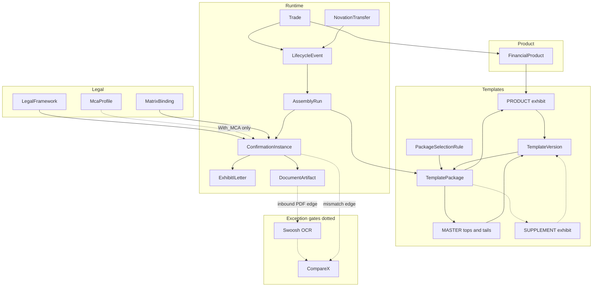

**Happy-path story under the diagram:**  
Trade event arrives → pick a **TemplatePackage** (MASTER letter + PRODUCT II-B, maybe SUPPLEMENT) → start an **AssemblyRun** → compose **ExhibitILetter** + economics → SmartDX renders → we store **DocumentArtifact** → callback TPs. MCA and III are optional. Swoosh / Compare X only show up when something is wrong or inbound.

### 3.2 Concept table (after the diagram)

| Thing | Simple meaning |
| --- | --- |
| Trade | One deal |
| FinancialProduct | Product type (Deliverable FX Option → II-B) |
| LegalFramework | 1998 or 2026 defs + version |
| McaProfile | Optional MCA defaults (Assumed) |
| TemplatePackage | Bundle: tops-and-tails + product (+ optional supplement) — borrowed pattern |
| DynamicTemplate / TemplateVersion | MASTER / PRODUCT / SUPPLEMENT fragment; DRAFT/LIVE/RETIRED |
| PackageSelectionRule | How we pick a package (product, event, entity…) |
| AssemblyRun | One assemble attempt for a trade event |
| MatrixBinding | Matrix type + version pin |
| ConfirmationInstance | Composed confirm for an event |
| ExhibitILetter | Letter wrapper (“tops and tails”) |
| FxOptionEconomics | II-B fields |
| Party | Names, LEI, office, roles |
| DocumentArtifact | Sent/received doc id |
| LifecycleEvent | NEW, AMEND, AFFIRM, NOVATION, … |
| NovationTransfer | Who leaves / who joins |
| ManualEntryValue / ManualDraftContent | Edge: human fills gaps (borrowed) |

We **borrow** AssemblyRun / TemplatePackage / selection rules / manual entry from the internal ER image. We **keep** MASTER / PRODUCT / SUPPLEMENT as the product ontology. “Tops and tails” = Exhibit I letter wrapper **where helpful** — not a forced rename everywhere.

---

## 4. Template layers — how they come together

Caption: *Letter wraps product. Supplements bolt on. Package ties the versions you activated.*

```text
TemplatePackage (LIVE)
├── tops and tails  → Exhibit I letter   (MASTER)
├── product         → Exhibit II-B       (PRODUCT)
└── optional        → Exhibit III-*      (SUPPLEMENT)

AssemblyRun uses that package + trade data
→ ConfirmationInstance → DocumentArtifact (via SmartDX)
```

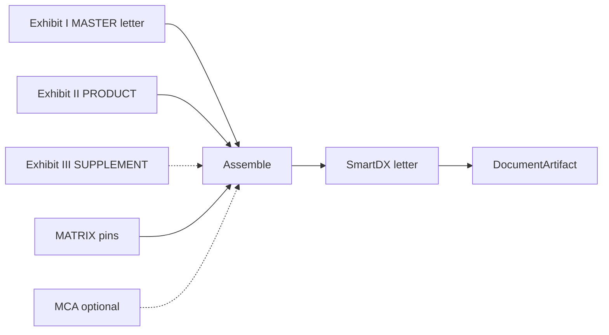

**Story:** Admin activates a package. A NEW_TRADE run selects that package by rules. Engine fills MASTER letter + II-B body. SmartDX prints the ISDA letter. Optional III and MCA only if elected.

**II-B add-ons allowed:** III-A, III-C, III-D, III-F, III-G, III-H.

---

## 5. Exhibit I letter (MASTER / tops and tails)

Exhibit I is the **confirmation letter**, not only a header.

| Block | You put |
| --- | --- |
| Heading | Letterhead, date, their name/address |
| Intro | “This letter confirms the Transaction…” |
| Defs | FX Definitions version |
| Agreement | Master date **or** long-form text |
| **Insert** | Exhibit II-B (+ III) body |
| Elections | LEI, calc agent, accounts, offices, notices |
| Closing | Supersession + signatures |

With MCA → short Master clause. Without MCA → long-form.  
Mocks: payload Excel + `specs/features/exhibit-i-letter.md`.

---

## 6. MCA paths

| Path | What you do |
| --- | --- |
| With_MCA | Attach Assumed `MCA-SCB-ACME-2026-001`; fill gaps from MCA. |
| Without_MCA | No profile; long-form Exhibit I; explicit elections. |

---

## 7. DDD bounded contexts

Ubiquitous language above is shared. Code and APIs group by context:

| Bounded context | Owns | Aggregate roots (sketch) |
| --- | --- | --- |
| **Template Admin** | Packages, versions, selection rules, activate/rollback | TemplatePackage |
| **Confirmation Assembly** | AssemblyRun, letter compose, SmartDX handoff | AssemblyRun |
| **Trade Lifecycle** | Events from TPs, amend/novation/exercise | Trade |
| **Affirmation / Matching** | Affirm webhooks, mismatch flags, Compare X gate | AffirmationCase |
| **Inbound Capture** | Swoosh classification + OCR (exception path) | InboundDocument |
| **Analytics / Timeline** | Per-trade timeline, aging, contagion, error queue | TimelineView |

API groups in `specs/api/openapi.md` follow these contexts.

---

## 8. Archetypes, jobs, impact, story map

### 8.1 Who + job (functional + emotional)

| Who | Functional JTBD | Emotional JTBD | Done when |
| --- | --- | --- | --- |
| Ops confirm analyst | Get a correct confirm out and affirmed | Feel calm under volume; not blamed for wrong template | Affirmed doc, few reworks |
| Template admin | Keep LIVE packages right | Trust the cutover; clear audit | Safe activate / rollback |
| Legal / product control | See defs, MCA, matrix choices | Confidence elections are traceable | Clear lineage |
| Desk support | Push amend/exercise without legalese | Not blocked waiting on ops jargon | Event in → status out |
| MIS lead | See SLA, affirm rate, errors | Early warning, not surprise backlog | Simple aggregates |
| Future agent (Phase 3) | Look up timeline with tools | — | Stubs only |

**OKR / metrics (unverified — placeholders for workshop):**

| Level | Metric | Baseline (unverified) | Target (unverified) |
| --- | --- | --- | --- |
| Outcome | NEW→Affirmed median time (FXO) | TBD hours | TBD hours |
| Outcome | Wrong-template send rate | TBD % | TBD % |
| Outcome | Affirm rate (FXO) | TBD % | TBD % |
| Hygiene | Open failed/error queue age p95 | TBD hours | TBD hours |

### 8.2 Impact map

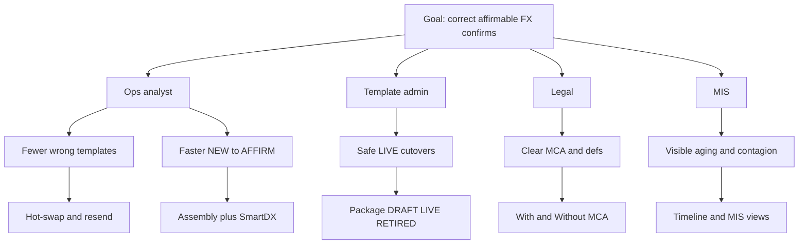

### 8.3 User story map

Core JTBD journey checked: **define → locate → prepare → confirm → send → match → change → recover → observe**. Missing pieces from earlier maps (locate package, prepare data, match) are explicit below.

| # | Backbone step | Trigger | Systems | Archetypes | Altitude | JTBD metrics | Emotional job |
| --- | --- | --- | --- | --- | --- | --- | --- |
| 1 | **Define** templates / package | New product or defs change | Template Admin | Admin, Legal | sea | Time to LIVE; audit complete | Confidence cutover is safe |
| 2 | **Locate** package for trade | NEW_TRADE received | Selection rules, Assembly | Ops, Engine | fish | Correct package first time % | No hunting folders |
| 3 | **Prepare** data / MCA path | Legal resolve | Legal, MCA, Matrix | Ops, Legal | fish | DQ pass rate | Less fear of missing LEI |
| 4 | **Confirm** draft letter | Assemble | Assembly, Exhibit I+II-B | Ops | sea | Compose p95 | Pride in clean letter |
| 5 | **Send** via SmartDX | Channel send | SmartDX, optional SWIFT | Ops | sea | Send success % | Relief it left the building |
| 6 | **Match** / affirm | Counterparty reply | Affirm / Matching, Compare X gate | Ops | sea | Affirm rate; unmatched age | Calm when matched |
| 7 | **Change** amend/novate/exercise | TPs lifecycle event | Trade Lifecycle, Assembly | Desk, Ops | sea | Cycle time per event | Not starting from scratch |
| 8 | **Recover** wrong template / OCR | Exception detected | Template Admin, Swoosh, Compare X | Ops, Admin | sea | Time to resend; OCR success | Control under fire |
| 9 | **Observe** timeline + aggregates | Always / start of day | Analytics / Timeline | MIS, Ops lead | kite | Aging p95; contagion alerts | Early warning, not blame |

Altitude key (Cockburn): **kite** = summary goal · **sea** = user goal · **fish** = subfunction · **clam** = too low (avoid in story map).

---

## 9. Use Case 2.0 — Deliverable FX Option

**Goal:** Book → assemble letter → SmartDX → affirm → later changes.  
**Precondition:** LIVE TemplatePackage exists (§10).

### 9.1 Success bar

| Level | Meaning |
| --- | --- |
| Minimum | Event accepted or clear error. No silent drop. |
| Success | Right package; letter via SmartDX; TPs ack; affirmable. |
| Nice | Auto-resend after hot-swap; rich timeline. |

### 9.2 Main success — usecase diagram

Caption: *Happy path only. Numbers match the step table.*

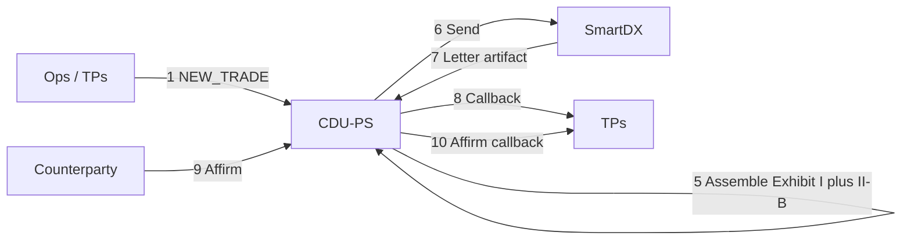

| # | Who | Does | System |
| --- | --- | --- | --- |
| 1 | TPs | Sends NEW_TRADE FXO | Trade Lifecycle API |
| 2 | CDU-PS | Checks id + DQ | Ingest |
| 3 | CDU-PS | Picks defs / MCA / matrix | Legal |
| 4 | CDU-PS | Locates LIVE TemplatePackage | Selection rules |
| 5 | CDU-PS | AssemblyRun: draft Exhibit I + II-B | Assembly |
| 6 | CDU-PS | Hands payload to SmartDX | SmartDX |
| 7 | SmartDX | Returns / hosts ISDA letter | SmartDX |
| 8 | CDU-PS | Acks TPs | Callback |
| 9 | Affirm channel | Affirms | Webhook |
| 10 | CDU-PS | Pushes affirm to TPs | Callback |
| 11–13 | TPs | Later AMEND / NOVATION / EXERCISE | Events → re-assemble |

### 9.3 Alternate flows (numbered to match extensions)

| # | If this | Then |
| --- | --- | --- |
| 3a | With MCA | Apply Assumed defaults |
| 3b | Without MCA | Long-form letter |
| 4a | Supplement elected | Append III |
| 5a | Deferred premium | Far premium date; warn |
| 5b | Manual entry required | PENDING_DATA_ENTRY on AssemblyRun |
| 9a | Unmatched / disputed | Store status; open Compare X gate |

### 9.4 Edge cases (exception gates)

| # | Edge | What we do |
| --- | --- | --- |
| E1 | Wrong template | Admin hot-swap; RESEND; supersede |
| E2 | Novation | New parties on Exhibit I; new confirm |
| E3 | Affirm fail | Retry; idempotent; non-affirm to TPs |
| E4 | DQ error | Reject with rule ids; no send |
| E5 | Disruption III-A | Extra clauses; may terminate |
| E6 | Inbound PDF / email confirm | **Swoosh** classify + OCR → CDU-PS; then Compare X |
| E7 | Data mismatch | **Compare X** reconciliation gate |
| E8 | SmartDX channel down | ChannelError; retry; timeline event |
| E9 | Idempotency clash | Same key, different body → conflict |
| E10 | Rollback package | New trades use prior LIVE |

---

## 10. Target architecture

### 10.1 Outbound happy path (locked)

```text
TPs → CDU-PS → SmartDX (ISDA letter) → CDU-PS → TPs
```

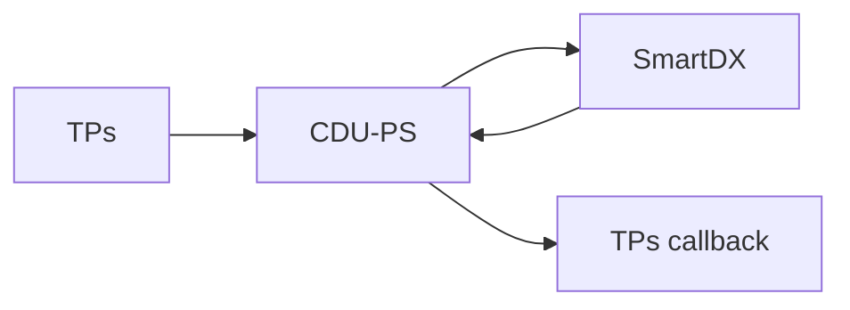

### 10.2 Exception gates (placeholders)

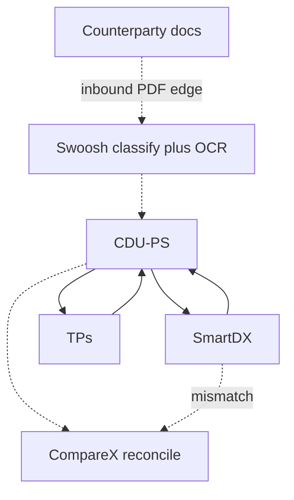

| System | Role |
| --- | --- |
| **Swoosh** | Downstream of CDU-PS: document classification + OCR PDF extraction (inbound / exception). |
| **Compare X** | Data reconciliation when outbound vs inbound (or affirm) disagree. |

Seed edge scenarios: inbound PDF for FXO affirm mismatch; OCR low confidence; Compare X field diffs on strike/premium. Full vendor contracts = Phase 2+.

### 10.3 Current vs target (sketch)

| | Current (as-is sketch) | Target (CDU-PS) |
| --- | --- | --- |
| Outbound | TPs / desk → mixed tools → letter | TPs → CDU-PS assemble → SmartDX → callback |
| Inbound | Mail / ad-hoc | Swoosh OCR gate into CDU-PS |
| Match | Manual / unclear system | Affirm webhook + Compare X gate |
| Audit | Scattered | Per-trade timeline |

Reference screenshots: `docs/reference/smartdx/` (confirmation flow, buy/sell operating model, SmartDX Docbox timeline).

### 10.4 Open question — counterparty matching

> **Open:** How does **external counterparty matching** work in the bank’s landscape — is matching another system (Markit/other), SmartDX Docbox, Compare X, or a mix?  
> Phase 1 treats Affirm webhook + Compare X as **placeholders**. Decision needed before Phase 2 wiring.

---

## 11. Timeline feature (SmartDX-inspired)

### 11.1 Per-trade timeline (FXO seed only)

For trade `TR-FXO-001`, show swimlane events: received → DQ → assembled → SmartDX sent → affirmed → amend/novation/exercise. Include actor, timestamp, document version, status chip.

Inspired by SmartDX Docbox “Timeline” (day/week filters, version markers, first view / approve). **Seed examples = Deliverable FX Option only.**

### 11.2 Aggregate views (simple — no overbuild)

| View | Ops value |
| --- | --- |
| **Failed / error queue** | Open DQ, channel, OCR, Compare X fails |
| **Aging / SLA** | Time in AffirmPending / Unmatched buckets |
| **Counterparty contagion** | Same counterparty with many unmatched/errors |

API shapes: Analytics / Timeline context in `specs/api/openapi.md`.

---

## 12. State diagrams

### 12.1 Template Admin (separate)

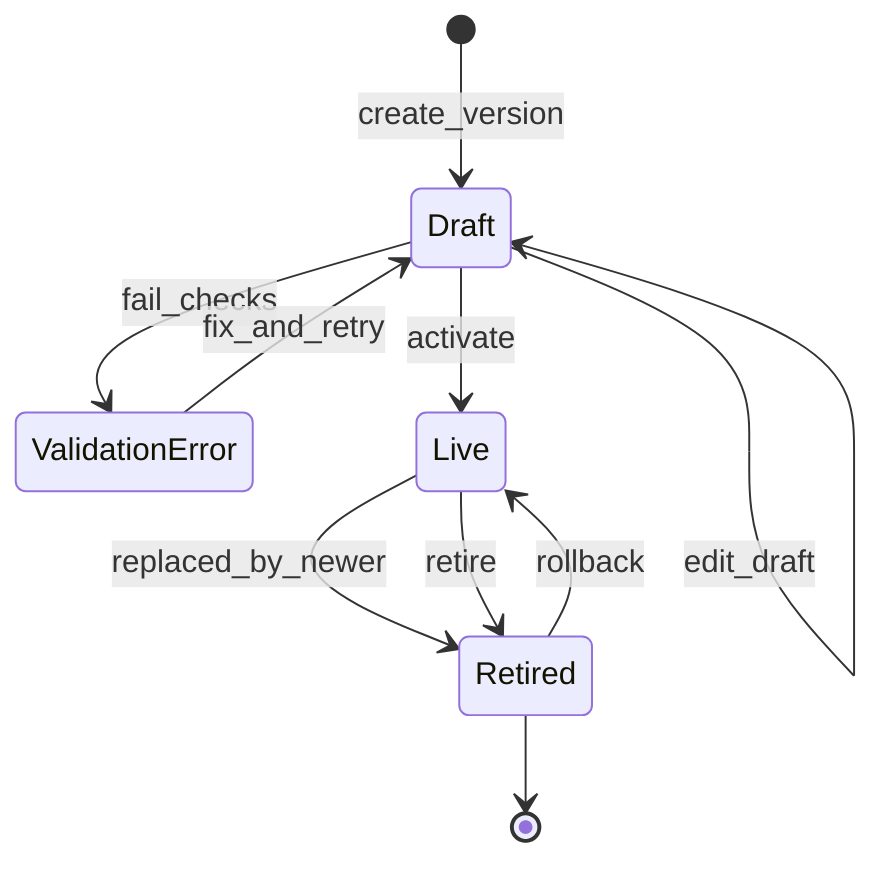

### 12.2 Generic trade

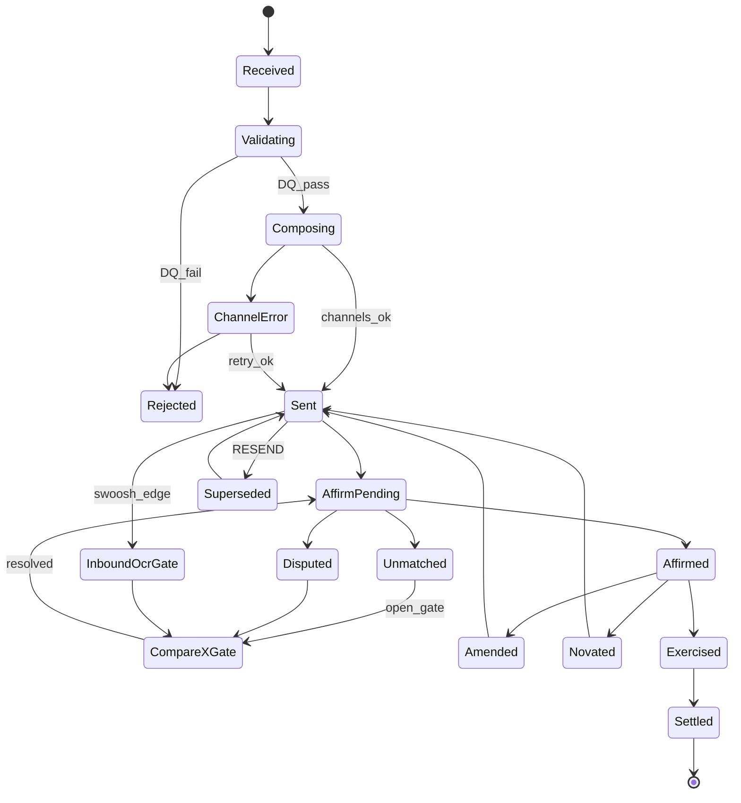

### 12.3 FXO deep dive

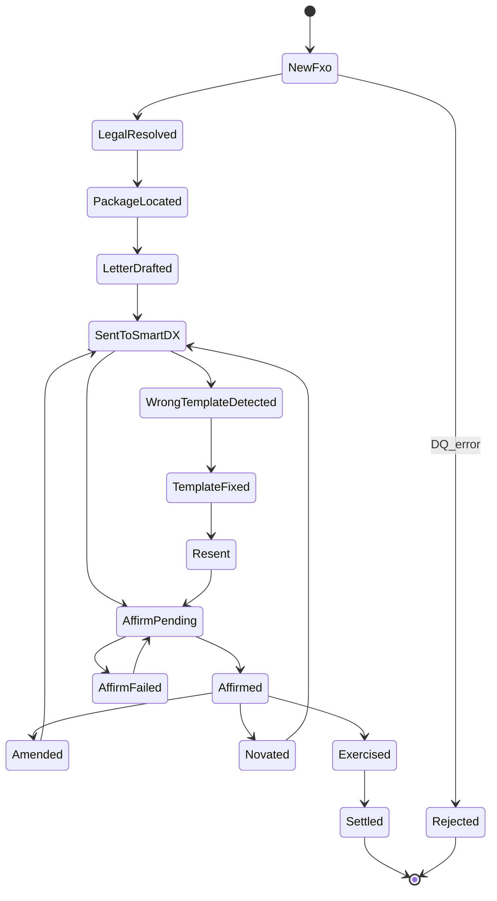

---

## 13. Sequences

### 13.1 Template Admin

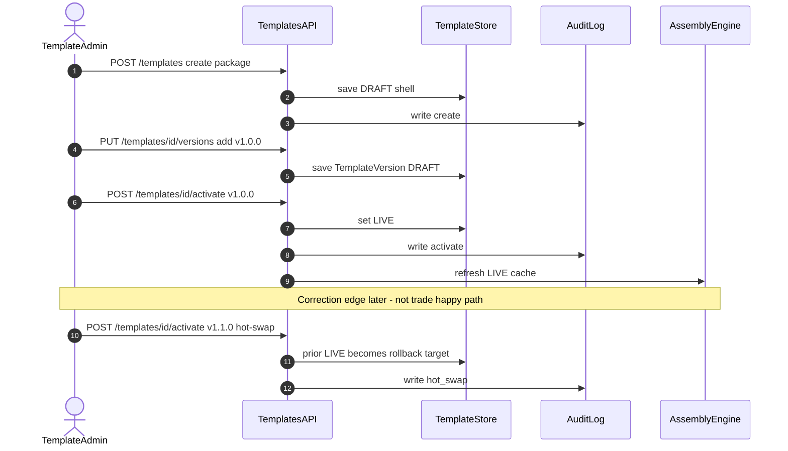

### 13.2 Trade lifecycle (FXO happy path)

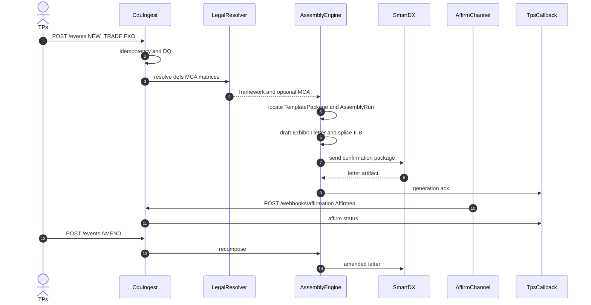

### 13.3 Exception — Swoosh + Compare X (placeholder)

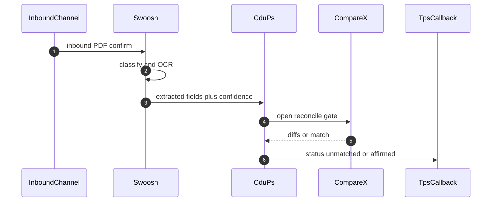

---

## 14. FXO worked example

Sample `TR-FXO-001`: EUR Call / USD Put, European, auto-exercise, 2027-12-01 → 2027-12-31, premium USD 15,000. Path: With_MCA.

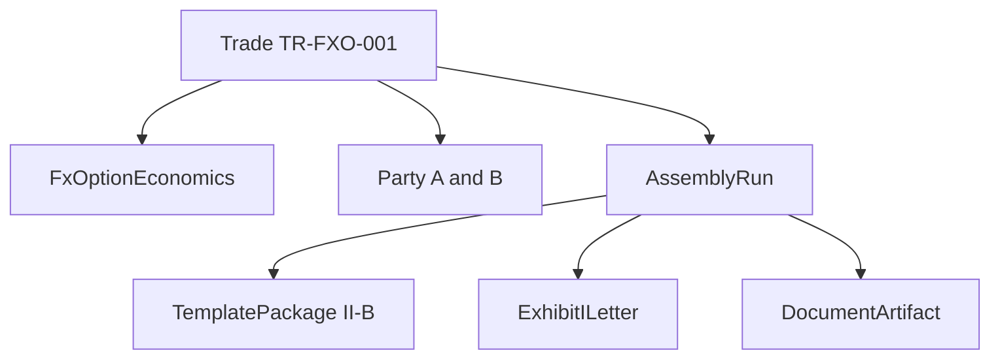

| Part | Entity | Template |
| --- | --- | --- |
| Strike, expiry, premium | FxOptionEconomics | II-B |
| Letter | ExhibitILetter | I (tops and tails) |
| Names / LEI | Party | I |
| MCA defaults | McaProfile | — |

Party A vs B attribute one-pager: [`docs/party-ab-fxo-one-pager.md`](party-ab-fxo-one-pager.md) + Excel `PartyAB_Attributes`.

---

## 15. Logical data model

### 15.1 Alignment

| Path / card | LDM entity |
| --- | --- |
| tradeId / productType | Trade / FinancialProduct |
| parties.* | Party |
| economics.* (II-B) | FxOptionEconomics |
| confirmation.* / letter | ExhibitILetter |
| template package | TemplatePackage |
| assembly | AssemblyRun |
| selection | PackageSelectionRule |
| mca / matrix | McaProfile / MatrixBinding |
| platform ids | PlatformContext |
| novation | NovationTransfer |

### 15.2 ER diagram (PK/FK, crow’s-foot style)

Caption: *Borrowed AssemblyRun / TemplatePackage patterns; MASTER=PRODUCT tops-and-tails mapping kept in notes.*

```mermaid
erDiagram
  TRADE ||--o{ PARTY : has
  TRADE ||--o| FX_OPTION_ECONOMICS : ii_b
  TRADE ||--o{ LIFECYCLE_EVENT : emits
  TRADE ||--o| PLATFORM_CONTEXT : has
  TRADE ||--o{ SUPPLEMENT_ELECTION : elects
  LIFECYCLE_EVENT ||--o| ASSEMBLY_RUN : starts
  ASSEMBLY_RUN }o--|| TEMPLATE_PACKAGE : uses
  ASSEMBLY_RUN ||--o| CONFIRMATION_INSTANCE : produces
  ASSEMBLY_RUN ||--o{ MANUAL_ENTRY_VALUE : captures
  ASSEMBLY_RUN ||--o{ MANUAL_DRAFT_CONTENT : captures
  TEMPLATE_PACKAGE ||--|| TEMPLATE_VERSION_MASTER : tops_and_tails
  TEMPLATE_PACKAGE ||--|| TEMPLATE_VERSION_PRODUCT : product
  TEMPLATE_PACKAGE ||--o| TEMPLATE_VERSION_SUPPLEMENT : optional
  PACKAGE_SELECTION_RULE }o--|| TEMPLATE_PACKAGE : selects
  CONFIRMATION_INSTANCE ||--|| EXHIBIT_I_LETTER : renders
  CONFIRMATION_INSTANCE ||--|| DOCUMENT_ARTIFACT : stores
  CONFIRMATION_INSTANCE }o--o| MCA_PROFILE : optional
  CONFIRMATION_INSTANCE }o--o{ MATRIX_BINDING : binds
  NOVATION_TRANSFER }o--|| TRADE : transfers

  TRADE {
    string tradeId PK
    string productType
    string mcaPath
    string status
  }
  PARTY {
    string partyId PK
    string tradeId FK
    string role
    string name
    string lei
  }
  FX_OPTION_ECONOMICS {
    string tradeId PK_FK
    date tradeDate
    decimal strikePrice
    date expirationDate
  }
  ASSEMBLY_RUN {
    string assemblyRunId PK
    string tradeEventId
    string templatePackageId FK
    string status
  }
  TEMPLATE_PACKAGE {
    string packageId PK
    string masterVersionId FK
    string productVersionId FK
    string supplementVersionId FK
    int version
    string status
  }
  PACKAGE_SELECTION_RULE {
    string ruleId PK
    string packageId FK
    string product
    string businessEvent
    int priority
  }
  EXHIBIT_I_LETTER {
    string letterId PK
    string confirmationId FK
  }
  DOCUMENT_ARTIFACT {
    string documentId PK
    string channel
  }
```

### 15.3 Class diagram (companion)

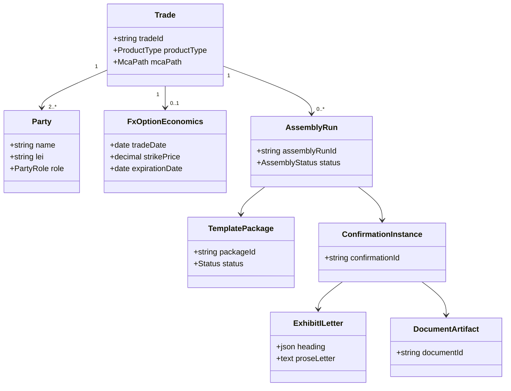

Excel: `Logical_Data_Model` sheet (working table).

---

## 16. Mapping workbooks

| File | Use |
| --- | --- |
| [`docs/mappings/cdu-ps-isda-2026-mapping.xlsx`](mappings/cdu-ps-isda-2026-mapping.xlsx) | Attributes, admin, LDM, DQ, FXO steps, legend, **PartyAB_Attributes** |
| [`docs/mappings/cdu-ps-fxo-deliverable-payload-mocks.xlsx`](mappings/cdu-ps-fxo-deliverable-payload-mocks.xlsx) | FXO payloads With/Without MCA + errors |
| [`docs/party-ab-fxo-one-pager.md`](party-ab-fxo-one-pager.md) | Party A vs B columnar attributes |

---

## 17. Non-functional (Phase 2 targets)

| Area | Target |
| --- | --- |
| Ingest ack | p95 under 2s |
| Compose | p95 under 5s mock SmartDX |
| Idempotency | One effect per key |
| Audit | Hot-swap / rollback / resend attributable |

Five-nines ideas remain aspirational only.

---

## 18. Acceptance (Phase 1 v1.3)

- [x] TPs / SmartDX naming; MCA in plain-words story  
- [x] Phase split moved to explainer  
- [x] Ontology story + dotted lines; table after diagram  
- [x] Template “how they come together” story; tops-and-tails where helpful  
- [x] Emotional JTBD; unverified OKRs  
- [x] Story map: systems, archetypes, altitude, metrics, emotion, trigger; core JTBD steps  
- [x] UC diagram; numbered alts/edges; target arch + Swoosh/Compare X; open matching question  
- [x] Timeline per-trade + simple aggregates (FXO seed)  
- [x] Party A/B one-pager; ER + class LDM; DDD contexts ↔ API  
- [x] Borrowed AssemblyRun / TemplatePackage in LDM Excel  
- [x] Store mirrors; commits on PR #1 after checkpoint `80d0833`

**Out of scope:** Phase 2 UI code; Phase 3 AI impl.

---

## 19. Open questions list

1. **Counterparty matching system** — external utility vs SmartDX Docbox vs Compare X vs mix? (§10.4)  
2. **OKR baselines/targets** — workshop to replace “unverified” placeholders (§8.1)  
3. **Swoosh / Compare X contracts** — auth, payload schemas, SLAs (Phase 2)  
4. **Inbound channel inventory** — email / portal / utility feeds into Swoosh  
5. **Manual drafting volume** — how often FXO needs MANUAL_DRAFT vs automated AssemblyRun  

---

## 20. References

- `docs/reference/isda/` (+ LICENSE-NOTICE)  
- `docs/reference/smartdx/` (timeline, confirmation flow, template mindmap, LDM ER, operating model)  
- `docs/phase-1-plan.md`  
- `docs/explainer-phase-split.md`  
- `docs/party-ab-fxo-one-pager.md`  
- `specs/features/`, `specs/scenarios/`, `specs/api/openapi.md`
