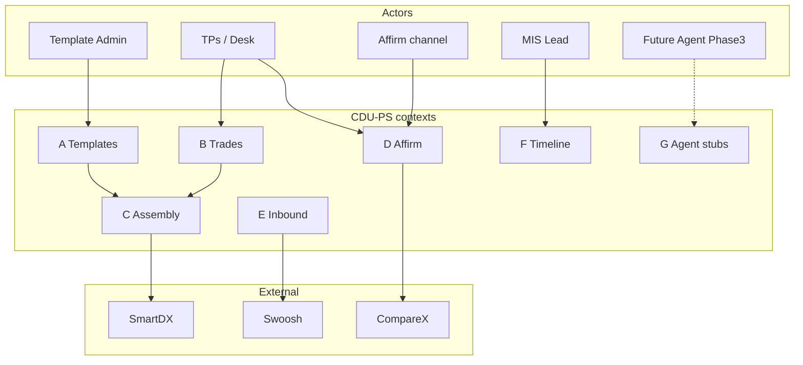

# CDU-PS API Contract (Phase 1 — spec only) v1.4

No running server in Phase 1. Phase 2 implements FastAPI against this contract.  
**Phase 3:** AI / chatbot / live MCP agents — stubs and thinking only; no implementation.

Base URL (prototype): `http://localhost:8080/v1`  
Auth (Phase 2): bearer service token; webhooks use HMAC `X-CDU-Signature`.

**Naming:** **TPs** = Transaction Processing systems. **SmartDX** = external vendor for ISDA confirmation letters.  
**DDD:** API groups map to bounded contexts in PRD §7.

---

## Conventions

| Item | Rule |
| --- | --- |
| Idempotency | Header `Idempotency-Key` on mutating POSTs/PUTs |
| Timestamps | ISO-8601 UTC |
| Errors | JSON problem body |
| JSON paths | Align with Excel `Attribute_Product_Map` / LDM entities |

### Error model

```json
{
  "error": {
    "code": "VALIDATION_FAILED",
    "message": "Human-readable summary",
    "details": [
      {"path": "trade.economics.strikePrice", "ruleId": "DQ-CROSS-001", "message": "…"}
    ],
    "requestId": "req_…"
  }
}
```

| HTTP | code examples |
| --- | --- |
| 400 | `VALIDATION_FAILED`, `BAD_ENUM` |
| 404 | `NOT_FOUND` |
| 409 | `CONFLICT`, `IDEMPOTENCY_REPLAY_MISMATCH` |
| 422 | `LEGAL_ELECTION_INVALID` |
| 500 | `INTERNAL` |
| 502/503 | `CHANNEL_UNAVAILABLE` (SmartDX / Swoosh / Compare X) |

---

## DDD-aligned API groups

| Group | Bounded context | Responsibility | Actors |
| --- | --- | --- | --- |
| **A. Templates & packages** | Template Admin | TemplatePackage, versions, selection rules, activate/rollback | Template Admin |
| **B. Trades / Events** | Trade Lifecycle | Ingest TPs events; trade read | TPs, Ops |
| **C. Assembly / Documents** | Confirmation Assembly | AssemblyRun, Exhibit I compose, SmartDX handoff, resend | Engine, Ops |
| **D. Affirmation / Matching** | Affirmation / Matching | Affirm webhook; Compare X gate; callbacks to TPs | Affirm channel, TPs |
| **E. Inbound capture** | Inbound Capture | Swoosh classify/OCR stubs (exception) | Ops, Swoosh |
| **F. Analytics / Timeline** | Analytics / Timeline | Per-trade timeline; aging; contagion; error queue | MIS, Ops lead |
| **G. Agent stubs** | (Phase 3) | Tool descriptors / skills | Future agents |

---

## APIs vs actors / systems



---

## Sequence — API usage (happy path)


---

## A. Templates & packages (Template Admin)

### `POST /templates`

Create TemplatePackage shell (MASTER tops-and-tails + PRODUCT + optional SUPPLEMENT).

```json
{
  "templateBundleId": "TB-FXO-DEL-2026-001",
  "masterTemplateId": "EXH-I-2026-v1",
  "productExhibitId": "II-B",
  "productType": "Deliverable_FX_Option",
  "supplementExhibitIds": [],
  "matrixBindings": {},
  "mcaRequired": true,
  "legalDefsYear": "2026",
  "hotReloadEnabled": true,
  "resendPolicy": "MANUAL"
}
```

### `PUT /templates/{id}/versions` · `POST /templates/{id}/activate` · `POST /templates/{id}/rollback`

Same semantics as v1.1 (DRAFT → LIVE; hot-swap; rollback).

### `POST /templates/selection-rules`

Upsert PackageSelectionRule rows (product, businessEvent, entity, priority).

---

## B. Trades / Events (Trade Lifecycle)

### `POST /events`

Ingest from **TPs**. Header: `Idempotency-Key`.

```json
{
  "eventType": "NEW_TRADE",
  "eventId": "evt_1001",
  "tradeId": "TR-FXO-001",
  "occurredAt": "2027-12-01T10:00:00Z",
  "mcaPath": "With_MCA",
  "mcaProfileId": "MCA-SCB-ACME-2026-001",
  "legal": {"defsYear": "2026", "mainBookVersion": "1.0", "matrixBindings": {"SRO": null}},
  "template": {"productExhibitId": "II-B", "supplementExhibitIds": []},
  "trade": {"product": {}, "parties": {}, "economics": {}}
}
```

### `GET /trades/{id}` · `GET /trades/{id}/timeline`

Trade snapshot; ordered TimelineEvent list (FXO seed).

---

## C. Assembly / Documents (Confirmation Assembly)

### `POST /assemblies`

Start AssemblyRun for trade/event (normally implied by `POST /events`).

```json
{
  "tradeId": "TR-FXO-001",
  "eventId": "evt_1001",
  "assemblyMode": "AUTOMATED",
  "channels": ["SmartDX"]
}
```

`assemblyMode`: `AUTOMATED` | `MANUAL_DRAFTING` | `MANUAL_ENTRY`.

Response includes `assemblyRunId`, `exhibitILetter` blocks, `documentId` (when automated complete).

### Manual drafting stubs (FXO)

| Method | Purpose |
| --- | --- |
| `GET /assemblies/{id}/shell` | Load LIVE template shell for edit (mode a) |
| `PUT /assemblies/{id}/manual-draft` | Save ManualDraftContent |
| `PUT /assemblies/{id}/manual-entries` | Save ManualEntryValue[] (drag-drop fields) |
| `POST /assemblies/{id}/submit` | Finish manual path → SmartDX |

All writes emit AuditEvent.

### Audit

| Method | Purpose |
| --- | --- |
| `GET /audit` | Filter by `entityType`, `entityId`, `tradeId`, time window |
| `GET /templates/{id}/audit` | Template package / version history |

### `GET /documents/{id}` · `POST /documents/{id}/resend`

Fetch artifact; superseding resend after hot-swap (audited).

---

## D. Affirmation / Matching

### `POST /webhooks/affirmation`

```json
{
  "documentId": "DOC-002",
  "tradeId": "TR-FXO-001",
  "status": "Affirmed",
  "timestamp": "2027-12-01T15:04:05Z",
  "differences": []
}
```

### `POST /matching/compare-x` (stub — exception gate)

Open or continue a Compare X reconciliation case.

```json
{
  "tradeId": "TR-FXO-001",
  "outboundDocumentId": "DOC-002",
  "inboundDocumentId": "INB-001",
  "reason": "AFFIRM_DISPUTED"
}
```

### Outbound callback to TPs

```json
{
  "tradeId": "TR-FXO-001",
  "eventType": "AFFIRM",
  "documentId": "DOC-002",
  "affirmationStatus": "Affirmed",
  "timestamp": "2027-12-01T15:04:05Z",
  "templateVersion": "1.1.0",
  "smartdxDocumentId": "SDX-…"
}
```

---

## E. Inbound capture (Swoosh stubs)

### `POST /inbound/swoosh/jobs` (stub)

Submit inbound PDF/reference for classify + OCR.

```json
{
  "source": "EMAIL",
  "tradeIdHint": "TR-FXO-001",
  "fileRef": "s3://…/inbound.pdf"
}
```

### `GET /inbound/swoosh/jobs/{id}`

Status + `extractedJson` + `ocrConfidence`. Low confidence → manual / Compare X gate.

---

## F. Analytics / Timeline

### `GET /trades/{id}/timeline`

Per-trade SmartDX-inspired timeline (FXO seed examples in PRD).

### `GET /analytics/summary`

Volumes, affirm rate, error rate by product (window query).

### `GET /analytics/queues/errors`

Failed / error queue (DQ, channel, OCR, Compare X).

### `GET /analytics/aging`

Buckets for AffirmPending / Unmatched age.

### `GET /analytics/contagion`

Counterparties with elevated unmatched/error counts (simple list).

### Analytics events (emit bus — Phase 2)

`analytics.confirmation.sent` · `analytics.confirmation.affirmed` · `analytics.confirmation.failed` · `analytics.template.activated` · `analytics.inbound.ocr_completed` · `analytics.matching.compare_opened`

---

## G. Agent-readiness stubs (Phase 3)

Any AI / chatbot UX is **Phase 3**. Stubs: `GET /agent/tools`, `GET /agent/skills`, `POST /agent/retrieve` over internal Attribute/PRD ids (not raw ISDA PDF dump).

---

## Event type enum

`NEW_TRADE` | `AMEND` | `TERMINATE` | `EXERCISE` | `NOVATION` | `AFFIRM` | `HOT_SWAP` | `ROLLBACK` | `RESEND`

## Phase 1 non-goals

- No OpenAPI YAML binary; markdown only  
- No running server; no live SmartDX / Swoosh / Compare X adapters  
- No AI chatbot implementation
