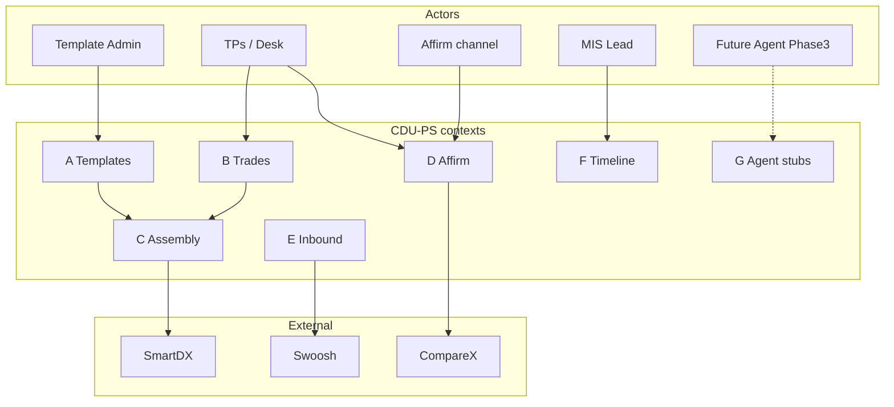
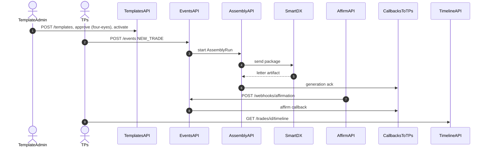

# CDU-PS API Contract v1.6 (Phase 2 — design pack)

No server. The Phase 2 prototype is a static HTML + Carbon site; an in-browser mock API answers these paths from `prototype/data/` using the route manifest `prototype/routes.json` (see [architecture](../../docs/design/architecture.md)). The later swap-in is a FastAPI replay of the same contract.  
**Phase 3:** AI / chatbot / live MCP agents — stubs and thinking only; no implementation.

Base URL (prototype): `/v1` on the static site origin (mock API). Later FastAPI swap-in: `http://localhost:8080/v1`.  
Auth (Phase 2): none in the static prototype; the contract keeps bearer service token and HMAC `X-CDU-Signature` on webhooks.

**Naming:** **TPs** = Transaction Processing systems. **SmartDX** = external vendor for ISDA confirmation letters.  
**DDD:** API groups map to bounded contexts in PRD §8.

**v1.5 changes (Phase 2):** every endpoint used by the simulation has a labelled `Request:` / `Response NNN:` example; full examples live in [`prototype/data/`](../../prototype/data/) and are checked by `scripts/check_prototype_sync.py` (file keys must appear in the example here, two levels deep). Added read endpoints (`GET /templates`, `GET /templates/{id}`, version/layer detail, selection rules, `GET /trades`, `GET /assemblies/{id}`), the SmartDX mock adapter, and the `POST /callbacks/tps` outbound contract. Affirm examples now use `DOC-001` (the NEW_TRADE document) to match the payload-mocks workbook.

**v1.6 changes:** FpML-style, product-agnostic trade model (see [modelling decisions](../../docs/design/modelling-decisions.md)): `trade.parties[]` + `trade.product` party references + `trade.economics` + `trade.documentation` (master agreement, master confirmation, contractual definitions, contractual matrix). Removed the top-level MCA flag, MCA profile id and `legal` block from `POST /events`; `mcaPath` stays as a derived read field. One product insert name: `productInsert`. Four-eyes approval before activate (`approval`, `approvalStatus`, `activationPolicy`; `POST /templates/{id}/versions/{version}/approval` planned, coming soon). `timelineAvailable` on trade rows.

---

## Conventions

| Item | Rule |
| --- | --- |
| Idempotency | Header `Idempotency-Key` on mutating POSTs/PUTs |
| Timestamps | ISO-8601 UTC |
| Errors | JSON problem body |
| JSON paths | Align with Excel `Attribute_Product_Map` / LDM entities |
| Examples | Values are illustrative; key sets are normative (sync-checked) |
| Trade model | FpML-style: `parties[]` (`id` is the `href` target), `product.buyerPartyReference` / `sellerPartyReference`, `economics` (product terms only), `documentation` |
| List selectors | Attribute paths address list items by key: `trade.parties[id=partyA].lei`, `trade.documentation.contractualMatrix[matrixType=SRO].version` |

### Error model

```json
{
  "error": {
    "code": "VALIDATION_FAILED",
    "message": "Human-readable summary",
    "details": [
      {"path": "trade.economics.strikePrice", "ruleId": "DQ-CROSS-001", "message": "…"}
    ],
    "requestId": "req_…"
  }
}
```

| HTTP | code examples |
| --- | --- |
| 400 | `VALIDATION_FAILED`, `BAD_ENUM` |
| 404 | `NOT_FOUND` |
| 409 | `CONFLICT`, `IDEMPOTENCY_REPLAY_MISMATCH`, `APPROVAL_REQUIRED`, `FOUR_EYES_VIOLATION` |
| 422 | `LEGAL_ELECTION_INVALID` |
| 500 | `INTERNAL` |
| 502/503 | `CHANNEL_UNAVAILABLE` (SmartDX / Swoosh / Compare X) |

---

## DDD-aligned API groups

| Group | Bounded context | Responsibility | Actors |
| --- | --- | --- | --- |
| **A. Templates & packages** | Template Admin | TemplatePackage, versions, selection rules, activate/rollback | Template Admin |
| **B. Trades / Events** | Trade Lifecycle | Ingest TPs events; trade read | TPs, Ops |
| **C. Assembly / Documents** | Confirmation Assembly | AssemblyRun, Exhibit I compose, SmartDX handoff, resend | Engine, Ops |
| **D. Affirmation / Matching** | Affirmation / Matching | Affirm webhook; Compare X gate; callbacks to TPs | Affirm channel, TPs |
| **E. Inbound capture** | Inbound Capture | Swoosh classify/OCR stubs (exception) | Ops, Swoosh |
| **F. Analytics / Timeline** | Analytics / Timeline | Per-trade timeline; aging; contagion; error queue | MIS, Ops lead |
| **G. Agent stubs** | (Phase 3) | Tool descriptors / skills | Future agents |

---

## APIs vs actors / systems



---

## Sequence — API usage (happy path)



---

## A. Templates & packages (Template Admin)

### `POST /templates`

Create TemplatePackage shell (MASTER tops-and-tails + PRODUCT + optional SUPPLEMENT). `mcaRequired: false` = one package serves With_MCA and Without_MCA trades (Legal Resolver branches per trade).

Request:

```json
{
  "templateBundleId": "TB-FXO-DEL-2026-001",
  "masterTemplateId": "EXH-I-2026-v1",
  "productExhibitId": "II-B",
  "productType": "Deliverable_FX_Option",
  "supplementExhibitIds": [],
  "matrixBindings": {},
  "mcaRequired": false,
  "legalDefsYear": "2026",
  "hotReloadEnabled": true,
  "resendPolicy": "MANUAL"
}
```

### `GET /templates`

List packages. Full example: `prototype/data/templates/index.json`.

Response 200:

```json
{
  "asOf": "2027-12-01T15:59:00Z",
  "count": 1,
  "items": [
    {"templateBundleId": "TB-FXO-DEL-2026-001", "packageName": "2026 FXO Deliverable (II-B)", "productType": "Deliverable_FX_Option",
     "productExhibitId": "II-B", "version": "1.1.0", "status": "LIVE", "versions": [{"version": "1.2.0", "status": "DRAFT"}]}
  ]
}
```

### `GET /templates/{id}`

Package view (overview, versions, bindings). Field names = Excel `Template_Admin_Utility` + LDM `TemplatePackage`. Full example: `prototype/data/templates/fxo-deliverable-2026/package.json`.

Response 200:

```json
{
  "packageId": "TB-FXO-DEL-2026-001",
  "templateBundleId": "TB-FXO-DEL-2026-001",
  "packageName": "2026 FXO Deliverable (II-B)",
  "masterTemplateId": "EXH-I-2026-v1",
  "productExhibitId": "II-B",
  "productType": "Deliverable_FX_Option",
  "supplementExhibitIds": [],
  "matrixBindings": {},
  "mcaRequired": false,
  "legalDefsYear": "2026",
  "hotReloadEnabled": true,
  "resendPolicy": "MANUAL",
  "version": "1.1.0",
  "status": "LIVE",
  "activatedAt": "2027-11-22T00:00:00Z",
  "rollbackTargetVersion": "1.0.0",
  "masterTemplateVersionId": "TV-I-2026-1.1.0",
  "productTemplateVersionId": "TV-IIB-2026-1.1.0",
  "supplementTemplateVersionId": null,
  "routingRules": {},
  "selectionRuleIds": ["PSR-FXO-DEL-2026-001"],
  "versions": [
    {"version": "1.2.0", "status": "DRAFT", "approvalStatus": "APPROVED", "activatedAt": null, "retiredAt": null,
     "masterTemplateVersionId": "TV-I-2026-1.2.0", "productTemplateVersionId": "TV-IIB-2026-1.1.0"}
  ],
  "audit": {"lastChangedBy": "u.admin.lee", "lastChangedAt": "2027-12-01T15:30:00Z"},
  "activationPolicy": {"fourEyes": true, "approverMustDifferFromActivator": true, "effectiveFrom": "2027-11-28T00:00:00Z", "approvalWorkflow": "COMING_SOON"},
  "notes": "…"
}
```

### `GET /templates/{id}/versions/{version}`

One package version with its layers, change log, validation and four-eyes `approval` (`null` for versions activated before `activationPolicy.effectiveFrom`). Full examples: `prototype/data/templates/fxo-deliverable-2026/versions/1.2.0.json`.

Response 200:

```json
{
  "templateBundleId": "TB-FXO-DEL-2026-001",
  "version": "1.2.0",
  "status": "DRAFT",
  "activatedAt": null,
  "retiredAt": null,
  "assemblyMode": "AUTOMATED",
  "layers": [
    {"templateVersionId": "TV-I-2026-1.2.0", "templateId": "EXH-I-2026-v1", "layer": "MASTER", "exhibitId": "I", "bodyFile": null}
  ],
  "changeLog": "Exhibit I notices: add SmartDX Docbox as Party A notice channel",
  "changes": [
    {"block": "elections", "attribute": "Contact details for notice Party A", "tpsJsonPath": "trade.parties[id=partyA].noticeContact", "before": "…", "after": "…"}
  ],
  "validation": {"status": "PASSED", "checkedAt": "2027-11-28T09:10:00Z", "checks": []},
  "approval": {"status": "APPROVED", "requestedBy": "u.admin.lee", "requestedAt": "2027-11-28T09:15:00Z", "approvedBy": "u.ctrl.ng",
               "approvedAt": "2027-12-01T15:30:00Z", "comment": "…", "auditId": "AUD-0007"},
  "audit": {"lastChangedBy": "u.ctrl.ng", "lastChangedAt": "2027-12-01T15:30:00Z"}
}
```

### `GET /templates/{id}/layers/{templateVersionId}`

Layer body: Exhibit I blocks (MASTER) or II-B fields (PRODUCT). The Exhibit I `productInsert` block carries `productInsert: {exhibitId, title, additionalProvisionExhibitIds}` — the ISDA splice point for the Exhibit II form and Exhibit III Additional Provisions. Every `attribute` + `tpsJsonPath` pair is an Excel `Attribute_Product_Map` row. Full examples: `prototype/data/templates/fxo-deliverable-2026/exhibit-i-master.json`, `…/exhibit-ii-b-product.json`.

Response 200:

```json
{
  "templateVersionId": "TV-IIB-2026-1.1.0",
  "templateId": "EXH-IIB-2026-v1",
  "layer": "PRODUCT",
  "exhibitId": "II-B",
  "version": "1.1.0",
  "status": "LIVE",
  "title": "Confirmation of a Deliverable FX Option Transaction",
  "exampleTradeId": "TR-FXO-001",
  "blocks": [{"block": "heading", "fields": [], "text": "…", "variants": {}, "productInsert": {"exhibitId": "II-B", "title": "…", "additionalProvisionExhibitIds": []}}],
  "fields": [{"attribute": "Strike Price", "tpsJsonPath": "trade.economics.strikePrice", "required": true, "example": "1.0850"}]
}
```

### `PUT /templates/{id}/versions`

Add a DRAFT version (DRAFT → LIVE via activate). Full example: `prototype/data/inbound/ui/TB-FXO-DEL-2026-001.put-version-1.2.0.json`.

Request:

```json
{
  "version": "1.2.0",
  "masterTemplateVersionId": "TV-I-2026-1.2.0",
  "productTemplateVersionId": "TV-IIB-2026-1.1.0",
  "supplementTemplateVersionId": null,
  "assemblyMode": "AUTOMATED",
  "changeLog": "…",
  "changes": [{"block": "elections", "attribute": "…", "tpsJsonPath": "…", "before": "…", "after": "…"}]
}
```

Response 201:

```json
{
  "templateBundleId": "TB-FXO-DEL-2026-001",
  "version": "1.2.0",
  "status": "DRAFT",
  "createdAt": "2027-11-28T09:00:00Z",
  "validation": {"status": "PENDING"},
  "auditId": "AUD-0005",
  "requestId": "req_tpl_put_120"
}
```

### `POST /templates/{id}/versions/{version}/approval` (planned — coming soon)

Four-eyes approval of a DRAFT version: `{"decision": "APPROVE" | "REJECT", "comment": "…"}` by a user other than the requester. Not simulated in Phase 2: the 1.2.0 approval (`AUD-0007`, `u.ctrl.ng`) is mocked as already given and the UI shows a "Coming soon" stub for the workflow.

### `POST /templates/{id}/activate`

DRAFT → LIVE; prior LIVE → RETIRED and becomes `rollbackTargetVersion`. Requires `approval.status = APPROVED` (else 409 `APPROVAL_REQUIRED`) and an activating user different from `approval.approvedBy` (else 409 `FOUR_EYES_VIOLATION`). Same body as the payload-mocks `HOT_SWAP` `INBOUND_ADMIN` row; ideal path uses `reason: PLANNED_RELEASE`, hot-swap edge uses `WRONG_PRODUCT_BINDING_FIXED`.

Request:

```json
{"action": "ACTIVATE", "templateBundleId": "TB-FXO-DEL-2026-001", "version": "1.2.0", "reason": "PLANNED_RELEASE"}
```

Response 200:

```json
{
  "templateBundleId": "TB-FXO-DEL-2026-001",
  "version": "1.2.0",
  "status": "LIVE",
  "activatedAt": "2027-12-01T16:00:00Z",
  "previousLiveVersion": "1.1.0",
  "rollbackTargetVersion": "1.1.0",
  "resendPolicy": "MANUAL",
  "approvedBy": "u.ctrl.ng",
  "approvedAt": "2027-12-01T15:30:00Z",
  "approvalAuditId": "AUD-0007",
  "auditId": "AUD-0008",
  "requestId": "req_tpl_activate_120"
}
```

### `POST /templates/{id}/rollback`

Same semantics as v1.1 (LIVE → prior version). EDGE in Phase 2 (E10).

### `GET /templates/selection-rules`

Response 200:

```json
{
  "items": [
    {"ruleId": "PSR-FXO-DEL-2026-001", "packageId": "TB-FXO-DEL-2026-001", "product": "Deliverable_FX_Option", "subProduct": null,
     "businessEvent": "NEW_TRADE", "entity": "SCB-SG", "confirmationMethod": "SmartDX", "priority": 10}
  ]
}
```

### `POST /templates/selection-rules`

Upsert PackageSelectionRule rows (product, businessEvent, entity, priority). Same item shape as above.

---

## B. Trades / Events (Trade Lifecycle)

### `POST /events`

Ingest from **TPs**. Header: `Idempotency-Key`. Full examples: `prototype/data/inbound/trades/TR-FXO-001.new-trade.json` (= Excel `With_MCA` NEW_TRADE INBOUND_TPS) and `TR-FXO-005.new-trade.json` (optional `assembly` hint).

Request:

```json
{
  "eventType": "NEW_TRADE",
  "eventId": "evt_1001",
  "tradeId": "TR-FXO-001",
  "occurredAt": "2027-12-01T10:00:00Z",
  "template": {"productExhibitId": "II-B", "supplementExhibitIds": [], "masterExhibitId": "I"},
  "trade": {
    "parties": [
      {"id": "partyA", "partyName": "Standard Chartered Bank Sample Desk", "lei": "5493001KJTIIGC8Y1R12", "office": "Singapore", "noticeContact": "…"},
      {"id": "partyB", "partyName": "ACME Corp Treasury", "lei": "549300ABCDEFGH123456", "address": "…", "office": "London", "noticeContact": "…"}
    ],
    "product": {"productType": "Deliverable_FX_Option", "transactionType": "Deliverable FX Option Transaction",
                "buyerPartyReference": {"href": "partyA"}, "sellerPartyReference": {"href": "partyB"}},
    "economics": {"tradeDate": "2027-12-01", "strikePrice": "1.0850"},
    "documentation": {
      "masterAgreement": {"masterAgreementType": "ISDA2002", "masterAgreementDate": "2026-01-15", "longFormFallback": false,
                          "governingLaw": null, "terminationCurrency": null},
      "masterConfirmation": {"masterConfirmationId": "MCA-SCB-ACME-2026-001", "masterConfirmationType": "…", "masterConfirmationDate": "2026-01-15"},
      "contractualDefinitions": [{"definitions": "2026 FX Definitions", "publisher": "ISDA/EMTA", "book": "Main Book", "version": "1.0"}],
      "contractualMatrix": []
    }
  },
  "assembly": {"requestedMode": "AUTOMATED", "reason": null}
}
```

`assembly` is optional (`requestedMode`: `AUTOMATED` | `MANUAL_DRAFTING` | `MANUAL_ENTRY`). Without_MCA trades send `documentation.masterConfirmation: null`, `masterAgreement.longFormFallback: true` and the long-form `governingLaw` / `terminationCurrency`; CDU-PS derives `mcaPath` from that (no separate inbound flag).

Response 202:

```json
{
  "eventId": "evt_1001",
  "tradeId": "TR-FXO-001",
  "status": "ACCEPTED",
  "tradeStatus": "Received",
  "assemblyRunId": "AR-FXO-001-01",
  "receivedAt": "2027-12-01T10:00:00Z",
  "requestId": "req_evt_1001",
  "links": {"trade": "/v1/trades/TR-FXO-001", "timeline": "/v1/trades/TR-FXO-001/timeline", "assembly": "/v1/assemblies/AR-FXO-001-01"}
}
```

### `GET /trades`

Ops desk queue. Query: `status`, `mcaPath`, `from`, `to`, `q`. Items = Excel `Prototype_Trade_Book` rows. `timelineAvailable` marks trades with a simulated `GET /trades/{id}/timeline`; the UI shows a stub for the rest. Full example: `prototype/data/outbound/api-responses/book/get-trades.200.json`.

Response 200:

```json
{
  "asOf": "2027-12-01T16:30:00Z",
  "counts": {"Received": 1, "Validating": 0, "Composing": 1, "ManualDraft": 1, "Sent": 0, "AffirmPending": 1, "Affirmed": 2},
  "count": 6,
  "items": [
    {"tradeId": "TR-FXO-001", "eventId": "evt_1001", "receivedAt": "2027-12-01T10:00:00Z", "partyBName": "ACME Corp Treasury",
     "partyBLei": "549300ABCDEFGH123456", "mcaPath": "With_MCA", "optionType": "EUR Call / USD Put", "callCurrency": "EUR",
     "callCurrencyAmount": "1000000", "strikePrice": "1.0850", "expirationDate": "2027-12-31", "status": "Affirmed",
     "assemblyRunId": "AR-FXO-001-01", "assemblyMode": "AUTOMATED", "templateVersion": "1.1.0", "documentId": "DOC-001",
     "affirmationStatus": "Affirmed", "sentAt": "2027-12-01T10:00:04Z", "affirmedAt": "2027-12-01T15:04:05Z", "timelineAvailable": true}
  ]
}
```

### `GET /trades/{id}`

Trade snapshot: read-model header fields plus the inbound `parties`, `product`, `economics`, `documentation` blocks. `mcaPath` is derived (`With_MCA` when `documentation.masterConfirmation` is set). Full example: `prototype/data/outbound/api-responses/TR-FXO-001/06-get-trade.200.json`.

Response 200:

```json
{
  "tradeId": "TR-FXO-001",
  "productType": "Deliverable_FX_Option",
  "mcaPath": "With_MCA",
  "status": "Affirmed",
  "timelineAvailable": true,
  "affirmationStatus": "Affirmed",
  "receivedAt": "2027-12-01T10:00:00Z",
  "lastEventAt": "2027-12-01T15:04:06Z",
  "eventIds": ["evt_1001"],
  "assemblyRunId": "AR-FXO-001-01",
  "currentDocumentId": "DOC-001",
  "smartdxDocumentId": "SDX-DOC-001",
  "template": {"templateBundleId": "TB-FXO-DEL-2026-001", "templateVersion": "1.1.0", "productExhibitId": "II-B"},
  "parties": [{"id": "partyA", "partyName": "…", "lei": "…", "address": "…", "office": "…", "noticeContact": "…", "settlementAccount": "…"}],
  "product": {"productType": "Deliverable_FX_Option", "transactionType": "…", "buyerPartyReference": {"href": "partyA"}, "sellerPartyReference": {"href": "partyB"}},
  "economics": {},
  "documentation": {"masterAgreement": {}, "masterConfirmation": {}, "contractualDefinitions": [], "contractualMatrix": []}
}
```

### `GET /trades/{id}/timeline`

See §F.

---

## C. Assembly / Documents (Confirmation Assembly)

### `POST /assemblies`

Start AssemblyRun for trade/event (normally implied by `POST /events`).

Request:

```json
{
  "tradeId": "TR-FXO-001",
  "eventId": "evt_1001",
  "assemblyMode": "AUTOMATED",
  "channels": ["SmartDX"]
}
```

`assemblyMode`: `AUTOMATED` | `MANUAL_DRAFTING` | `MANUAL_ENTRY`. Response = `GET /assemblies/{id}` shape.

### `GET /assemblies/{id}`

AssemblyRun snapshot as it moves through DQ → legal → package → compose. `status` enum = LDM `AssemblyRun.status`. `legal` is the Legal Resolver result only (framework, MCA path, master confirmation, long-form flag); the terms themselves stay in the trade's `documentation`. Full examples: `prototype/data/outbound/api-responses/TR-FXO-001/02-…` to `04-get-assembly.completed.200.json`.

Response 200:

```json
{
  "assemblyRunId": "AR-FXO-001-01",
  "tradeId": "TR-FXO-001",
  "tradeEventId": "evt_1001",
  "templatePackageId": "TB-FXO-DEL-2026-001",
  "templateVersion": "1.1.0",
  "assemblyMode": "AUTOMATED",
  "status": "COMPLETED",
  "createdAt": "2027-12-01T10:00:00Z",
  "completedAt": "2027-12-01T10:00:03Z",
  "confirmationId": "CONF-001",
  "documentId": "DOC-001",
  "dq": {"status": "PASSED", "ruleIds": ["DQ-REQ-001"], "errors": []},
  "legal": {"frameworkId": "LF-2026-1.0", "mcaPath": "With_MCA", "masterConfirmationId": "MCA-SCB-ACME-2026-001", "longFormFallback": false},
  "package": {"ruleId": "PSR-FXO-DEL-2026-001", "templateBundleId": "TB-FXO-DEL-2026-001", "version": "1.1.0",
              "masterTemplateVersionId": "TV-I-2026-1.1.0", "productTemplateVersionId": "TV-IIB-2026-1.1.0", "supplementTemplateVersionId": null},
  "exhibitILetter": {"path": "With_MCA", "longFormFallback": false, "masterConfirmationId": "MCA-SCB-ACME-2026-001", "blocks": {}, "proseLetter": "…"}
}
```

### Manual drafting (FXO)

| Method | Purpose |
| --- | --- |
| `GET /assemblies/{id}/shell` | Load LIVE template shell for edit (mode a) |
| `PUT /assemblies/{id}/manual-draft` | Save ManualDraftContent |
| `PUT /assemblies/{id}/manual-entries` | Save ManualEntryValue[] (drag-drop fields) — STUB in Phase 2 |
| `POST /assemblies/{id}/submit` | Finish manual path → SmartDX |

All writes emit AuditEvent.

### `GET /assemblies/{id}/shell`

Full example: `prototype/data/outbound/api-responses/TR-FXO-005/03-get-assembly-shell.200.json`.

Response 200:

```json
{
  "assemblyRunId": "AR-FXO-005-01",
  "tradeId": "TR-FXO-005",
  "templateBundleId": "TB-FXO-DEL-2026-001",
  "templateVersion": "1.1.0",
  "masterTemplateVersionId": "TV-I-2026-1.1.0",
  "productTemplateVersionId": "TV-IIB-2026-1.1.0",
  "assemblyMode": "MANUAL_DRAFTING",
  "status": "PENDING_MANUAL_DRAFT",
  "reason": "Counterparty requested bespoke Calculation Agent wording",
  "editableBlocks": ["elections"],
  "loadedBy": "u.ops.tan",
  "loadedAt": "2027-12-01T16:40:00Z",
  "exhibitILetter": {"path": "Without_MCA", "longFormFallback": true, "masterConfirmationId": null, "blocks": {}, "proseLetter": "…"},
  "productBody": {"exhibit": "II-B", "generalTerms": {}}
}
```

### `PUT /assemblies/{id}/manual-draft`

Request:

```json
{"templateVersionId": "TV-I-2026-1.1.0", "content": {"blocks": {}}, "draftedBy": "u.ops.tan"}
```

Response 200:

```json
{
  "id": "MDC-005-01",
  "assemblyRunId": "AR-FXO-005-01",
  "templateVersionId": "TV-I-2026-1.1.0",
  "content": {"blocks": {}},
  "contentHash": "sha256:…",
  "draftedBy": "u.ops.tan",
  "savedAt": "2027-12-01T16:52:00Z",
  "status": "PENDING_MANUAL_DRAFT",
  "auditId": "AUD-0506"
}
```

### `POST /assemblies/{id}/submit`

Request:

```json
{"submittedBy": "u.ops.tan", "channels": ["SmartDX"]}
```

Response 200:

```json
{
  "assemblyRunId": "AR-FXO-005-01",
  "status": "COMPLETED",
  "confirmationId": "CONF-105",
  "documentId": "DOC-105",
  "templateVersion": "1.1.0",
  "completedAt": "2027-12-01T16:55:00Z",
  "auditId": "AUD-0507",
  "requestId": "req_md_submit_005"
}
```

### SmartDX handoff (mock adapter)

The prototype hosts a SmartDX stand-in under the same base URL. Payloads = Excel payload-mocks `OUTBOUND_SMARTDX` rows.

### `POST /mock/smartdx/documents`

Full examples: `prototype/data/outbound/smartdx/DOC-001.send.json`, `DOC-105.send.json`.

Request:

```json
{
  "channel": "SmartDX",
  "documentId": "DOC-001",
  "tradeId": "TR-FXO-001",
  "templateBundleId": "TB-FXO-DEL-2026-001",
  "templateVersion": "1.1.0",
  "exhibits": {"master": "I", "product": "II-B", "supplements": []},
  "mcaPath": "With_MCA",
  "exhibitILetter": {"path": "With_MCA", "longFormFallback": false, "masterConfirmationId": "MCA-SCB-ACME-2026-001", "blocks": {}, "proseLetter": "…"},
  "productBody": {"exhibit": "II-B", "generalTerms": {}},
  "priorDocumentId": null,
  "manualDraftContentId": null
}
```

Response 201:

```json
{
  "smartdxDocumentId": "SDX-DOC-001",
  "documentId": "DOC-001",
  "tradeId": "TR-FXO-001",
  "status": "GENERATED",
  "generatedAt": "2027-12-01T10:00:04Z",
  "artifact": {"format": "PDF", "uri": "mock://smartdx/SDX-DOC-001.pdf", "pages": 3}
}
```

### `POST /mock/smartdx/documents/{id}/status`

Request:

```json
{"channel": "SmartDX", "action": "STATUS_UPDATE", "documentId": "DOC-001", "affirmationStatus": "Affirmed"}
```

### Audit

| Method | Purpose |
| --- | --- |
| `GET /audit` | Filter by `entityType`, `entityId`, `tradeId`, time window |
| `GET /templates/{id}/audit` | Template package / version history |

### `GET /audit`

AuditEvent fields = PRD §7 minimum = LDM `AuditEvent`. Full example: `prototype/data/timeline/audit-events.json`.

Response 200:

```json
{
  "asOf": "2027-12-01T16:55:02Z",
  "count": 28,
  "items": [
    {"auditId": "AUD-0007", "at": "2027-12-01T15:30:00Z", "actorId": "u.ctrl.ng", "action": "template.approved",
     "entityType": "TemplatePackage", "entityId": "TB-FXO-DEL-2026-001", "beforeVersion": null, "afterVersion": "1.2.0",
     "tradeId": null, "correlationId": "req_tpl_approve_120"},
    {"auditId": "AUD-0008", "at": "2027-12-01T16:00:00Z", "actorId": "u.admin.lee", "action": "template.activated",
     "entityType": "TemplatePackage", "entityId": "TB-FXO-DEL-2026-001", "beforeVersion": "1.1.0", "afterVersion": "1.2.0",
     "tradeId": null, "correlationId": "req_tpl_activate_120"}
  ]
}
```

### `GET /templates/{id}/audit`

Response 200:

```json
{
  "templateBundleId": "TB-FXO-DEL-2026-001",
  "items": [
    {"auditId": "AUD-0005", "at": "2027-11-28T09:00:00Z", "actorId": "u.admin.lee", "action": "template.version_added",
     "entityType": "TemplatePackage", "entityId": "TB-FXO-DEL-2026-001", "beforeVersion": null, "afterVersion": "1.2.0",
     "tradeId": null, "correlationId": "req_tpl_put_120"}
  ]
}
```

### `GET /documents/{id}`

Full example: `prototype/data/outbound/api-responses/TR-FXO-001/07-get-document.200.json`.

Response 200:

```json
{
  "documentId": "DOC-001",
  "tradeId": "TR-FXO-001",
  "channel": "SmartDX",
  "status": "GENERATED",
  "affirmationStatus": "Affirmed",
  "templateBundleId": "TB-FXO-DEL-2026-001",
  "templateVersion": "1.1.0",
  "smartdxDocumentId": "SDX-DOC-001",
  "priorDocumentId": null,
  "createdAt": "2027-12-01T10:00:04Z",
  "artifact": {"format": "PDF", "uri": "mock://smartdx/SDX-DOC-001.pdf", "pages": 3},
  "exhibitILetter": {"path": "With_MCA", "longFormFallback": false, "masterConfirmationId": "MCA-SCB-ACME-2026-001", "blocks": {}, "proseLetter": "…"}
}
```

### `POST /documents/{id}/resend`

Superseding resend after hot-swap (audited). EDGE in Phase 2 (E1).

---

## D. Affirmation / Matching

### `POST /webhooks/affirmation`

Full example: `prototype/data/inbound/webhooks/DOC-001.affirmed.json` (= Excel `With_MCA` AFFIRM INBOUND_WEBHOOK).

Request:

```json
{
  "documentId": "DOC-001",
  "tradeId": "TR-FXO-001",
  "status": "Affirmed",
  "timestamp": "2027-12-01T15:04:05Z",
  "differences": []
}
```

Response 200:

```json
{
  "documentId": "DOC-001",
  "tradeId": "TR-FXO-001",
  "affirmationStatus": "Affirmed",
  "tradeStatus": "Affirmed",
  "receivedAt": "2027-12-01T15:04:05Z",
  "duplicate": false,
  "requestId": "req_aff_doc001"
}
```

### `POST /matching/compare-x` (stub — exception gate)

Open or continue a Compare X reconciliation case (dispute after the AMEND document `DOC-002`).

```json
{
  "tradeId": "TR-FXO-001",
  "outboundDocumentId": "DOC-002",
  "inboundDocumentId": "INB-001",
  "reason": "AFFIRM_DISPUTED"
}
```

### `POST /callbacks/tps`

Outbound: CDU-PS → TPs (TPs-hosted endpoint). Payloads = Excel payload-mocks `CALLBACK_TPS` rows. Full examples: `prototype/data/outbound/tps-callbacks/`.

Request (generated):

```json
{
  "tradeId": "TR-FXO-001",
  "eventType": "NEW_TRADE",
  "documentId": "DOC-001",
  "timestamp": "2027-12-01T10:00:05Z",
  "templateVersion": "1.1.0",
  "smartdxDocumentId": "SDX-DOC-001",
  "swiftMsgRef": null,
  "status": "GENERATED"
}
```

Request (affirm):

```json
{
  "tradeId": "TR-FXO-001",
  "eventType": "AFFIRM",
  "documentId": "DOC-001",
  "affirmationStatus": "Affirmed",
  "timestamp": "2027-12-01T15:04:06Z",
  "templateVersion": "1.1.0",
  "smartdxDocumentId": "SDX-DOC-001",
  "swiftMsgRef": null
}
```

---

## E. Inbound capture (Swoosh stubs)

### `POST /inbound/swoosh/jobs` (stub)

Submit inbound PDF/reference for classify + OCR.

```json
{
  "source": "EMAIL",
  "tradeIdHint": "TR-FXO-001",
  "fileRef": "s3://…/inbound.pdf"
}
```

### `GET /inbound/swoosh/jobs/{id}`

Status + `extractedJson` + `ocrConfidence`. Low confidence → manual / Compare X gate.

---

## F. Analytics / Timeline

### `GET /trades/{id}/timeline`

Per-trade SmartDX-inspired timeline. Event fields = LDM `TimelineEvent`; every event links one AuditEvent. Full examples: `prototype/data/timeline/TR-FXO-001.json`, `TR-FXO-005.json`.

Response 200:

```json
{
  "tradeId": "TR-FXO-001",
  "asOf": "2027-12-01T15:04:06Z",
  "lanes": ["TPs", "CDU-PS", "SmartDX", "Counterparty"],
  "events": [
    {"timelineEventId": "TL-01-09", "tradeId": "TR-FXO-001", "eventId": "evt_1001", "at": "2027-12-01T15:04:05Z",
     "actor": "svc.affirm-webhook", "lane": "Counterparty", "action": "affirm.affirmed", "status": "Affirmed",
     "documentId": "DOC-001", "templateVersion": "1.1.0", "auditId": "AUD-0109", "detail": "Affirmed, 0 differences"}
  ]
}
```

### `GET /analytics/summary`

Volumes, affirm rate, error rate by product (window query). Derived from the trade book.

Response 200:

```json
{
  "asOf": "2027-12-01T16:30:00Z",
  "window": {"from": "2027-12-01T00:00:00Z", "to": "2027-12-01T16:30:00Z"},
  "productType": "Deliverable_FX_Option",
  "volumes": {"received": 6, "sent": 3, "affirmed": 2, "manualDraft": 1},
  "affirmRate": 0.6667,
  "errorRate": 0.0,
  "medianNewToAffirmedMinutes": 227.0
}
```

### `GET /analytics/queues/errors`

Failed / error queue (DQ, channel, OCR, Compare X). Empty on the ideal path.

Response 200:

```json
{"asOf": "2027-12-01T16:30:00Z", "count": 0, "items": []}
```

### `GET /analytics/aging`

Buckets for AffirmPending / Unmatched age.

Response 200:

```json
{
  "asOf": "2027-12-01T16:30:00Z",
  "series": [
    {"status": "AffirmPending", "measuredFrom": "sentAt", "buckets": [{"label": "1-4h", "count": 1}]}
  ]
}
```

### `GET /analytics/contagion`

Counterparties with elevated unmatched/error counts (simple list; `flagged` when unmatched + errors ≥ threshold).

Response 200:

```json
{
  "asOf": "2027-12-01T16:30:00Z",
  "threshold": 3,
  "items": [
    {"partyBName": "Globex Holdings Ltd", "partyBLei": "549300TRANSFeree0001", "trades": 2, "open": 2, "unmatched": 0, "errors": 0, "flagged": false}
  ]
}
```

### Analytics events (emit bus — Phase 2)

`analytics.confirmation.sent` · `analytics.confirmation.affirmed` · `analytics.confirmation.failed` · `analytics.template.activated` · `analytics.inbound.ocr_completed` · `analytics.matching.compare_opened`

---

## G. Agent-readiness stubs (Phase 3)

Any AI / chatbot UX is **Phase 3**. Stubs: `GET /agent/tools`, `GET /agent/skills`, `POST /agent/retrieve` over internal Attribute/PRD ids (not raw ISDA PDF dump).

---

## Event type enum

`NEW_TRADE` | `AMEND` | `TERMINATE` | `EXERCISE` | `NOVATION` | `AFFIRM` | `HOT_SWAP` | `ROLLBACK` | `RESEND`

## Non-goals (Phase 1–2 design pack)

- No OpenAPI YAML binary; markdown only  
- No live SmartDX / Swoosh / Compare X adapters (mock SmartDX only)  
- No AI chatbot implementation
