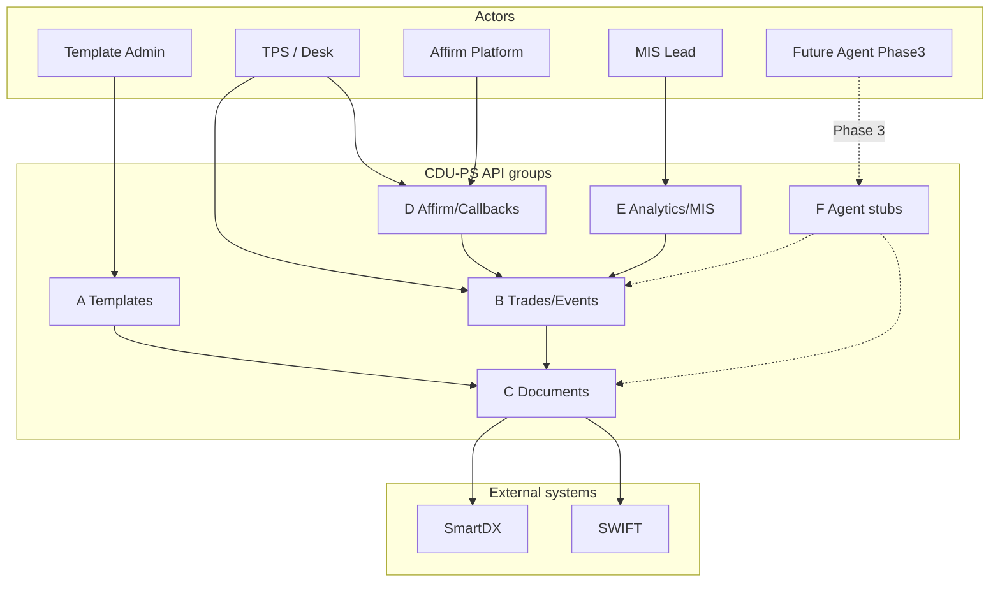
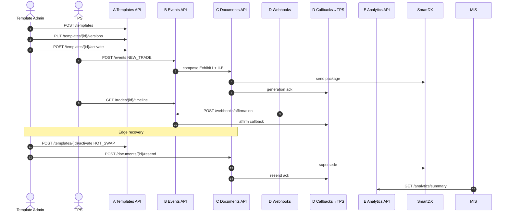
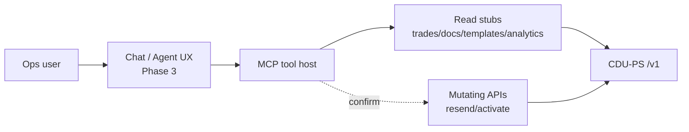

# CDU-PS API Contract (Phase 1 — spec only) v1.1

No running server in Phase 1. Phase 2 implements FastAPI against this contract.  
**Phase 3:** AI / chatbot / live MCP agents — **stubs and thinking only** below; no implementation.

Base URL (prototype): `http://localhost:8080/v1`  
Auth (Phase 2): bearer service token; webhooks use HMAC `X-CDU-Signature`.

---

## Conventions

| Item | Rule |
| --- | --- |
| Idempotency | Header `Idempotency-Key` on mutating POSTs/PUTs |
| Timestamps | ISO-8601 UTC |
| Errors | JSON problem body |
| TPS paths | Align with Excel `Attribute_Product_Map` |

### Error model

```json
{
  "error": {
    "code": "VALIDATION_FAILED",
    "message": "Human-readable summary",
    "details": [
      {"path": "trade.economics.strikePrice", "ruleId": "DQ-CROSS-001", "message": "…"}
    ],
    "requestId": "req_…"
  }
}
```

| HTTP | code examples |
| --- | --- |
| 400 | `VALIDATION_FAILED`, `BAD_ENUM` |
| 404 | `NOT_FOUND` |
| 409 | `CONFLICT`, `IDEMPOTENCY_REPLAY_MISMATCH` |
| 422 | `LEGAL_ELECTION_INVALID` |
| 500 | `INTERNAL` |
| 502/503 | `CHANNEL_UNAVAILABLE` (SmartDX/SWIFT) |

---

## Product-oriented API groups

| Group | Responsibility | Primary actors |
| --- | --- | --- |
| **A. Templates & lifecycle** | Create/version/activate/rollback MASTER·PRODUCT·SUPPLEMENT bundles | Template Admin |
| **B. Trades / Events** | Ingest lifecycle events; read trade + timeline | TPS, Ops |
| **C. Documents / Generation** | Compose Exhibit I letter + body; resend; fetch artifact | Engine, Ops |
| **D. Affirmation / Callbacks** | Inbound affirm webhook; outbound TPS callbacks | Affirm platform, TPS |
| **E. Analytics / MIS** | Volumes, affirm rates, error rates, template usage | MIS / Ops Lead |
| **F. Agent-readiness stubs** | Tool-shaped read APIs / skill manifests for future agents | Phase 3 agents |

---

## Use-case style diagram — APIs vs actors/systems



---

## Sequence — API usage across the system

Template setup APIs first; then trade APIs; affirm/callback; MIS reads. Matches PRD split journeys.



---

## A. Templates & lifecycle

### `POST /templates`

Create MASTER+PRODUCT(+SUPPLEMENT) bundle shell.

```json
{
  "templateBundleId": "TB-FXO-DEL-2026-001",
  "masterTemplateId": "EXH-I-2026-v1",
  "productExhibitId": "II-B",
  "productType": "Deliverable_FX_Option",
  "supplementExhibitIds": [],
  "matrixBindings": {},
  "mcaRequired": true,
  "legalDefsYear": "2026",
  "hotReloadEnabled": true,
  "resendPolicy": "MANUAL"
}
```

### `PUT /templates/{id}/versions`

```json
{
  "version": "1.1.0",
  "status": "DRAFT",
  "notes": "Fix II-B product binding",
  "exhibitILetterTemplateRef": "letter-exh-i-2026-v1.1.0"
}
```

### `POST /templates/{id}/activate`

Body: `{ "version": "1.1.0" }` → LIVE; may emit logical `HOT_SWAP`.

### `POST /templates/{id}/rollback`

Body: `{ "targetVersion": "1.0.0" }`

### `GET /templates/{id}` / `GET /templates/{id}/versions`

Read bundle + version history (audit fields included).

---

## B. Trades / Events

### `POST /events`

Ingest lifecycle event. Header: `Idempotency-Key`.

**NEW_TRADE example:** see payload mocks Excel / abbreviated:

```json
{
  "eventType": "NEW_TRADE",
  "eventId": "evt_1001",
  "tradeId": "TR-FXO-001",
  "occurredAt": "2027-12-01T10:00:00Z",
  "mcaPath": "With_MCA",
  "mcaProfileId": "MCA-SCB-ACME-2026-001",
  "legal": {
    "defsYear": "2026",
    "mainBookVersion": "1.0",
    "matrixBindings": {"SRO": null}
  },
  "template": {
    "productExhibitId": "II-B",
    "supplementExhibitIds": []
  },
  "trade": { "product": {}, "parties": {}, "economics": {} }
}
```

**NOVATION fragment:**

```json
{
  "eventType": "NOVATION",
  "tradeId": "TR-FXO-001",
  "novation": {
    "transferor": "Party B",
    "transferee": "Party C",
    "remainingParty": "Party A",
    "effectiveDate": "2028-01-15"
  }
}
```

**Responses:** `202` `{ "tradeId", "eventId", "confirmationId?", "documentId?", "status" }`

### `GET /trades/{id}`

Trade snapshot + latest document + affirmation status.

### `GET /trades/{id}/timeline`

Ordered lifecycle events.

---

## C. Documents / Generation

### `POST /documents/compose` (internal/engine; exposed for ops/debug)

Trigger compose of Exhibit I letter + product body for a trade/event (normally implied by `POST /events`).

```json
{
  "tradeId": "TR-FXO-001",
  "eventId": "evt_1001",
  "channels": ["SmartDX", "SWIFT"]
}
```

**Response includes** structured `exhibitILetter` blocks + `productBodyRef` + channel ids.

### `GET /documents/{id}`

Fetch DocumentArtifact metadata + letter snapshot.

### `POST /documents/{id}/resend`

```json
{
  "reason": "WRONG_TEMPLATE_CORRECTED",
  "templateVersion": "1.1.0"
}
```

Response: `{ "priorDocumentId", "documentId", "channels": ["SmartDX"] }`

---

## D. Affirmation / Callbacks

### `POST /webhooks/affirmation`

```json
{
  "documentId": "DOC-002",
  "tradeId": "TR-FXO-001",
  "status": "Affirmed",
  "timestamp": "2027-12-01T15:04:05Z",
  "differences": []
}
```

Statuses: `Matched` | `Unmatched` | `Affirmed` | `Disputed`

### Outbound `POST /callbacks/tps` (shape)

```json
{
  "tradeId": "TR-FXO-001",
  "eventType": "AFFIRM",
  "documentId": "DOC-002",
  "affirmationStatus": "Affirmed",
  "timestamp": "2027-12-01T15:04:05Z",
  "templateVersion": "1.1.0",
  "smartdxDocumentId": "SDX-…",
  "swiftMsgRef": null
}
```

---

## E. Analytics / MIS (high-level)

Read models for ops reporting. Phase 2 may back with SQL/warehouse; Phase 1 = contract only.

### `GET /analytics/summary`

Query: `from`, `to`, `productType?`

```json
{
  "window": {"from": "2027-12-01", "to": "2027-12-31"},
  "tradesBooked": 120,
  "confirmationsSent": 118,
  "affirmRate": 0.92,
  "errorRate": 0.05,
  "p95ComposeMs": 1800,
  "byProduct": [
    {"productType": "Deliverable_FX_Option", "sent": 40, "affirmed": 37, "errors": 2}
  ]
}
```

### `GET /analytics/templates/usage`

LIVE/RETIRED version counts; hot-swap/resend counts.

### `GET /analytics/errors`

Top DQ rule ids / channel failures.

### Analytics **events** (emit for MIS bus — Phase 2)

| Event name | When |
| --- | --- |
| `analytics.confirmation.sent` | After SmartDX/SWIFT accept |
| `analytics.confirmation.affirmed` | Affirm webhook Affirmed |
| `analytics.confirmation.failed` | DQ or channel failure |
| `analytics.template.activated` | Activate / rollback |
| `analytics.lifecycle.novation` | Novation composed |

---

## F. Agent-readiness stubs (Phase 3 — thinking only)

> **Any AI / chatbot / autonomous agent UX is Phase 3.** Phase 1 documents shapes so services can later expose MCP tools / skills without redesigning core APIs.

### Thinking

- Prefer **read-only tools** first: `get_trade`, `get_timeline`, `get_document`, `get_template`, `search_dq_failures`
- Mutations (`resend`, `activate`) require human confirmation / break-glass roles
- Skills wrap Use Case 2.0 journeys (“investigate unmatched affirm”, “explain Exhibit I elections”)
- Emit structured lineage (exhibit, Assumed flags) so agents cite correctly
- Never train on licensed ISDA PDF text outside license; agents should reference internal Attribute map ids

### Conceptual diagram



### Stub endpoints (non-normative placeholders)

| Stub | Purpose |
| --- | --- |
| `GET /agent/tools` | List tool descriptors (JSON Schema) |
| `GET /agent/skills` | List skill manifests referencing UC steps |
| `POST /agent/retrieve` | RAG-ish retrieve over **internal** Attribute/PRD ids (not raw ISDA PDF dump) |

Phase 2 may implement empty 501 stubs; Phase 3 fills behaviour.

---

## Event type enum

`NEW_TRADE` | `AMEND` | `TERMINATE` | `EXERCISE` | `NOVATION` | `AFFIRM` | `HOT_SWAP` | `ROLLBACK` | `RESEND`

---

## Phase 1 non-goals

- No OpenAPI YAML binary; markdown contract only  
- No running server, auth, live SmartDX/SWIFT  
- No AI chatbot implementation (Phase 3)
